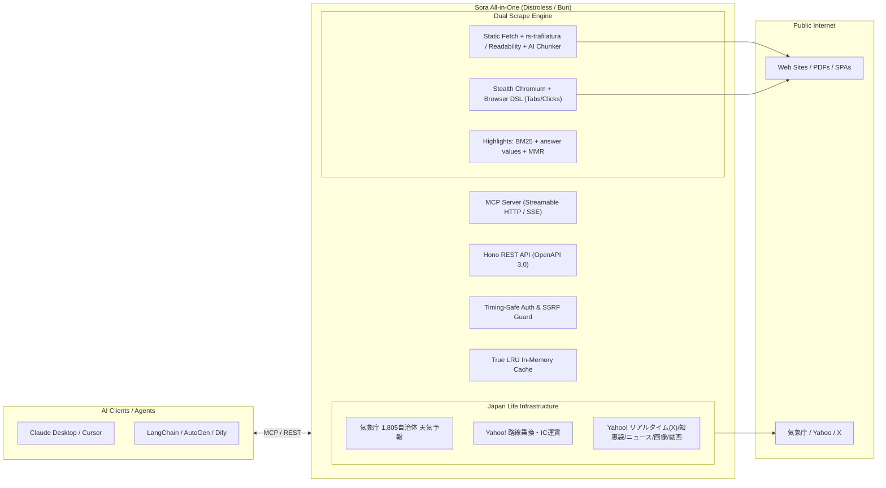

# Sora (空)

> **日本のWebをAIエージェントから利用するための Self-hosted MCP / REST 統合サーバー**  
> *All-in-One, Zero-Middleware Web Scraping & Japanese Life Infrastructure Engine for AI Agents*

`Sora` は、LLM や AI エージェント（Claude Desktop, Cursor, Cline, OpenCodeInterpreter, Dify など）が **日本の Web 空間と日常インフラを自由かつ安全に探索・操作するための All-in-One MCP / REST サーバー** です。

外部 DB（Redis / PostgreSQL）やメッセージキューを一切必要とせず、**ヘッドレス Chromium と日本語 CJK フォントを内包した単一コンテナ** だけで動作します。Chromium はブラウザ描画が必要になった時だけ起動し、無操作が続くと自動で閉じるため、静的取得が中心の用途では常駐メモリは 200MB 前後（実測）です。1GB 級の小さな VPS では、ブラウザ描画の同時実行数が利用可能メモリから自動で絞られます（[4.4 低メモリ環境での運用](#44-低メモリ環境での運用)）。



---

## ⚡ 5秒で繋がる Quickstart

Sora は **MCP (Model Context Protocol)** サーバーとして動作し、Docker / Podman コンテナで起動して AI エージェントから接続します。

### ① Docker / Podman での起動
```bash
docker run -d -p 3016:8000 --name sora ghcr.io/ikenokazuki/sora:latest
```

### ② MCP 接続 (Claude Desktop / Cursor / Cline / Antigravity)
AI エージェントの設定ファイル（`claude_desktop_config.json` 等）に以下を追加するだけで接続できます。
Sora は Anthropic の Tool Search / progressive disclosure 設計原則を参考にしつつ、client-neutral MCP として独自の **CORE (12ツール) + DEFERRED (20ツール) + `search_tools`** 方式を実装しており、初期状態では 12 のコアツール（`scrape`, `search_web`, `search_deep`, `get_weather`, `search_route` 等）と `search_tools` のみを露出し、残りの 20 ツールは `search_tools` により動的にオンデマンド有効化されるため、ツール定義によるコンテキスト消費を最小限に抑えられます（全 33 ツール）。

```json
{
  "mcpServers": {
    "sora": {
      "url": "http://localhost:3016/mcp"
    }
  }
}
```

### ③ ChatGPT (Custom GPTs / Actions & Desktop MCP) での利用
- **Custom GPTs (Actions / OpenAI)**:
  1. ChatGPT の GPT Builder で「Configure」→「Actions」→「Create new action」を選択。
  2. 「Import from URL」に `http://<your-host>:3016/openapi.json` を指定すると、全 82 オペレーション（73 パス、別名を含む）が自動登録され、ChatGPT から日本の Web 検索・スクレイピング・天気・知恵袋・X速報・荷物追跡・住所正規化等を呼び出せます。
- **ChatGPT Desktop (MCP)**:
  `http://localhost:3016/mcp` を MCP サーバーとして指定。

### ④ LLM ネイティブ機能との共存・2層構造ツール決定フレームワーク (Zero-Refusal & Two-Tier Architecture v2.13.0+)

ChatGPT や Claude、ローカル LLM（Llama / Qwen / Ollama 等）と MCP を接続した際、**「専用ツールが見当たらないと『ツールがないため答えられません』と勝手に回答を拒絶してしまう」「スニペットだけで中途半端に推測してハルシネーションを起こす」** という課題が発生しがちです。

Sora では、**回答拒絶の完全防止（Zero-Refusal Policy）と、Google / Firecrawl のベストプラクティスを取り入れた 2 層構造ツール決定フレームワーク (v2.13.0+)** を標準実装しています：

1. **回答拒絶の全面禁止（Zero-Refusal Policy）**:
   - MCP 初期化ハンドシェイク（`initialize`）時に注入される `instructions` において、「スケジュール専用ツール、営業時間専用ツール、発売日専用ツール等がない」という理由で回答を拒絶することを厳禁としています。
2. **2層構造ツール決定フレームワーク (Two-Tier Architecture)**:
   - **Tier 1（公式専門データ直結ツール・強制呼び出し）**:
     貿易（HTS/CPSC/FDA）、日本法令・国会審議録、気象庁防災・地震・道路交通、路線乗換・フライト・標高、Xリアルタイム速報、iTunes音楽メタデータの 6 大ドメインは、モデル自前の推測を厳禁とし、必ず Sora の専用ツールを実行。
   - **Tier 2（万能深層Web検索ツール・全実世界データ調査）**:
     上記以外のあらゆる事実調査（ライブ・イベント・試合日程、新製品・発売日、営業時間・店舗情報、人物・企業の最新動向、時事ニュース、技術ドキュメント等）は、**`search_deep`（推奨一次ツール）** を呼び出し、ノイズ除去された Clean Markdown 本文まで深く読み込んで包括的・根拠ある回答を構築。
3. **Web 探索・本文取得の使い分けルール**:
   - `search_web`（formats 省略時: 高速な URL・スニペット探索）を使用し、スニペットだけで開場時間や規約などの詳細が不確定な場合は、推測で終わらせず公式 URL を `scrape` ツールで精読して本文を確認することを推奨。ただし、`search_web` に `formats: ["markdown"]` を指定して同一呼出で既に本文を取得済みである場合は、二重の `scrape` 呼び出しは不要です。深層Web+X調査には `search_deep` を使用。
4. **軽量な返却キー注記による入力・出力の分離**:
   - トークン爆発やローカル LLM の KV キャッシュ枯渇・互換性問題を引き起こす巨大な JSON 出力スキーマは避け、ツールの説明末尾に返却キー（`返却: { ... }`）を注記することで、LLM がレスポンスの構造を理解しやすくしています。

> [!TIP]
> **ChatGPT や Cursor、Cline 等の Custom Instructions（システムプロンプト）設定例**:
> もしクライアント側でさらに確実にツール呼び出しを徹底させたい場合は、以下をシステム指示に追加することを推奨します：
> ```text
> 【Sora ツール利用規約】
> 1. 専用ツールがないことを理由に回答を拒否してはならない（ライブ日程・営業時間・発売日・最新動向等は必ず search_deep または search_web でWebから能動調査すること）。
> 2. 以下の専門・公的データに関しては、自身の知識で推測せず必ず Sora MCP ツールを実行すること：
>    - 米国貿易・通関・HTSコード・FDA・CPSC規制判定・GCC証明書生成: check_product_compliance, lookup_hts, check_regulations, generate_gcc_certificate
>    - 日本の法令・国会審議録: search_laws, search_diet_minutes
>    - 気象・防災・地震・道路交通・標高・施設・航空運航・住所・郵便番号: get_weather, get_disaster_info, search_road_traffic, get_place_info, search_poi, get_flight_status, lookup_address
>    - 国内交通乗換・運賃: search_route
>    - 日本のSNS速報・知恵袋・トレンド・音楽: search_realtime、公開SNS投稿: search_social_posts, fetch_social_post（REST: POST /social/search・POST /social/fetch）, search_chiebukuro, search_keywords, search_music
> 3. search_web でスニペットのみ取得して詳細が不足する場合は公式URLを scrape で精読すること（ただし search_web + formats: ["markdown"] で既に本文取得済みの場合は再度の scrape は不要）。深層Web+X調査には search_deep を使用すること。
> ```

---
## Soraの由来
Soraはアイドルグループ「[君と見るそら](https://x.com/kimisora_jpn)」から引用しました。
「そら」は夜空に晴天に雨上がりに夕焼けにカラッとした夏空などいろんな「表情」があります。
リアルタイム情報や知の蓄積であるWEBもある意味で「表情」。
それをAIに「伝えて」リアルタイムで反映するという想いを込めてます。
cloud（雲）も空にあり空は世界中繋がってます。
ネット上の情報を一つのツールで「繋げる」という意味もあります。

---

## 🌟 主な特徴と強み (Why Sora?)

1. **🗾 日本の日常インフラ & Web 探索を単一 MCP で提供**:
   - 海外製ツール（Firecrawl / Tavily）では対応できない「Yahoo! 知恵袋」「X (Twitter) リアルタイム速報」「気象庁公式オープンデータ直結（全国 1,805 市区町村自動選定）」「電車乗換案内」を単一 MCP で提供。
2. **⚡ ミリ秒級の応答 & 低メモリ（2026-10-08 実測）**:
   - Bun ランタイムで、`/health` は 1ms 前後、起動から応答可能になるまで約 0.6 秒、起動直後の常駐メモリは約 160MB（静的取得後 約 200MB）。
   - ブラウザ描画（SPA 昇格・`browser_action` 等）が必要になった時だけ Chromium が起動し（描画中は合計 約 950MB）、無操作 5 分（`SORA_BROWSER_IDLE_TTL_MS`）で閉じて約 200MB に戻ります。
3. **📦 完全オールインワン & ゼロミドルウェア**:
   - Redis、PostgreSQL、外部ワーカーキュー等は一切不要。単一コンテナだけで即座に完結。
4. **🛡️ Distroless（シェルなし）& 厳格なセキュリティ**:
   - ベースイメージに `gcr.io/distroless/cc-debian12` を採用。コンテナ内に `/bin/sh`, `bash`, `curl` 等が存在せず、RCE（任意コード実行）攻撃を無力化。
   - SSRF / DNS Rebinding 遮断、定数時間比較による Timing Attack 防止、ブラウザセッション所有権分離、DoS 防御（Body Limit 10MB）を標準装備。
5. **🕹️ ステートフルなブラウザ操作 DSL**:
   - `open` → `fill` → `click` → `screenshot` → `evaluate`（`evaluate` は `SORA_BROWSER_ALLOW_EVALUATE=true` のときだけ）の複数ターン対話型ブラウザセッションを API / MCP から直接制御。
6. **⚡ 次世代スクレイピング＆構造化抽出エンジン (v2.13.0+)**:
   - **BrowserContext セッション分離 & アセット高速遮断**: 常駐 Chromium におけるセッションごとの完全隔離と、不要メディア・Webフォント・3Dモデル・広告トラッカーのネットワーク層即時遮断（転送量を大幅に削減。ページにより異なる）。CSS/JS は保持しレイアウト計算と不可視要素除外を担保。
   - **本文ベースの静止検知（SPA待機）**: 固定スリープを廃止し、見えている本文（長さ・先頭/中央/末尾・画像数）が 200ms 変化しなくなった時点で完了。多言語化ウィジェット等が属性だけを書き換え続けるページで、上限まで待たない。`networkidle` が来ないページも、`load` 後 5 秒で打ち切って現在の DOM から本文を取得。
   - **イベント・パンくず・表構造化抽出**: Schema.org `Event`/`MusicEvent` の自動構造化、パンくず階層ナビゲーションパス抽出、複雑な表の結合セル（`colspan`/`rowspan`）2Dマトリクス正規化、および重要告知画像（チラシ・タイテ・図表）スコアリングを標準搭載。
   - **Clean Content Sanitizer**: プロンプトインジェクション用制御トークンや不可視ゼロ幅文字を自動無害化。
7. **🎯 ハイライトの選び方**:
   - 本文を見出しごとの節に分け、節ごとに見出し階層ボーナス付き BM25 で点数を付けます（`src/extractor/hierarchical_bm25.ts`）。日本語は語と 2 語のつながりで数えます。
   - 要件の語の回答値（対象つき）・表の行・定義の組がある節を上げ、最新を問う問いでは古い値を、日付を問う問いでは年の合わない日付を下げます（倍率は `src/retrieval/evidence_weights.ts` の一表）。
   - 上位の節を MMR で重複を避けて選びます。`highlightMaxCount` を指定するとその件数まで、省略時は上位 3 件に、合計約 1,600 字に収まる節を足し（8 件まで）、拾えていない検索語を含む節も 1 つ足し、最後に点が首位の 0.25〜0.35 倍の節を残りの字数で足します。長い節は点数の密度が最も高い連続区間（Dinkelbach 法）に切り出し、節の書き出し（350 字まで）を前に付けます。省略時は、1,600 字を超える節の段落（300 字までの塊。文で切れずに 600 字を超える塊は除く）も候補にし、選んだ塊は同じ節のハイライトにまとめます。
   - 先頭のメタデータ（frontmatter）・「📍 階層」「📅」の目印の行・リンクだけのナビの塊は候補にしません。本文に検索語が無ければ、検索結果のスニペットや説明文を根拠にします。
   - 評価: 日本語の公開評価集 JQaRA で、選んだ段落の正解の割合 0.53（v2.53.0 までの rho-select v2 は 0.33）。記録は `docs/evaluations/term-matching/results.md`。
8. **📊 検索順位の保持と取得後の証拠評価**:
   - Web検索の単一結果集合はプロバイダーの順位を保持します。複数クエリ統合は加重 RRF、Deep Search の本文・ハイライト選択は BM25 と回答値・対象との関連・日付整合性を用いて評価します。新しいページを一律に優先する設計ではありません。
9. **🛡️ Evidence-Preserving Accessibility Hints（根拠データプレーン v2.15.0+)**:
   - **Block Provenance (出所トラッキング)**: 各見出し・段落・表ブロックへ `[S1:P4 | 2026-09-01]` 形式のアンカー識別子と連番を自動付与。LLM が回答時に引用元ブロックを決定論的に特定可能。
   - **Evidence Diagnostics (客観的証拠診断量)**: Sora 自身が主観で「情報不足」と断定せず、REST の `/scrape`・`/scrape/batch`・`/search` と MCP の `search_deep` で `verbose: true` のとき（MCP の `scrape` の `verbose` では、`url`・`urls` とも付きません）`highlightDiagnostics` に、クエリ基本単語網羅率（`queryCoverage`）や候補数、客観的な証拠シグナル（`weakEvidenceSignal`）を返し、上位エージェントが追加調査要否を自律判断。
10. **🌐 最新 IR (情報検索) & RAG 理論 (v2.16.0+)**:
   - **MMR (Maximal Marginal Relevance) 多様性選択**: Jaccard 類似度を用いた反復多様性選択により、同一内容の言い換え重複を抑え、異なる観点の重要文を幅広く採択（多様性の重みは 0.7 固定）。
11. **⏳ Temporal Context Anchor (時間的文脈アンカー / 相対日時の絶対解決)**:
   - 記事の `publishedTime` を基準日（Reference Date）とし、「明日」「来週金曜」「3日前」等の相対日時表現を決定論的にパースして `[YYYY-MM-DD]` 注記を自動埋め込み＆構造化返却。過去記事を未来の予定と取り違える誤りを防止（`annotateTemporal: true`）。
12. **🗜️ Smart Table Minimizer (表・スペック表のトークン圧縮)**:
   - Web 上のスペック表・料金表・比較表から、全行空欄の列、同一プレースホルダー列（`-`, `—`, `N/A`, `なし` 等）、および空行を $O(R \times C)$ のインメモリ走査で自動検知・パージ。テーブルのトークン消費を 30〜70% 削減（常に有効）。
13. **📦 日本主要5社＋UPS・FedEx・DHL Express 荷物追跡 API & MCP ツール**:
   - 8社の追跡結果を統一スキーマで返します。認証情報が必要なキャリアで未設定の場合は `unknown` と公式追跡URLを返します。
   - 伝票番号の形式で候補を絞り、最大2社ずつ・合計4社まで照会します。配送イベントなどの根拠を確認して採用し、通信失敗は `error` として未登録の `not_found` と区別します。

---

### 📊 パフォーマンスと構成（Sora の実測値）

| 項目 | 実測値 | 計測条件 |
|---|---|---|
| `/health` 応答 | 0.6〜1.3 ms | ローカル、2026-10-08 |
| 起動 → 応答可能 | 約 0.6 秒 | `bun src/index.ts`、空の SQLite |
| 常駐メモリ（起動直後） | 約 160 MB | bun プロセスのみ（Chromium 未起動） |
| 常駐メモリ（静的取得後） | 約 195 MB | `mode: fast` でスクレイプした後 |
| 常駐メモリ（ブラウザ描画中） | 約 950 MB | bun 約 250MB + Chromium 約 700MB（7 プロセス） |
| 常駐メモリ（無操作 5 分後） | 約 200 MB | Chromium 解放後（`SORA_BROWSER_IDLE_TTL_MS`） |
| イメージサイズ | 約 750 MB | Bun + Chromium + 日本語フォント（展開後。圧縮して約 345 MB） |
| 必要なコンテナ構成 | 単一コンテナ | Redis / PostgreSQL / ワーカーキュー不要 |
| セキュリティ設計 | Distroless（シェルなし・非 root） | `gcr.io/distroless/cc-debian12` |

> 他のスクレイピング製品（Firecrawl のセルフホスト等）とのメモリ・応答時間の数値比較は、同一条件で計測していないため掲載しません。Sora の特徴は、外部ミドルウェア不要の単一コンテナであることと、知恵袋・X・気象庁・乗換・法令など日本向けのデータ源を標準で備えていることです。

---

### ⏱️ 各エンドポイントの実測応答速度 (Measured Latency: Cold vs Cached)

実機ローカルサーバーにおける「初回取得（非キャッシュ時）」と「キャッシュヒット時」の実測レイテンシ一覧です。計測時期が異なる値を含みます（再計測した値は上の表と下の「LLM に渡る量の目安」を参照）。ネットワーク待ちが支配的な項目は、相手先の状況や出口 IP により大きく変わります。

| エンドポイント | 初回取得 (非キャッシュ時) | キャッシュ時 (2回目以降) | 処理内容・技術特徴 |
|---|:---:|:---:|---|
| `GET /health` | **0.2 〜 1.8 ms** | — | API 死活監視・ヘルスチェック（Bun 最適化） |
| `GET /weather` (気象庁天気) | **約 38 ms** | **0.4 〜 0.7 ms** | 気象庁公式 CDN（`jma.go.jp`）直結パース＋1,805自治体自動選定 |
| `POST /scrape` (静的最速モード) | **約 79 ms** | **0.5 〜 1.0 ms** | Web ページの高速フェッチ＋Markdown 本文抽出 |
| `POST /scrape` (SPA自動昇格 / ブラウザ描画) | **約 0.8 〜 1.3 秒** | **0.5 〜 1.0 ms** | BrowserContext一時分離＋アセット遮断＋DOM Quiescence（200ms静止検知）により大幅高速化 |
| `POST /transit/route` (乗換案内) | **約 390 ms** | **0.6 〜 7.0 ms** | Yahoo! 路線情報スクレイプ（最適経路・IC運賃計算） |
| `POST /search/realtime` (X速報) | **約 440 ms** | **0.6 ms** | Yahoo! リアルタイム検索（Xツイート＆画像抽出） |
| `POST /search/news` (ニュース) | **約 480 ms** | **0.6 ms** | Yahoo! ニュース最新記事検索 |
| `POST /search/image` / `video` | **450 〜 550 ms** | **0.6 ms** | Yahoo! 画像・動画検索 |
| `POST /search/chiebukuro` (知恵袋) | **420 〜 500 ms** | **0.6 ms** | Yahoo! 知恵袋 Q&A 検索 |
| `POST /search/suggest` (サジェスト) | **約 820 ms** | **0.5 ms** | Yahoo! オートコンプリート関連語補完 |
| `POST /browser/action` (初回実行) | **約 1.1 秒** | — | Stealth Chromium 起動＋描画＋クリック＋待機＋スクショ＋Markdown 抽出 |
| `POST /browser/action` (セッション継続) | **約 0.3 〜 0.6 秒** | — | 既存タブ（`sessionId`）上での追加アクション実行 |
| `POST /trade/compliance` (商品判定) | **約 0.6 〜 1.2 秒** | **0.5 ms** | HTS実在検証＋FDA規制判定＋CPSC証明書・eFiling一括診断 |
| `POST /trade/hts-predict` (HTSコード推測) | **約 70 ms**（初回のみ約 20 秒） | **約 50 ms** | USITC 公式 HTS 全件の階層つき全文検索（約 1 ms）＋手元の判例の索引の照会（最大 5 回）の統合。初回は HTS 全件（約 12MB）と判例の索引（約 6MB）を取得して保存する |
| `POST /tracking` (荷物追跡) | **約 200 〜 400 ms** | **0.5 ms** | 番号の形で順位を付け、上位最大 4 社を 2 社ずつ照会（`1Z` の UPS は 1 社だけ）＋自動判別 |

#### ⚡ 内部エンリッチメント・AI最適化処理の実測速度 (In-Memory Latency)

外部 LLM API を介さず、すべて Bun ネイティブおよび最適化アルゴリズムにより **1ミリ秒未満（< 1ms）** で完結します。

| 処理・機能 | 処理時間 (1回あたり実測値) | 特徴・アルゴリズム |
|---|:---:|---|
| **Dinkelbach法 最大情報密度パッセージ抽出** (`dinkelbachOptimalPassage`) | **0.005 ms** (`5 µs`) | 分数計画法による厳密な最適連続文探索（$\max \frac{W}{L^\alpha}, \alpha=0.6$） |
| **祖先見出し階層BM25 スコアリング** (`scoreSectionsWithHierarchicalBM25`) | **0.02 ms** (`21 µs`) | 祖先全階層減衰伝播（$\gamma=0.6$）＋形態素バイグラム自動合成 |
| **読了時間・文字統計計算** (`calculateContentStats`) | **0.03 ms** (`31 µs`) | CJK/英単語の高速カウント＆推定読了時間算出 |
| **イベント・スケジュール構造化抽出** (`extractEventsFromJsonLd`) | **0.05 ms** (`48 µs`) | Schema.org Event/MusicEvent の正規化と日時・会場・チケット解析 |
| **パンくず階層パス抽出** (`extractBreadcrumbs`) | **0.04 ms** (`42 µs`) | BreadcrumbList & nav[aria-label=breadcrumb] の自動マッピング |
| **テーブル結合セル2D正規化** (`gfmTable` / `normalizeTable`) | **0.06 ms** (`60 µs`) | colspan / rowspan のグリッド自動展開補完マトリクス |
| **Clean Content Sanitizer** (`cleanMarkdownTokens`) | **0.04 ms** (`45 µs`) | LLM 制御トークン・不可視ゼロ幅文字の安全なサニタイズ |
| **検索結果アイテム間 動的IDF BM25+ リランキング** (`rerankSearchResults`) | **0.08 ms** (`85 µs`) | 検索結果コーパスからの動的IDF算出＋タイトル/本文多信号リランキング（`search_chiebukuro`・`search_laws` で使います。`search_web` は既定では検索元の順位のままです） |
| **Block Provenance 出所付与** (`assignBlockProvenance` / `formatBlockAnchor`) | **0.05 ms** (`50 µs`) | 各ブロックへの連番識別子（`[S1:P4]`）・引用アンカー付与 |
| **Evidence Diagnostics 客観的証拠診断** (`computeEvidenceDiagnostics`) | **0.05 ms** (`50 µs`) | クエリ単語網羅率（$Coverage$）・証拠シグナル算出 |
| **MMR 多様性パッセージ選択** (`selectMaximalMarginalRelevance`) | **0.02 ms** (`20 µs`) | Jaccard 類似度を用いた類似文ペナルティ＆多様性最大化 |
| **Temporal Context Anchor 相対日時解決** (`extractTemporalAnchors`) | **0.04 ms** (`40 µs`) | 基準日からの決定論的オフセット計算＆注記付与 |
| **Smart Table Minimizer 表トークン圧縮** (`minimizeTableMatrix`) | **0.03 ms** (`30 µs`) | 空欄列・冗長記号列・空行の O(R*C) 自動パージ |
| **PII 個人情報自動マスキング** (`maskPiiInText`) | **0.55 ms** (`557 µs`) | メール・電話・Luhn クレジットカード判定＆置換 |

---

## 🏛️ 設計思想 (Design Philosophy & Principles)

`Sora` は、以下の **4つのコア設計原則** に基づいて構築されています：

1. **✂️ オッカムの剃刀（Occam's Razor & Zero-Middleware）**:
   - *「必要が無いなら多くのものを定立してはならない。要件を満たす最も単純な構成が最良の構成である。」*
   - Redis、PostgreSQL、外部キュー、重厚なマイクロサービス群を一切排除。**「単一コンテナ（All-in-One）」** だけで動作し、月800円の VPS や Raspberry Pi から数万リクエストのクラウドまで壊れずに常駐します。
2. **🛡️ ステルスと生還率のパレート最適（Stealth & Pareto Optimum）**:
   - 単に「0ms で機械的アクセス」をすれば、相手先サーバーの WAF や Cloudflare に即座に IP を BAN され、成功率は 0% に堕ちます。
   - 同一ドメインへの連続アクセス時に **150ms + Jitter（0〜100ms ゆらぎ）** を自動挿入し、タイピングにも **15〜40ms の人間的遅延** を付与。AI から見た体感速度を損なわずに **確実にデータを持ち帰る生還率** を最優先しています。
3. **🔒 ディストロレスによる堅牢なセキュリティ（Distroless by Design）**:
   - コンテナ内に `/bin/sh`, `bash`, `curl`, `apt` が存在しないため、万が一未知の脆弱性があっても攻撃者がシェルを奪取する余地（RCE: 任意コード実行）が原理的にありません。非 root 実行および厳格な SSRF 遮断を標準装備。
4. **🗾 公的オープンデータ直結・持続可能性（Sustainable & Autonomous）**:
   - 天気予報は気象庁公式オープンデータ CDN（`jma.go.jp`）へ直接アクセス。全国 1,805 市区町村名のゼロミリ秒自動解決と 1 時間の LRU キャッシュにより、相手先サーバーへの負荷を最小限に抑えながら永久に自律稼働します。

---

## 1. クイックスタート

### 1.1 コンテナの起動 (Docker / Podman)

GitHub Container Registry (GHCR) から 1 コマンドで即座に起動できます:

```bash
docker run -d \
  --name sora \
  -p 3016:8000 \
  -e SORA_MODULES="all" \
  ghcr.io/ikenokazuki/sora:latest
```

APIキーによる認証は任意です。必要な場合のみ `-e SORA_API_KEY="..." ` を追加してください（設定時はキー必須、未設定時は認証なしで利用可能）。

> [!NOTE]
> `localhost` / `127.0.0.1` / `[::1]` からの接続は、ホスト側のポート（上の例では 3016）が何であってもそのまま使えます。LAN の IP アドレス・公開ホスト名・リバースプロキシ経由で MCP（`/mcp`・`/sse`・`/message`）へ接続する場合は、`-e SORA_ALLOWED_HOSTS="sora.example.com"` を追加してください（ブラウザ上のクライアントから接続するなら `-e SORA_ALLOWED_ORIGINS="https://sora.example.com"` も）。許可されていない Host や Origin からの接続は 403 になり、応答の `hint` に設定すべき環境変数が示されます。
>
> REST API も、**ブラウザ上のページから**呼ぶ要求に限り、同じ許可リストで Host と Origin を検査します（別サイトのページからの呼び出しと、DNS rebinding で手元のサーバーが操作されるのを防ぐため）。curl・スクリプト・サーバー間通信のように、ブラウザを介さない要求は検査されず、Host が何でも従来どおり使えます。同じサーバーの `/docs`・`/swagger` からの「試す」も、そのまま動きます。自作の Web アプリなど別の Origin のページから呼ぶ場合は、`-e SORA_ALLOWED_ORIGINS="http://localhost:5173"` のようにそのページの Origin を追加してください。

### 1.2 MCP クライアント設定（Claude Desktop / Cursor / Cline / Windsurf 等）

#### Streamable HTTP 接続（推奨・標準）
設定ファイル（例: `claude_desktop_config.json` や Cursor の MCP 設定）に以下を追加します:

```json
{
  "mcpServers": {
    "sora": {
      "url": "http://localhost:3016/mcp",
      "headers": {
        "Authorization": "Bearer your-secret-api-key"
      }
    }
  }
}
```

#### SSE 接続（レガシー SSE クライアント向け）
```json
{
  "mcpServers": {
    "sora": {
      "url": "http://localhost:3016/sse",
      "headers": {
        "Authorization": "Bearer your-secret-api-key"
      }
    }
  }
}
```
*(※ API キーが未設定の場合は `headers` を省略可能です)*

---

## 2. 提供 MCP ツール一覧 (全 33 ツール / 12 のモジュール & ハイブリッド 13 コア構成)

Sora は、目的に応じて **12 個の論理モジュール（全 33 ツール）** で構成されています。環境変数 `SORA_MODULES`（デフォルト: `all`、または `web,browser,yahoo,life,disaster,watch,music,gov,trade,media,intel,youtube`）で有効化するカテゴリを自由にカスタマイズ可能です。これとは別に、自己責任で使う **`lyrics` モジュール（歌詞全文、1 ツール）** があります。`all` には含まれず、`SORA_MODULES=all,lyrics` のように名前を挙げたときだけ有効になります（[Module 12](#-module-12-lyrics-sora_modulesalllyrics)）。同じく **`shazam` モジュール（楽曲認識、1 ツール）** も `all` には含まれず、`SORA_MODULES=all,shazam` のように名前を挙げたときだけ有効になります（[Module 14](#-module-14-song-recognition-sora_modulesallshazam)）。同じく **`hts-archive` モジュール（HTS の版の保存、REST だけ）** も `all` には含まれず、`SORA_MODULES=all,hts-archive` のように名前を挙げたときだけ有効になります（[Module 15](#-module-15-hts-release-archive-sora_modulesallhts-archive)）。

ツールの答えを Sora がどう決めているか（HTS コードの推測、CPSC・GCC の判定、住所の正規化、地名の解決など）は、[判断エンジンの一覧](docs/engines/README.md)に機能ごとに書いています。

v4 までのツール名（`scrape_batch`・`normalize_address`・`watch_register` など）から移るときは、[v5.0.0 への移行（旧ツール名 → 新ツール名）](#v500-への移行旧ツール名--新ツール名)の表を見てください。

### 🔍 動的ツール発見 (Tool Search Tool: `search_tools`)
Anthropic の Tool Search / progressive disclosure 設計原則を参考にしつつ、Sora では client-neutral MCP として独自の **CORE (12ツール) + DEFERRED (20ツール) + `search_tools`** 方式を実装しています。AI エージェントが日常的・頻繁に使う代表的な 12 個のコアツールを初期有効（★ CORE）とし、残りの 20 ツールは `search_tools` によるオンデマンド動的有効化（・ DEFERRED）とすることで、1-hop の即時自律実行とコンテキストトークン消費の極小化を両立しています。

- **初期有効 (★ CORE 13 ツール: 機能 12 + search_tools)**:
  - `scrape`: Web ページ Markdown 抽出（`urls` で最大 20 件を一括並行取得）・フルページスクリーンショット（`fullPage: true`）・Shopify 等の DOM 剪定 & 在庫/価格/ブランド メタデータ抽出
  - `search_web`: 最速 1-hop Web 検索（候補 URL・スニペット即応、formats 指定で上位本文インライン取得対応）
  - `search_deep`: 深層統合検索・本文一括スクレイピング & リアルタイム速報（responseMode: evidence（既定）/ full）
  - `search_social_posts`: 公開 SNS 投稿検索（Weibo 新着 / Threads・Instagram・Facebook 公開投稿）
  - `fetch_social_post`: 公開 SNS 投稿（X・Weibo・Threads・Instagram・Facebook。X は `statusId` でも可）の本文・日時・反応取得
  - `search_tools`: 現在 tools/list に表示されていない追加/deferred ツールの検索・動的有効化（Tool Search Tool）
  - `check_product_compliance`: 商品統合コンプライアンス一括診断（HTSコード/FDA/CPSC/eFiling）
  - `get_weather`: 気象庁 1,805 市区町村天気予報
  - `search_route`: Yahoo! 乗換案内・IC 運賃
  - `search_chiebukuro`: Yahoo! 知恵袋 Q&A 検索
  - `search_realtime`: Yahoo! リアルタイム検索（X/Twitter 最新投稿・画像 URL 抽出）
  - `get_disaster_info`: 気象庁 警報・注意報（`include: ["warnings"]`）・地震情報（`include: ["earthquake"]`）
  - `search_laws`: e-Gov 法令キーワード検索（`keyword`）・条文の全文（`lawId`）
- **動的有効化 (・ DEFERRED 20 ツール)**:
  - `track_package`: 日米主要8社（ヤマト・佐川・郵便・西濃・福山・UPS・FedEx・DHL）荷物追跡・自動キャリア判別。米3社も含め資格情報なしで動作（米3社はステルスブラウザ取得、資格情報があれば公式API優先）
  - `inspect_image`: 画像 URL 取得 & MCP マルチモーダル視覚入力（Base64 / `ImageContent`）
  - `get_youtube`: `url` の形で判別。動画なら題名・説明文・チャプターと時刻つきの字幕（手動の字幕、無ければ自動字幕。要約は呼び出し側の AI）、チャンネル（URL・@ハンドル・ID）なら最新の動画（題名・公開日・説明文の先頭・視聴回数。Yahoo の検索は使わない）
  - `get_flight_status`: 羽田・成田・伊丹・関西・中部の 5 空港のフライト運航状況・遅延・欠航
  - `get_place_info`: 住所・地名または座標の地点の情報。座標解決（国土地理院・Nominatim）& `include` で選ぶ情報（既定の `elevation`: 国土地理院の標高（海抜））
  - `search_poi`: OpenPOI直結 全国施設POI検索（座標付き。338万件。`withAddress: true`でローカル住所情報を付与）
  - `lookup_address`: デジタル庁 ABR / 日本郵便の住所。`address` で住所正規化（街区・住居番号・地番 level 8）& 代表点座標・郵便番号・名寄せ照合、`lat`・`lon` だけで緯度経度からの最寄り住所逆引き（住居表示・地番）、`zipcode` だけで郵便番号から住所候補
  - `search_diet_minutes`: 国会会議録 衆参本会議・委員会答弁検索
  - `lookup_hts`: 米国 HTS/HS コード。`htsCode` があれば USITC 公式 HTS での実在検証、省けば推測（USITC 公式 HTS 全件＋CBP 分類判例。英語で入力）・分岐点の確認質問
  - `check_regulations`: 米国の規制判定。`agencies` で CPSC 証明書 (GCC/CCC) / eFiling 義務と FDA 規制を選ぶ（既定は両方）
  - `generate_gcc_certificate`: 米国 CPSC の一般適合証明書（GCC）と通関の保留に出す書類（呼び出し側の記録から作る。HTS は推測しない）
  - `browser_action`: ヘッドレス Chromium ブラウザ自動操作（クリック/入力/待機/スクショ）
  - `crawl_site`, `search_media`, `search_keywords`, `search_road_traffic`, `watch`, `search_music`, `research_country_context`, `get_country_context`

```
┌───────────────────────────────────────────────────────────────────────────────────────────────────────────────────────────────────┐
│                                                         Sora - Modular MCP                                                        │
├─────────────────┬───────────────────┬──────────────────┬─────────────────┬─────────────┬───────────────┬──────────────┬───────────┤
│ 🌐 Core Web     │ 🤖 Browser Action │ 🇯🇵 Yahoo Services │ 🗾 Daily Life   │ 🚨 Disaster │ 👁️ Watch/Diff │ 🏛️ Gov / Law │ 📦 Trade  │
│ (`web`)         │ (`browser`)       │ (`yahoo`)        │ (`life`)        │(`disaster`) │ (`watch`)     │ (`gov`)      │ (`trade`) │
│ ★scrape         │ ・browser_action  │ ・search_media   │ ★search_route   │★get_        │・watch        │★search_laws  │★check_    │
│ ★search_web     │   (クリック/入力/ │ ★search_chie-    │   (乗換案内)    │  disaster_  │ (action で    │ (keyword /   │  product_ │
│ ★search_deep    │    スクショ/JS実行│   bukuro         │ ★get_weather    │  info       │  登録/確認/   │  lawId)      │  compli-  │
│ ★search_tools   │    セッション保持)│ ★search_realtime │   (気象庁天気)  │ (警報・地震)│  一覧/削除)   │・search_diet_│  ance     │
│ ・crawl_site    │                   │ ・search_keywords│ ・search_road_  │             ├───────────────┤  minutes     │・lookup_  │
│                 │                   │                  │   traffic (道路)│・get_       │ 🎵 Music      │ (国会会議録) │  hts      │
│                 │                   │                  │ ・get_flight_   │  place_info │ (`music`)     ├──────────────┤ (照合/    │
│                 │                   │                  │   status (航空) │ (国土地理院)│・search_music │ 📷 Media     │  推測)    │
│                 │                   │                  │ ・track_package │             │ (曲・歌手・   │ (`media`)    │・check_   │
│                 │                   │                  │   (荷物追跡)    │             │  アルバム)    │・inspect_    │  regula-  │
│                 │                   │                  │                 │             │               │  image       │  tions    │
│                 │                   │                  │                 │             │               │ (マルチモ    │ (CPSC/    │
│                 │                   │                  │                 │             │               │  ーダル視覚) │  FDA)     │
└─────────────────┴───────────────────┴──────────────────┴─────────────────┴─────────────┴───────────────┴──────────────┴───────────┘
★ = 初期常時有効 (CORE: 13ツール: 機能 12 + search_tools) / ・ = search_tools により動的オンデマンド有効化 (DEFERRED: 20ツール)
図は 8 列の簡略表示です。貿易の `generate_gcc_certificate`・Media（`inspect_image`）・YouTube（`get_youtube`）・Music・Intel（`research_country_context` / `get_country_context`）・公開 SNS（`search_social_posts` / `fetch_social_post`）の扱いは本文の一覧が正です。
`browser_action` の JS 実行（`evaluate`）は、環境変数 `SORA_BROWSER_ALLOW_EVALUATE=true` のときだけ動きます（既定は拒否）。
```

### v5.0.0 への移行（旧ツール名 → 新ツール名）

v5.0.0 で、MCP のツールを用途ごとに 53 個から 33 個にまとめました（初期公開は 14 個から 13 個）。旧いツール名 29 個がなくなり、新しいツール名 9 個（`search_media`・`search_keywords`・`lookup_address`・`get_place_info`・`get_disaster_info`・`watch`・`lookup_hts`・`check_regulations`・`get_youtube`）ができました。

- **旧名の別名は残していません。** 旧名で呼ぶと、`isError` の `MCP error -32602: Tool <旧名> not found`（例: `MCP error -32602: Tool scrape_batch not found`）です。下の表の新しいツールと引数で呼んでください。
- **`search_tools` で旧名を検索すると、新しいツールが見つかります**（新しいツールの検索語に旧名を入れています）。
- **ツールの統合では、REST を変えていません。** まとめたツールが呼ぶ REST の URL・リクエスト・レスポンスの欄は同じで（応答の文だけ変えたものがあります）、`GET /tools` の操作の名前（`operationId`）も旧いツール名のままです（v4.2.0 からの REST の変更（`GET /client` の廃止など）は [RELEASE_NOTES.md](RELEASE_NOTES.md) の v5.0.0 の節）。型付きクライアント（`client/`）は、`GET /client` の廃止とともに消しました。
- 統合したツールは、入力（`type`・`action`・`include`・`part`・`agencies`、URL の形、どの引数を渡したか）で使い方を選びます。選んだ使い方に無い引数を既定と違う値で渡すと、正しい使い方を添えた入力の誤り（`isError`、「入力の誤り: …」）になります。既定と同じ値は通ります。
- 応答の形とエラーの変化は、[RELEASE_NOTES.md](RELEASE_NOTES.md) の v5.0.0 の節にあります。

| 旧ツール名 | 新ツール名 | 呼び方（引数） | 備考 |
|---|---|---|---|
| `scrape_batch` | `scrape` | `urls`（最大 20 件）。`concurrency`・`webhookUrl` も `urls` のときだけ | `fullPage`・`keepDataImages` は `url` のときだけ |
| `map_site` | `crawl_site` | `listOnly: true`（`limit`・`since`・`until`） | 本文を巡回するときは `listOnly` を省く |
| `fetch_x_post` | `fetch_social_post` | X の投稿の `url`、または `statusId` | モジュールは `web`（旧は `yahoo`）。`commentLimit` は X 以外のときだけ |
| `search_image` | `search_media` | `type: "image"` | `page` は image・video のときだけ |
| `search_video` | `search_media` | `type: "video"` | `transcripts`・`transcriptChars`・`updated`・`platform` は video のときだけ |
| `search_news` | `search_media` | `type: "news"` | `page` は使えない（`page: 1` は通る） |
| `suggest_keywords` | `search_keywords` | `query` を渡す | `limit` は 20 まで |
| `search_trend` | `search_keywords` | `query` を省く | `limit` は 50 まで |
| `normalize_address` | `lookup_address` | `address`（`zipcode`・`lat` と `lon`・`compareAddress` で突き合わせ、`level` で階層） | 応答に `mode: "normalize"` |
| `reverse_geocode` | `lookup_address` | `address` なしで `lat` と `lon`（`maxDistanceMeters`） | 応答に `mode: "reverse"` |
| `search_postal_code` | `lookup_address` | 郵便番号から住所: `zipcode` だけ。住所から郵便番号: `address` | `zipcode` だけなら応答に `mode: "postal"`。`address` なら正規化の応答の `postalCodes`（入力の写しの欄は `address` でなく `input`） |
| `get_elevation` | `get_place_info` | `address`、または `lat` と `lon`（`include` の既定は `["elevation"]`） | 応答は `{ location, elevation, include }`。`address` と `lat`・`lon` を同時に渡すとエラー |
| `search_disaster_warnings` | `get_disaster_info` | `city` か `areaCode`（`include` は既定で `["warnings"]`） | 応答は `{ include, warnings }`。地域を省くと地震を返す（警報は地域が必須） |
| `search_earthquake` | `get_disaster_info` | 地域を省く、または `include: ["earthquake"]`（`limit`・`minIntensity`） | 応答は `{ include, earthquake }`。両方は `include: ["warnings", "earthquake"]` |
| `get_law_text` | `search_laws` | `lawId` | `keyword` と `lawId` はどちらか 1 つ。`search_laws` はコアのツール |
| `search_song` | `search_music` | `attribute: "songTerm"` | |
| `search_artist` | `search_music` | `attribute: "artistTerm"` と `entity: "song"` / `"album"`。アーティストの情報は `entity: "musicArtist"`（`attribute` なし） | |
| `watch_register` | `watch` | `action: "register"`（`url` は必須。`title`・`selector`・`webhookUrl`） | |
| `watch_check` | `watch` | `action: "check"`（`id`。省くと全件） | |
| `watch_list` | `watch` | `action: "list"` | |
| `watch_delete` | `watch` | `action: "delete"`（`id` は必須） | |
| `predict_hts_code` | `lookup_hts` | `htsCode` を省く（`productName` は必須） | 応答に `mode: "predict"` |
| `verify_hts_code` | `lookup_hts` | `htsCode` と `description` | 旧の `productDescription` は `description`。応答に `mode: "verify"` |
| `check_cpsc_certificate` | `check_regulations` | `htsCode`・`targetAge`（cpsc を含むとき必須）。CPSC だけなら `agencies: ["cpsc"]` | `agencies` の既定は `["cpsc", "fda"]`。応答は `{ agencies, cpsc?, fda? }`（頼んだ機関の節だけ） |
| `check_fda_regulated` | `check_regulations` | `htsCode` と `agencies: ["fda"]`（`foodContact`） | 既定（両方）では `targetAge` も要る |
| `get_country_context_evidence` | `get_country_context` | `part: "evidence"`（`evidenceIds`、または `cursor`・`limit`） | `part` を省くと保存したレポート（旧 `get_country_context` と同じ） |
| `get_country_context_updates` | `get_country_context` | `part: "updates"`（`cursor`） | |
| `get_youtube_transcript` | `get_youtube` | 動画の URL か 11 文字の動画 ID（`lang`・`fromSec`・`maxChars`） | 応答に `mode: "video"` |
| `get_youtube_channel` | `get_youtube` | チャンネルの URL・`@ハンドル`・`UC…` の ID（`limit`） | 応答に `mode: "channel"` |

### 💻 コード実行環境から使う (REST の直接呼び出し)
`search_tools` は `detail`（`names` / `summary` / `schema`）と `activate:false` で、ツールを有効化せずに名前や入力スキーマだけを調べられます。コードを実行できる LLM には、MCP を直接呼ぶより REST を直接呼ぶ方法を案内します（言語は問いません。`GET /tools` で操作の一覧、`GET /tools/<name>` で入力のスキーマ、あとは一覧の `method` と `path` を呼びます）。結果の絞り込みや連鎖をコードで行い、モデルには必要な分だけ返せます（`search_deep` 上位 3 件で 27,892 → 934 文字）。手順・例・実測は [docs/code-execution.md](docs/code-execution.md)。instructions・`search_tools` の応答・MCP スキル `sora-client`（MCP リソース `sora-skill://sora-client`）から案内します（直接 MCP を呼ぶより優先）。

### 🌐 Module 1: Core Web & Crawling (`SORA_MODULES=web`)
Web 検索と本文スクレイピング、一括並行取得、深層統合検索、動的ツール発見、サイトマップ解析、再帰クロール。

| ツール名 | 状態 | 説明 | 識別プロパティ | 主要引数 |
|---|:---:|---|---|---|
| `scrape` | **★ CORE** | 指定 URL の Web ページまたは PDF をスクレイピングし、本文をクリーンな Markdown に変換して返却します。動的・SPA サイトは DOM Quiescence（200ms静止検知）と一時 BrowserContext 分離により、不要アセットを高速遮断しながら安全に完全描画待機。イベント構造化（Schema.org Event/MusicEvent）、パンくず階層パス、テーブル結合セル（colspan/rowspan）の2D正規化、Smart Table Minimizer（空欄・冗長列自動パージ）、重要告知画像（チラシ・タイテ・図表）スコアリング、祖先見出し階層BM25（減衰係数0.6）に回答値の倍率を掛けたハイライト選択（長い節は Dinkelbach 法で情報密度が最大の区間を切り出す）、MMR 多様性選択、Temporal Context Anchor（相対日時の絶対解決）、Block Provenance 出所追跡（`[S1:P4]`）、読了時間、PII 保護に対応。画像・音声・動画のファイル（`Content-Type` が `image/`・`audio/`・`video/`。上限の 30MB を超えるものも）は中身を読まず、種類と大きさだけを返します（`contentStatus: "unavailable"`）。HTTP の状態が 400 以上のページ（ブロックやエラーの画面）は `contentStatus: "unavailable"` で返します（v2.48.0）。TikTok の動画の URL は、ブラウザで開いたページのデータから、説明文・投稿者・投稿日時と、TikTok の自動字幕（字幕のある動画だけ。`### 1m23s` の見出しで段落に分ける）を本文にして返します（約 10〜13 秒。v2.49.0）。 | `source: "web"` | - `url` (string): 対象 URL / PDF。`url` か `urls` のどちらか 1 つ<br>- `urls` (string[]): 複数ページの一括取得 (最大20件)。ドメインスロットリングを維持しながら並行取得し、`{ total, successful, failed, results, errors }` で返す（`results` は入力の順ではなく、取得が終わった順）<br>- `concurrency` (number, 任意, `urls` のときだけ): 並行ワーカー数 (デフォルト: 3, 最大: 5)<br>- `webhookUrl` (string, 任意, `urls` のときだけ): 完了時に、応答と同じ整形後の結果を 1 回だけ POST する URL<br>- `fullPage`・`keepDataImages` (boolean, 任意): `url` のときだけ<br>- `maxChars` (number, 任意): 最大文字数 (デフォルト: 30000。`urls` のときは 1 ページあたりで 50000 まで)<br>- `mode` (string, 任意): `"auto"` (デフォルト), `"fast"`, `"browser"`<br>- `formats` (string[], 任意): `["markdown", "html", "rawHtml", "links", "screenshot", "jsonLd", "images", "tables"]`（`html` は本文の HTML、`rawHtml` は取得したそのままの HTML）<br>- `onlyMainContent` (boolean, 任意): 本文のみ抽出 (デフォルト: true)<br>- `query` (string, 任意): ハイライトの検索語<br>- `responseMode` (string, 任意): `"full"` (デフォルト) または `"evidence"`（ハイライトがあれば content をハイライトに置き換える）<br>- `annotateTemporal` (boolean, 任意): 相対日時の絶対解決注記 [YYYY-MM-DD]<br>- `maskPii` (boolean, 任意): 個人情報自動マスキング<br>- `includeMedia` (boolean, 任意, デフォルト: true): `false` で本文（Markdown）の画像を `[画像: alt]` にし、`ogImage` と `media` を省く（`formats` の `images` は残す。`rawHtml` の `` は消さない。`html` は、記事以外のページ（rs-trafilatura の本文を使うページ）では `false` のとき画像を戻さないので画像が入らず、記事（Readability の本文）では残る）<br>- `verbose` (boolean, 任意): 内部詳細メタデータを含めるか |
| `search_web` | **★ CORE** | **【万能Web検索・候補探索】** Web 検索を実行し、タイトル・概要スニペット・URL を高速取得します（省略時は高速軽量検索）。`formats: ["markdown"]` などを指定した場合は上位ヒット記事をインライン取得・スクレイプし、1回の呼び出しで本文まで返却可能です。検索元（Yahoo! JAPAN）の順位のまま返します。ドメイン絞り込み・除外・期間指定に対応。 MCP は `count`・`items` を最上位で返し、REST（`POST /search/web`）は `data` で包みます。 | `source: "web"` | - `query` (string, 必須): 検索キーワード<br>- `limit` (number, 任意): 取得件数 (最大: 20。formats指定時に省略した場合は5。formats未指定かつlimit省略時は軽量provider searchの既定結果件数を維持)<br>- `includeDomains` (string[], 任意): 絞り込むドメイン<br>- `excludeDomains` (string[], 任意): 除外するドメイン<br>- `updated` (string, 任意): 期間指定 (`"all"`, `"day"`, `"week"`, `"year"`)<br>- `formats` (string[], 任意): 出力形式 (例: `["markdown"]` 指定で上位ページを自動スクレイプして本文インライン返却)<br>- `maxChars` (number, 任意): formats 指定時の最大文字数<br>- `onlyMainContent` (boolean, 任意): 本文のみ抽出 (デフォルト: true) |
| `search_deep` | **★ CORE** | **【万能深層Web検索・最新事実/スケジュール/イベント調査】** Web 検索＋上位サイト本文自動スクレイプ（Clean Markdown）＋X/Twitterリアルタイム速報を一度にまとめて取得（Firecrawl/Tavily互換）。MMR 多様性選択、Temporal Context Anchor、Smart Table Minimizer、深層エビデンス駆動リランキング（`rerankByDeepEvidence`）対応。返却量は `responseMode` で選択可能。既定は `evidence`（ハイライト中心。局所的事実の確認はこれで足りる）。全文要約・網羅的調査・複数観点の比較・ページ全体の文脈が必要な場合は `full` を指定（MCP・REST 共通）。`evidence` で根拠が不足・曖昧な場合は `full` または `formats: ["markdown"]` で再取得できます。根拠が足りているかは、応答の `contextSufficiency` で確認できます。 | Web: `source: "web"`<br>X: `source: "x"`<br>YouTube: `source: "youtube"` | - `query` (string, 必須): 検索キーワード。http(s) の URL を入れると、検索せずにその URL（最大 `limit` 件）を `scrape` と同じ方法で読んで返す（Web・X・動画の検索はしない。URL 以外の語はハイライトの選択に使う。v2.48.0）<br>- `limit` (number, 任意): 本文取得件数 (デフォルト: 5, 最大: 20)<br>- `responseMode` (string, 任意): `"evidence"` (デフォルト: 局所事実・ハイライト優先) または `"full"` (全文・網羅調査重視)<br>- `formats` (string[], 任意): 出力フォーマット（responseMode と直交して指定可能）<br>- `scrapeContent` (boolean, 任意): 本文を含めるか (デフォルト: true)<br>- `includeRealtime` (boolean, 任意): リアルタイム検索も含めるか (デフォルト: true)<br>- `realtimeFocus` (string, 任意): X 投稿で優先する発信者。`"official"`=本人・公式（予定・告知・事実確認）、`"public"`=本人以外（評判・感想・炎上・現地の様子）。省略時はクエリの語から判定（評判・炎上・口コミなどがあれば public）<br>- `realtimeAnchor` (string, 任意, 100字まで): X 検索で守る固有名詞（クエリ中の人名・グループ名・作品名・会場名など）。クエリの語に対応すれば推定より優先し、緩和検索でこの語を落とさない。対応する語が無ければ無視して推定する<br>- `realtimeLimit` (number, 任意, 1〜100, デフォルト: 20): 返す X 投稿の上限（公式の投稿は別枠）。省いた件数は `realtime.omittedCount`。20 より大きくすると取得も増やす（Yahoo の1回の取得は最大40件）<br>- `officialAccountId` (string, 任意): 公式XアカウントID<br>- `updated` (string, 任意): 期間指定 (`"all"`, `"day"`, `"week"`, `"year"`。`videos` の動画検索にも使う)<br>- `noCache` (boolean, 任意): キャッシュ迂回・強制最新取得<br>- `maxChars` (number, 任意): 各ページの markdown とハイライトの最大文字数 (デフォルト: 30000。`html` には効かない)<br>- `includeMedia` (boolean, 任意, デフォルト: true): `false` で画像・動画の URL（X 投稿の `media`、各ページの `ogImage` と `media`、本文（Markdown）中の画像）を省く（`formats` の `rawHtml` の `` は消さない。`html` は、記事以外のページでは画像が入らない）。ページを取るときにも false を渡すので、rs-trafilatura が画像を戻す 2 回目の取り出しは走らせない。画像の内容が必要な質問では省かない<br>- `annotateTemporal` (boolean, 任意): 相対日時の絶対解決注記 [YYYY-MM-DD]<br>- `adaptiveScrape` (boolean, 任意, デフォルト: false): 証拠不足時の追加取得を許可<br>- `scrapeBudget` (number, 任意, デフォルト: 8, 最大: 20): adaptive時の取得上限<br>- `scrapeDeadlineMs` (number, 任意, 0〜120,000, デフォルト: 0=無効): 本文取得の打ち切り上限（opt-in。遅いが本文のあるページも落ちるため、待ち時間を優先する場合のみ指定）。半数のページが揃ってから5秒待っても終わらないページ、または上限に達したページは打ち切り、`deadlineExceeded: true` とスニペット代替で返す（打ち切りを発動した応答はキャッシュせず、補充取得も `adaptiveScrape` の追加取得も行わない。打ち切った取得自体は継続しキャッシュに残る）<br>- `videos` (number, 任意, 0〜5, デフォルト: 0): 動画の中身が要るとき、Yahoo! 動画検索の上位の YouTube 動画の字幕を何本読んで `results` に足すか（`source: "youtube"`。動画検索は YouTube に絞る。Web 検索と並行して取得し、検索語に関係する部分が選ばれる。0 なら動画は検索しない。検索語に URL があるときは使わない）<br>- `maxTotalChars` (number, 任意, 1,000〜500,000): 全結果の本文 Markdown 合計の上限。上位ほど多く配分し、超過分は段落境界で切り詰めて `markdownTruncated: {totalChars, keptChars}` を付与（`highlights` は削らない。切り詰めのとき本文の塊を先に残し、ナビの塊（短いラベルのリンクだけの塊）を先に落とす。未指定なら制限なし） |
| `search_tools` | **★ CORE** | **【追加ツール検索・動的有効化】** 現在 tools/list に表示されていない Sora の追加/deferred ツール（荷物追跡・音楽メタデータ・国会会議録・フライト運航状況・米国輸出通関詳細等）をキーワード検索し、現在の MCP セッション内で即座に有効化します。すでに tools/list に表示されているツール（天気・乗換・知恵袋・X速報等）は直接呼び出してください。サーバー設定で無効化されたモジュールのツールは search_tools では復活しません。 | - | - `query` (string, 必須): 検索キーワードまたはカテゴリ名 (例: `"荷物追跡"`, `"ヤマト"`, `"音楽"`, `"国会"`, `"trade"`, `"life"`) 任意引数 `detail`（`names` / `summary` / `schema`）で返す詳しさを、`activate:false` で有効化せずに調べるだけにできます。 |
| `crawl_site` | ・ DEFERRED | 指定した URL 配下のページを再帰的にクロールし、複数ページの本文を一括収集します。`listOnly: true` のときは本文を取らず、sitemap.xml や内部リンクからサイト内の URL 一覧（サイトマップ）だけを高速抽出し、`{ url, links, count, source }` で返します。 | `source: "web"` | - `url` (string, 必須): クロール開始 URL（`listOnly` のときは対象のベース URL）<br>- `listOnly` (boolean, 任意, デフォルト: false): `true` で URL 一覧だけ。`limit`・`since`・`until` は `listOnly` のときだけ、下の巡回の引数は `listOnly` でないときだけ指定できる<br>- `limit` (number, 任意): URL 一覧の取得件数 (デフォルト: 200, 最大: 1000)。`since`・`until` で絞ってから件数で切る<br>- `since` / `until` (string, 任意): サイトマップの `lastmod` で絞る日付・日時。`lastmod` の無い URL は常に残り、サイトマップが無くリンクをたどる切り替えのときは効かない<br>- `maxPages` (number, 任意): 最大取得ページ数 (デフォルト: 10, 最大: 50)<br>- `maxChars` (number, 任意): 1 ページあたりの最大文字数 (デフォルト: 15000, 最大: 50000)<br>- `includePatterns` / `excludePatterns` (string[], 任意): たどる URL のパスを絞る・除くワイルドカード (例: `["/docs/**"]`・`["/tag/**", "*.pdf"]`。起点の URL は常に取る)<br>- `formats` (string[], 任意): 取得する形式 (デフォルト: `["markdown"]`)。`screenshot` を指定すると各ページ（最大 50）に全画面の画像が付き、応答が大きくなります<br>- `query` (string, 任意): ハイライトの検索語<br>- `responseMode` (string, 任意): `"full"` (デフォルト) または `"evidence"`<br>- `annotateTemporal` (boolean, 任意): 相対日時の絶対解決注記 [YYYY-MM-DD]<br>- `highlightMaxCount` (number, 任意, 1〜10): ハイライトの件数。省略時は上位 3 件に、合計約 1,600 字に収まる節を足し (8 件まで)、拾えていない検索語を含む節も 1 つ足す。指定するとその件数まで<br>- `includeMedia` (boolean, 任意, デフォルト: true): `false` で本文（Markdown）の画像を `[画像: alt]` にし、`ogImage` と `media` を省く（`formats` の `images` は残す。`rawHtml` の `` は消さない。`html` は、記事以外のページ（rs-trafilatura の本文を使うページ）では `false` のとき画像を戻さないので画像が入らず、記事（Readability の本文）では残る） |
---

### 💡 LLM / Agent 連携時のベストプラクティス & `limit` 調整ガイド

遅延ツールは `search_tools` で有効化すると、正式名（例: `search_keywords`）と `default.` を付けた互換名（`default.search_keywords`）が公開されます。初期公開は13ツールで、有効化した遅延ツールごとに2定義が追加されます。通常は正式名を使用してください。カテゴリ名を指定した検索は、そのカテゴリの全ツールを対象にします。

有効化状態はMCPセッションごとに分離されます。`initialize` の応答で受け取った `Mcp-Session-Id` を後続の要求に付けると、そのセッション内で追加ツールを利用できます。同じAPIキーを使う別接続や、別の匿名接続には引き継がれません。切断・セッション期限切れ・再接続後は `search_tools` で再度有効化してください。セッションIDを持つ要求は、作成時と同じAPIキー（匿名の場合は匿名接続）で送信してください。

セッションIDを付けない単発要求では有効化状態を保存せず、`tools/list` は初期公開の13ツールを返します。既知の遅延ツール名と入力スキーマを使った `tools/call` は、その要求内だけで実行できます（`default.` 互換名も対応）。`search_tools` の呼び出しは後続の別要求の一覧を変更しません。どちらの接続方式でも無効モジュールのツールは利用できません。`SORA_MCP_DEFER_TOOLS=false` は従来どおり正式名の全33ツールを公開します。

エージェントや RAG アプリケーションで Web 検索・スクレイピング・クロールを活用する際、取得件数（`limit`）の設定によってレイテンシや回答品質が大きく変化します。

#### 1. 取得件数を増やすメリット・デメリット

| 項目 | メリット | デメリット・リスク | 推奨設定 |
| :--- | :--- | :--- | :--- |
| **統合深層検索 (`/search`)** | より幅広いソースから情報を網羅できる。 | ・**レイテンシ増大**: 10〜20 サイトを並行取得すると応答時間が 5〜15 秒に遅延。<br>・**LLM コンテキスト肥大化**: 大量の全文を渡すとトークン消費が増大し、重要情報が埋もれる（*Lost in the Middle* 現象）。 | デフォルト `5`<br>(最大 `20`) |
| **サイト内クロール (`/crawl`)** | ドキュメント全体の網羅的なナレッジ収集が可能。 | ・**時間・リソース消費**: ページ数に比例して処理時間が増大。 | デフォルト `10`<br>(最大 `50`) |
| **サイトマップ探索 (`/map`)** | サイト全体の構造を瞬時に把握可能。 | ・テキスト処理のみのため負荷は極めて小さい。 | デフォルト `200`<br>(最大 `1000`) |

#### 2. 最も高精度な LLM 活用のベストプラクティス
> [!TIP]
> **より効果的なアプローチ**:
> 1. **スニペットと全文の使い分け**: 検索スニペット（`search_web`）自体は **10〜20 件** 返して概要を広く把握しつつ、全文スクレイプ対象（`search_deep` の `limit`）は **上位 3〜5 件に絞る** のが最も高速かつ高精度です。
> 2. **クエリに関係する段落だけを読む（`query` の指定）**: `query` を指定すると、見出し階層ボーナス付き BM25 に回答値の倍率を掛けた点数で、クエリに関係する段落を MMR で重複を避けて選びます。LLM は長いページ全体を読む代わりに、関係する段落だけを読めるため、不要なトークンを減らせます。さらに W3C 標準の `textFragmentUrl`（`#:~:text=...`）が自動生成され、ブラウザや `browser_action` が該当位置へ即座に自動スクロール・反転表示します。
> 3. **Evidence-Preserving Accessibility Hints（根拠データプレーン）**: REST の `/scrape`・`/scrape/batch`・`/search` と MCP の `search_deep` で `verbose: true` のとき、客観的観測量（クエリ単語網羅率 `queryCoverage` や `weakEvidenceSignal`）を `highlightDiagnostics` に付与します（MCP の `scrape` の `verbose` では、`url`・`urls` とも付きません）。LLM の自律判断を妨げず、決定論的な事実データを供給します。
> 4. **検索結果の並べ方**: `search_chiebukuro`・`search_laws` の検索結果は、返却されたヒットアイテム群からインメモリでドキュメント頻度 $df(t)$ と動的 IDF を算出し、タイトル（重み 3.0）と本文（重み 1.0）の BM25 TF 飽和＋長さ正規化で瞬時にリランキングされます。`search_web` は検索元の順位のままです。さらに深層統合検索（`/search`, `/search/deep`）では、スクレイピング完了後に本文およびハイライトの重要クエリ単語カバレッジやハイライトの点数を再評価する**深層エビデンス駆動リランキング（`rerankByDeepEvidence`）**が自動作動し、スニペット段階の偽陽性（作詞者等のキーフレーズが本文に含まれない記事）を排除して真に回答根拠を含むソースを最上位に浮上させます。
> 5. **説明文（`description`）**: meta の説明文（og:description・meta description・JSON-LD）をそのまま返します。ハイライトで置き換えません（v4.0.0 から）。ページに meta の説明文が無いときは返しません。
> 6. **全エンドポイント共通メタデータ (Firecrawl / Tavily 互換)**: `publishedTime`（公開日時/更新日時）、`author`（著者名）、`siteName`（サイト名）を OGP / JSON-LD / HTML メタタグから自動抽出し、Frontmatter および JSON レスポンスに付与。LLM が情報の鮮度（ファクトチェック）を瞬時に判定可能。
> 7. **GFM シンタックスハイライト言語の保持**: `<pre><code class="language-python">` 等からプログラミング言語名を正確に識別し、Markdown 出力時に ` ```python ` として再現。
> 8. **自動トークン圧縮 & ノイズ除去**: 空リンク、無効な JavaScript リンク、不要な重複空行を自動クレンジング（`cleanMarkdownTokens`）し、Cookie 同意バナー（OneTrust / Cookiebot 等）も完全パージするため、LLM コンテキストを常にクリーンに保ちます。
> 9. **robots.txt サイトマップ自動発見**: `/robots.txt` から変則配置された Sitemap URL を自動検出し、Sitemap Index を最大 1,000 件まで再帰走査。
> 10. **クロール時のストリーミング**: 多数のページを巡回する際は、`POST /crawl/stream`（SSE）を利用して 1 ページ取得完了ごとに逐次受信・処理することで、全体の完了を待たずに即座にユーザーや LLM へ中間応答を返せます。
> 11. **MMR 多様性選択**:
>     - Jaccard 類似度ペナルティにより、同一事実の言い換え重複を排除し、異なる観点の重要文を幅広く採択（多様性の重みは 0.7 固定）。
> 12. **時間的文脈アンカー (`annotateTemporal: true`)**: 記事の公開日時（`publishedTime`）を基準日とし、「明日」「来週金曜」「3日前」などの相対日時表現を決定論的にパースして `[YYYY-MM-DD]` 注記を自動埋め込み＆`temporalAnchors` 構造体を返却。過去記事を未来の予定と誤認する時間的な取り違えを防止。
> 13. **スマート表トークン圧縮 (常に有効)**: Web 上のスペック表・料金表・比較表から、全行空欄列、同一プレースホルダー列（`-`, `—`, `N/A`, `なし` 等）、および空行を $O(R \times C)$ で自動パージし、表のトークン消費を 30〜70% 削減。


#### 3. 実測ベンチマークとスケーラビリティ特性 (ローカル実測値)

| 処理 | 件数・ページ数 | 平均レイテンシ (ms) | スループット | 特性・備考 |
| :--- | :--- | :--- | :--- | :--- |
| **サイト内クロール** (`/crawl`) | `maxPages: 5` (旧デフォルト) | **358 ms** | 13.9 pages/sec | 3並行フェッチにより極めて高速 |
| | `maxPages: 10` (**新デフォルト**) | **341 ms** | **29.3 pages/sec** | 並行キューの効率化で旧デフォルトと同等の所要時間 |
| | `maxPages: 20` | **2,046 ms** | 9.8 pages/sec | 20ページの全文収集を約2秒で完了 |
| | `maxPages: 50` (**新上限**) | **4,685 ms** | 10.7 pages/sec | 50ページ巡回も 5秒未満で安定動作 |
| **サイトマップ探索** (`/map`) | `limit: 100` (旧デフォルト) | **826 ms** | - | XML/HTML パースのみで極めて軽量 |
| | `limit: 200` (**新デフォルト**) | **882 ms** | - | 100件時とほぼ変わらない応答速度 (+56ms) |
| | `limit: 1000` (**新上限**) | **808 ms** | - | 1,000件探索でもオーバーヘッドほぼゼロ |
| **統合深層検索** (`/search`) | `limit: 3` (旧デフォルト) | **約 1.4 秒** | - | Web検索 + 上位3件並行スクレイプ |
| | `limit: 5` (**新デフォルト**) | **約 2.0 〜 3.4 秒** | - | Web検索 + 上位5件並行スクレイプ |
| | `limit: 20` (**新上限**) | **約 4 〜 8 秒** | - | 幅広いソースのディープ調査用 |

#### 4. `search_deep` のレイテンシとコンテキスト量を調整する（2026-10-08 実測）

LLM の待ち時間は「サーバーの取得時間」と「LLM に渡る量（プロンプトの長さ）」で決まります。既定設定・`limit: 5` で 18 クエリを計測した値です（ローカル、初回取得）。

- **応答サイズ**: 平均 81KB（24〜240KB）。内訳は本文 Markdown 49%、X 投稿 31%、ハイライト 11%。
- **待ち時間**: 1.1〜14.4 秒、中央値 3.3 秒。遅いときは、最も遅い 1 ページ（ブラウザ描画に昇格したページなど）が全体を律速します。
- **`tools/list`**: 全 33 ツールで約 57,000 字（`outputSchema` を除外した後。除外前は約 131,000 字）。初期公開の 13 ツールは約 23,000 字です（`bun scripts/measure-context.ts`、2026-11-12）。

| 目的 | 指定するもの | 内容と注意 |
|---|---|---|
| 渡す量を上限で抑える | `maxTotalChars` | 全結果の本文合計の上限。上位ほど多く配分し、超過分は段落境界で切り詰めて `markdownTruncated` を付与（`highlights` は削らない。切り詰めのとき本文の塊を先に残し、ナビの塊を先に落とすため、ナビだけが残ることを避けられる）。実測では 60,000 で値・関連段落の欠落なし、40,000 で値の再現が平均 98%（最小 87%）、24,000 以下は一覧・比較ページの後半の値が落ちます。応答バイトの削減は 40,000 で平均 4%、24,000 で 10% 程度のため、効果が出るのは本文が大きい一部のクエリです |
| 本文の全文が要る | `responseMode: "full"` | 既定の `evidence` は、ハイライトを残し、安全条件を満たす結果だけ本文の重複返却を省略します（ハイライトが本文とほぼ同じ長さの結果は本文だけ返します。ただし本文が `maxChars` で切れた結果は、ハイライトを切る前の全文から選ぶので、入れ替えずにハイライトを返します）。全文要約・網羅的な列挙・複数観点の比較では `full` を指定 |
| 遅いページに引きずられたくない | `scrapeDeadlineMs` | opt-in（既定は無効）。半数のページが揃ってから 5 秒待っても終わらないページ、または上限に達したページを打ち切り、`deadlineExceeded: true` とスニペット代替で返す。遅いが本文のあるページも落ちるため、待ち時間を優先する場合のみ指定 |
| 不足していれば追加取得したい | `adaptiveScrape` / `scrapeBudget` | 根拠が不足している間だけ候補を追加で取得（opt-in） |
| 足りているかを知りたい | 応答の `contextSufficiency` | 常に付与（`scrapeContent: true`）。`partial` の `reasons`（`unmentioned:語` / `unanswered:語` / `few-success`）を見て、`responseMode: "full"` での再取得や追加調査を判断できます。`no_gap_detected` は十分の保証ではありません |

まず既定のまま呼び、`contextSufficiency` が `partial` / `insufficient` のときだけ追加の手を打つ使い方を想定しています。

---

### 🤖 Module 2: Browser Actions & Automation (`SORA_MODULES=browser`)
フォーム入力、ボタンクリック、画面スクロール、JavaScript 実行（`SORA_BROWSER_ALLOW_EVALUATE=true` のときだけ）、スクリーンショット撮影、マルチターン対話セッション。

| ツール名 | 説明 | 識別プロパティ | 主要引数 |
|---|---|---|---|
| `browser_action` | Web ページを開き、指定された一連のアクションシーケンス（クリック・文字入力・キー押下・スクロール・待機・スクショ・JS実行・ページ遷移）を実行して最終画面の Markdown や Base64 スクリーンショットを返却。ボタンの「表示テキスト指定クリック」や `sessionId` によるマルチターン対話セッション維持に対応。 | `source: "browser"` | - `url` (string, 任意): 開始/遷移 URL<br>- `sessionId` (string, 任意): 既存セッションID<br>- `createSession` (boolean, 任意): セッションを作成・維持するか<br>- `closeSession` (boolean, 任意): セッションを終了するか<br>- `actions` (array, 任意): 実行アクション一覧 (`click`, `fill`, `press`, `select`, `scroll`, `wait`, `evaluate`（`SORA_BROWSER_ALLOW_EVALUATE=true` のときだけ）, `navigate`)<br>- `extract` (object, 任意): `{ markdown: true, screenshot: true, html: false }`<br>- `timeout` (number, 任意): ページ遷移（最初の URL・`navigate`）の待ち時間 ms。全体の制限時間ではない |

---

### 🇯🇵 Module 3: Yahoo! JAPAN Services (`SORA_MODULES=yahoo`)
日本のメディア・Q&A・トレンド・リアルタイム情報に完全特化した検索群。

| ツール名 | 説明 | 識別プロパティ | 主要引数 |
|---|---|---|---|
| `search_media` | Yahoo! JAPAN の画像・動画・ニュースの検索（`type` で選ぶ）。`image` は画像タイトル・画像URL・サムネイル・画像サイズ・ソース元ページ、`video` は動画タイトル・動画URL・再生時間・配信元・サムネイル（`transcripts` を指定すると、上位の YouTube 動画に、検索語に関係する字幕の部分（時刻つき）を `transcript` として付けます。全文は `get_youtube`）、`news` は最新ニュース記事のタイトル・概要・配信社・公開日時・記事URLを取得します。REST は `POST /search/image`・`/search/video`・`/search/news` のまま。 | 各アイテムに `source: "image"`・`"video"`・`"news"` | - `type` (string, 必須): `"image"`・`"video"`・`"news"`<br>- `query` (string, 必須): 検索キーワード（`video` で URL を入れると検索せず、`items: []` と読み方の `message` を返す。v2.48.0）<br>- `limit` (number, 任意): 取得件数 (デフォルト: 20, 最大: 50。`image`・`video` は大きい値を指定しても 20 件)<br>- `page` (number, 任意, `image`・`video` のときだけ): ページ番号 (1 始まり, 上限: 100)。`limit` によらず 20 件ずつ進む。漏れなく続けるには `limit` を省く<br>- `transcripts` (number, 任意, `video` のときだけ): 字幕を付ける YouTube 動画の本数 (デフォルト: 0, 最大: 5)<br>- `transcriptChars` (number, 任意, `video` のときだけ): 1 本あたりの最大文字数 (デフォルト: 2000, 500〜10,000)<br>- `updated` (string, 任意, `video` のときだけ): 投稿日の期間 `"all"` (デフォルト), `"hour"`, `"day"`, `"week"`, `"month"`, `"year"`<br>- `platform` (string, 任意, `video` のときだけ): 動画サイト `"all"` (デフォルト), `"youtube"`, `"tiktok"`, `"x"`, `"instagram"`, `"niconico"`, `"dailymotion"`。YouTube・ニコニコ・Dailymotion は Yahoo の絞り込み、ほかは検索語に `site:` を足して絞る（`updated` か `platform` を指定すると、Yahoo の動画検索のページを直接読む。v2.48.0）<br>- そのモードに無い引数（`news` の `page`、`image`・`news` の動画の引数）は、正しい使い方を添えた入力の誤りになる（既定値と同じ値は通す） |
| `search_chiebukuro` | Yahoo!知恵袋 Q&A 検索を実行し、質問タイトル・回答数・解決ステータス・本文スニペットを取得します。アイテム間動的コーパスIDF付きBM25+リランキングによりクエリへの適合度が高いQ&Aを最上位表示。 | 各アイテムに `source: "chiebukuro"` | - `query` (string, 必須): 検索キーワード<br>- `limit` (number, 任意): 取得件数 (デフォルト: 10, 最大 10 件。大きい値を指定しても 10 件)<br>- `page` (number, 任意): ページ番号 (1 始まり, 上限: 100)。`limit` によらず 10 件ずつ進む。漏れなく続けるには `limit` を省く |
| `search_keywords` | `query` を指定すると Yahoo! JAPAN オートコンプリートサジェスト（関連検索ワード・補完候補）、省くと Yahoo リアルタイム検索の最新トレンド（急上昇キーワードランキング 20 件）を取得します。REST は `POST /search/suggest`・`/search/trend` のまま。 | サジェスト: `source: "suggest"`<br>トレンド: 各アイテムに `source: "x"` | - `query` (string, 任意): 補完キーワード。省くと急上昇トレンド<br>- `limit` (number, 任意): 取得件数。サジェストはデフォルト 10・上限 20（超えると入力の誤り）、トレンドはデフォルト 20・上限 50（返るのはページに載っている件数まで。2026-11 は 31 件） |
| `search_realtime` | **【必須・Web検索代替不可】** Yahoo! リアルタイム検索を実行し、X (旧 Twitter) の最新ポスト（投稿者・本文・投稿日時・メディア・URL）を取得します。アイドルのライブ出演・物販タイテ・緊急告知・現地の生の声や障害速報の調査に最適。新着順 (`recent`) と 話題順 (`popular`) の切り替えに対応。X取得はYahooのJSON直取得 (MCPバイナリ不使用)。一部失敗時は `partial: true` と `providerErrors` を付与。 MCP は `count`・`items` を最上位で返し、REST（`POST /search/realtime`）は `data` で包みます。 | 各アイテムに `source: "x"` | - `query` (string, 任意): 検索キーワード (他条件の指定時は省略可)<br>- `accountId` / `fromUser` (string, 任意): 特定アカウント (`id:xxx` に変換)<br>- `toAccount` (string, 任意): 宛先 (`@xxx` に変換)<br>- `hashtags` (string, 任意): ハッシュタグ (`#` 付与)<br>- `excludeWords` (string, 任意): 除外語 (`-` 付与)<br>- `orWords` (string[], 任意): OR検索 (`(A B)` に変換)<br>- `url` (string, 任意): URL/ドメイン (`URL:` 演算子として送信)<br>- `sort` (string, 任意): `"recent"` (新着順, デフォルト) または `"popular"` (話題順)<br>- `limit` (number, 任意): 返す投稿の上限 (デフォルト: 20, 最大: 40)。省いた件数は `omittedCount`<br>- `page` (number, 任意): ページ番号 (デフォルト: 1。`limit` 件ずつ進む)<br>- `focus` (string, 任意): `"official"`（本人・公式を優先）または `"public"`（本人以外を優先。評判・感想・炎上の調査）。省略時はクエリの語から判定<br>- `anchor` (string, 任意, 100字まで): 守る固有名詞（クエリ中の語）。クエリの語に対応すれば推定より優先し、緩和検索でこの語を落とさない |
| `fetch_social_post`（X の投稿。モジュールは `web`） | Xの個別投稿をステータスIDまたは投稿URLで指定して全文・投稿日時・メディアを取得（FxTwitter経由・ID突合検証済みのみ返却）。`search_realtime` で見つけた投稿の深掘り用。取得不可は明示エラー。X 以外（Weibo・Threads・Instagram・Facebook）の URL は公開 SNS 投稿の取得になる。REST は `POST /realtime/post` のまま。 | `found: true` 時に `detail.text` | - `url` (string, 任意): X投稿URL（x.com・twitter.com）<br>- `statusId` (string, 任意, X だけ): 数値ステータスID（`url` の代わりに指定可）。`url` か `statusId` のどちらかは必須<br>- `commentLimit` は X 以外のときだけ |

> 💡 **X (旧 Twitter) ポスト詳細・長文投稿（Note Tweet）の適応的補完**:  
> X post detail enrichment may use the third-party FxTwitter/FxEmbed public API. Only the public X status ID is sent. The integration is fail-soft and can be disabled with `SORA_X_DETAIL_PROVIDER=off`.

---

### 🗾 Module 4: Japan Daily Life & Transit (`SORA_MODULES=life`)
日本の公共交通・気象庁公式オープンデータに直結した生活インフラ機能。

| ツール名 | 説明 | 識別プロパティ | 主要引数 |
|---|---|---|---|
| `search_route` | 日本国内の電車乗換案内。駅間の最適ルート・所要時間・乗換回数・IC/きっぷ運賃を探索。経由駅指定（最大3駅）、日時指定、特急/新幹線利用フラグに対応。 | `source: "transit"` | - `from` (string, 必須): 出発駅名 (例「東京」)<br>- `to` (string, 必須): 到着駅名 (例「新宿」)<br>- `via` (string[], 任意): 経由駅 (最大3駅)<br>- `timeType` (string, 任意): `"departure"`, `"arrival"`, `"first_train"`, `"last_train"`<br>- `ticket` (string, 任意): `"ic"`, `"cash"`<br>- `sortBy` (string, 任意): `"time"`, `"transfer"`, `"fare"` |
| `get_weather` | 気象庁公式オープンデータ直結による日本全国各地の今日・明日・明後日および週間（最大8日間）の天気予報、予想気温、降水確率、天気概況、風・波情報を取得。全国 1,805 市区町村名の自動解決に対応。 | `source: "weather"` | - `city` (string, 必須): 市区町村名・地名または都道府県名 (例「天童市」「軽井沢」「箱根」「浦安」「東京」) または 6桁の予報区の番号 (例「130010」)。都道府県名は県の代表の予報区。気象台が複数ある北海道・鹿児島・沖縄は予報区か市町村の名前で (「北海道」だけはエラー)。見つからない地名と、複数の市町村に当たる名前 (例「府中」) はエラー<br>- `days` (number, 任意): 予報日数 (1〜8日, デフォルト: 7) |
| `search_road_traffic` | Yahoo! 道路交通情報のページによる日本全国の高速道路・都市高速・主要有料道路のリアルタイム道路交通情報（事故・渋滞・通行止め・車線規制・工事等）を取得。都道府県・主要高速道路の区間別詳細に対応。 | `source: "yahoo-roadway"` | - `pref` (string, 任意): 都道府県名またはコード (例「東京都」「愛知県」「大阪府」「13」)。解決できない値はエラー<br>- `road` (string, 任意): 道路名 (例「東名高速」「中央道」「名神高速」「東北道」)。`pref` と併せるとその都道府県のページを絞る。該当する道路の情報が無ければ、その旨を返す |
| `get_flight_status` | 羽田・成田・伊丹・関西・中部の 5 空港の国内線・国際線フライトのリアルタイム運航状況、定刻、変更時刻、便名、行先、欠航・遅延ステータスおよび理由詳細を取得。 | `source: "yahoo-transit"` | - `airport` (string, 任意): 空港名またはコード (5 空港だけ。他の空港はエラー。例: "羽田", "成田", "HND", "NRT", デフォルト: "羽田")<br>- `type` (string, 任意): `"departure"`(出発) または `"arrival"`(到着)<br>- `category` (string, 任意): `"domestic"`(国内線) または `"international"`(国際線)<br>- `flightNumber` (string, 任意): 便名絞り込み (例: "ANA2421", "JAL505")<br>- `keyword` (string, 任意): 出発地・行先・航空会社名絞り込み |
| `track_package` | 日本の主要運送会社（ヤマト運輸、佐川急便、日本郵便、西濃運輸、福山通運）と国際配送（UPS、FedEx、DHL Express）の荷物追跡・配達状況を照会。伝票番号からのキャリア自動判別（`carrier: "auto"`）と、公式追跡ページの URL（`trackingUrl`。佐川急便は番号を渡せないため入力ページ）を返す。 | `source: "tracking"` | - `trackingNumber` (string, 必須): お問い合わせ伝票番号 (ハイフン有無両対応)<br>- `carrier` (string, 任意): 運送会社コード (`"auto"`: 自動判別, `"yamato"`, `"sagawa"`, `"japanpost"`, `"seino"`, `"fukutsu"`, `"ups"`, `"fedex"`, `"dhl"`) |


---

### 🚨 Module 5: Disaster, Geo & Address (`SORA_MODULES=disaster`)
気象庁公式特別警報・気象警報・注意報および気象庁の公式地震情報（使えない間は P2P地震情報）、デジタル庁アドレス・ベース・レジストリ（ABR）/ 日本郵便の一次データを用いた住所正規化・郵便番号・逆ジオコーディング。

| ツール名 | 説明 | 識別プロパティ | 主要引数 |
|---|---|---|---|
| `get_disaster_info` | 気象庁公式防災情報による特別警報・危険警報・警報・注意報（大雨、土砂災害、高潮、暴風、大雪、波浪、雷等。河川の氾濫は対象外）と、気象庁の公式データ（使えない間は P2P地震情報）によるリアルタイム地震履歴（発生時刻、震源地、マグニチュード、深さ、最大震度、津波有無、各地の観測地点）を、`include` で選んで返します（`warnings`・`earthquake`。既定は `city` か `areaCode` があれば `["warnings"]`、無ければ `["earthquake"]`。両方は `["warnings","earthquake"]`）。応答は `{ include, warnings, earthquake }` で、`warnings` は REST の `/disaster/warnings`、`earthquake` は `/disaster/earthquake` の応答（`{ count, earthquakes }`）と同じ中身です。警報は市区町村単位（都道府県名は県全体、市区町村でも都道府県でもない名前は予報区単位）でリアルタイム取得し、大雨・土砂災害・高潮は段階（`alertLevel`: レベル2〜5）付き。見つからない地名はエラー。`warnings` には `city` か `areaCode` が必要です。 | `source: "disaster"` | - `city` (string, 任意): 市区町村名 (例: "新宿区", "札幌", "札幌市中央区")。都道府県名 (例: "静岡県", "石川") は県全体で、気象台が複数ある北海道・鹿児島・沖縄は気象台を挙げたエラー。予報区の名前も可 (例: "富士五湖")。複数の市町村に当たる名前は都道府県名や市・町を付ける (例: "北海道森町", "川崎市")。`warnings` のとき<br>- `areaCode` (string, 任意): 気象庁エリアコード。7桁は市町村 (例: "1310400")、6桁は予報区または気象台 (例: "130010", "130000")、2桁は都道府県 (例: "27"。北海道・鹿児島・沖縄は6桁の気象台で指定)。区域に分かれた市は応答の7桁をカンマでつないだもの (例: "1410011,1410012") も可。`warnings` のとき<br>- `limit` (number, 任意): 地震の取得件数 (1〜20, デフォルト: 5)<br>- `minIntensity` (number, 任意): 最小震度フィルター (10=震度1, 20=震度2, 30=震度3, 40=震度4, 45=震度5弱, 50=震度5強)。震度で絞ってから `limit` 件を返す。`earthquake` のとき。取得に失敗したときは 0 件でなくエラー<br>- `include` (string[], 任意): 返す情報（`warnings`: 警報・注意報、`earthquake`: 地震） |
| `get_place_info` | 地点（住所・地名か座標のどちらか一方）の情報を返します。住所・地名は緯度経度へ解決し（番地まである住所は国土地理院、施設名・駅名・地名はNominatim）、`include` で選んだ情報を節ごとに返します（いまは `elevation`: 国土地理院の海抜標高（m）。既定）。応答は `{ location, elevation, include }` で、座標解決の欄（`matchedTitle`・`geocodingSource`・`geocodingAttribution`・`needsVerification`・`lat`・`lon`）は `location` に、標高の欄（`elevationMeters`・`dataAccuracy`・`formatted`・`source`）は `elevation` にあります。解決先は`location.matchedTitle`、取得元の確認要求は`location.needsVerification`で確認できます。取得済みローカル住所データがあれば優先。`address` と `lat`・`lon` の両方、`lat` だけ、使えない `include` の値は、正しい使い方を示すエラー。REST（`/geo/elevation`）の応答は平らなまま。 | `elevation.source: "gsi"` | - `address` (string, 任意): 住所・地名文字列 (例: "東京都千代田区永田町1-7-1", "原宿")。`lat`・`lon` とは排他<br>- `lat` (number, 任意): 緯度 (-90〜90、`lon` とペア)<br>- `lon` (number, 任意): 経度 (-180〜180、`lat` とペア)<br>- `noCache` (boolean, 任意): 座標・標高を再取得<br>- `include` (string[], 任意): 返す情報 (`elevation`。デフォルト: `["elevation"]`) |
| `search_poi` | OpenPOI直結の全国施設POI検索。中心地名を座標化し（番地まである住所は国土地理院、それ以外はNominatim）、周辺施設を返却。`centerResolved`で解決先・取得元・要確認フラグを確認できます。応答の`attribution`（OpenPOI API・[出典ページ](https://openpoiapi.com/attribution.html)）と各`pois[].attributions`（`withAddress`指定時は`addressAttribution`も）は、結果を表示・公開する際に出典として表示し、保存時は`licenses` / `attributions`を保持してください。 | `source: "openpoi"` | - `query` (string, 任意): 施設キーワード (例: "ラーメン")<br>- `center` (string, 任意): 中心地名 (例: "渋谷", "原宿")<br>- `lat` / `lon` (number, 任意, ペア指定): 中心座標。centerとは排他<br>- `radiusMeters` (number, 任意): 半径m (デフォルト: 5000、bbox 指定時は無視)<br>- `bbox` (string, 任意): 矩形範囲 (center/radiusより優先)<br>- `limit` (number, 任意): 最大件数 (1-50)<br>- `withAddress` (boolean, 任意): 各POIの住所を正規化して郵便番号を付け、POIの座標と突き合わせて addressInfo として付与（住所データ未取得の地域は初回に取得を待つ。最大 `SORA_ADDRESS_WAIT_MS`）。待ち時間までに揃わなかったPOIは`addressIncomplete: true`（全体の`addressIncomplete` / `addressPending` / `addressUnavailable`で不足を確認）で、数秒後の再実行で完全になります。解釈できない住所は`addressInfo`なしで印も付きません<br>- `noCache` (boolean, 任意): 地名解決を再取得 |
| `lookup_address` | デジタル庁 ABR・日本郵便による住所の正規化・逆ジオコーディング・郵便番号検索。入力で選び、応答の `mode` に `normalize` / `reverse` / `postal` を返します。`address` は住居表示・地番・番地号（level 8）まで照合し、代表点座標・郵便番号（住所から郵便番号の逆引きは応答の `postalCodes`）を付与。任意で郵便番号照合、座標近傍判定、別住所との名寄せ（`compareAddress`）を実行。`address` なしの `lat`・`lon` は最寄り住所の逆引き（住居表示または地番の level 8 の住所、全国地方公共団体コード、街区・番地号キー、郵便番号）。`zipcode` だけは郵便番号から住所候補（町字・事業所）。組み合わせの誤り（`lat`・`lon` と `zipcode` だけ、`address` に `maxDistanceMeters` など）は、正しい使い方を示すエラー。 | `attribution: "デジタル庁 アドレス・ベース・レジストリ..."` | - `address` (string, 任意): 正規化する住所 (例: "東京都千代田区永田町1-7-1")<br>- `zipcode` (string, 任意): 郵便番号 (例: "100-0014"、ハイフン有無不問)。単独なら住所候補、`address` と一緒なら突き合わせ<br>- `lat` / `lon` (number, 任意, ペア指定): `address` なしなら逆引きする座標、`address` と一緒なら突き合わせ用座標<br>- `level` (number, 任意): 正規化深さ上限 (1〜8、デフォルト: 8。`address` のときだけ)<br>- `compareAddress` (string, 任意): 名寄せ比較用住所 (`address` のときだけ)<br>- `maxDistanceMeters` (number, 任意): 番地・号の点を探す範囲 (メートル, デフォルト: 300, 上限: 2000。逆引きのときだけ) |

---

### 👁️ Module 6: Watch & Diff Monitoring (`SORA_MODULES=watch`)
汎用 Web ページ監視プリミティブ。URL / セレクタごとの差分検知（`watch` の `action: "check"` を呼んだときに前回と比べる。自動の巡回は無い）、SQLite 履歴永続化、差分があったときの Webhook 通知。

| ツール名 | 説明 | 識別プロパティ | 主要引数 |
|---|---|---|---|
| `watch` | Web ページの変更監視。`action` で選びます。`register`: 監視ターゲットを登録し、初期ハッシュベースラインを構築します（チケット当落、再販監視、お知らせ検知等。REST は `POST /watch/register`）。`check`: 登録された監視ターゲットの差分スキャンを実行し、変化の有無・ハッシュ値・スナップショットを返します。差分検知時は自動で Webhook を発火します。MCP は `id` 指定時は結果1件、省略時は結果の配列をそのまま返し、REST（`POST /watch/check`）は `{ result }` / `{ results }` で包みます。`list`: 現在 SQLite に永続化されている監視ターゲットの一覧および最終チェック状態を取得します。MCP は監視対象の配列をそのまま返し、REST（`GET /watch/list`）は `{ count, targets }` で返します。`delete`: 指定したIDの監視ターゲットをSQLiteから削除し、以後の差分監視を停止します（REST は `DELETE /watch/:id`）。その `action` で使わない引数（`check` に `url` など）や、足りない引数（`register` に `url`、`delete` に `id` が無い）は、正しい使い方を示すエラー。 | `source: "watch"` | - `action` (string, 必須): `"register"`・`"check"`・`"list"`・`"delete"`<br>- `url` (string, `register` で必須): 監視対象の Web ページ URL<br>- `title` (string, 任意, `register` のときだけ): 監視ターゲットの識別用タイトル<br>- `selector` (string, 任意, `register` のときだけ): ピンポイントで監視する CSS セレクタ<br>- `webhookUrl` (string, 任意, `register` のときだけ): 差分検知時に通知する Webhook URL<br>- `id` (string): 監視ターゲット ID。`check` では任意（省略時は全登録ターゲットを一括スキャン）、`delete` では必須 |

---

### 🎵 Module 7: Music Metadata (`SORA_MODULES=music`)
iTunes 公式 Search API と連携した楽曲・アルバム・アーティストのメタデータ検索（法的リスクゼロ）。

| ツール名 | 説明 | 識別プロパティ | 主要引数 |
|---|---|---|---|
| `search_music` | iTunes Search API による楽曲・アルバム・アーティストのメタデータ検索を実行し、高解像度ジャケット画像（600x600）、30秒試聴音源 URL、アーティスト名、リリース日、Apple Music リンク等を取得します。曲名で探す（REST の `POST /search/song`）ときは `attribute: "songTerm"`、アーティスト名で代表曲・アルバムを探す（REST の `POST /search/artist`）ときは `attribute: "artistTerm"` と `entity: "song"` / `"album"`、アーティスト基本情報は `entity: "musicArtist"`（`attribute` なし）。※ライブ・公演日程や最新の出演スケジュール・最新活動情報は `search_deep` または `search_realtime` を使用してください。 | `source: "music"` | - `query` (string, 必須): 検索キーワード (曲名、アーティスト名、アルバム名)<br>- `country` (string, 任意): 国コード (デフォルト: "jp")<br>- `entity` (string, 任意): "song" (楽曲一覧), "album" (アルバム一覧), "musicArtist" (アーティスト情報) (デフォルト: "song")<br>- `attribute` (string, 任意): "songTerm" (曲名), "artistTerm" (アーティスト名), "albumTerm" (アルバム名) のどれか（ほかの値は 400）<br>- `limit` (number, 任意): 取得件数 (1〜50, デフォルト: 20) |

---

### 🏛️ Module 8: Government & Law Data (`SORA_MODULES=gov`)
デジタル庁・総務省公式 e-Gov 法令 API v2 および 国立国会図書館公式 API と連携した日本の法令条文検索・国会審議発言録全文検索（完全無料・登録不要）。

| ツール名 | 説明 | 識別プロパティ | 主要引数 |
|---|---|---|---|
| `search_laws` | e-Gov 法令 API v2 による法令検索と条文取得。`keyword` を指定すると、キーワード法令検索を実行し、法令名、法令番号、公布年月日、法令種別の一覧を取得します。BM25+ 多信号リランキングにより完全一致法令を最上位表示（REST は `POST /gov/laws`）。`lawId` を指定すると、法令条文・本文詳細を、章・節・条・項・号が正確に構造化された Markdown 形式で返却します（REST は `POST /gov/law-text`）。`keyword`・`lawId` はどちらか 1 つ（両方・どちらも無い・`lawId` に `limit` は、正しい使い方を示すエラー）。 | `source: "e-gov"` | - `keyword` (string, 任意): 検索キーワード (例: "著作権法", "民法")<br>- `lawId` (string, 任意): e-Gov 法令ID (例: "129AC0000000089"。検索結果の `id`)<br>- `limit` (number, 任意): 取得件数 (1〜50, デフォルト: 20。`keyword` のときだけ) |
| `search_diet_minutes` | 国立国会図書館公式 API による戦後〜最新（2026年）の衆議院・参議院本会議および全委員会の発言記録・議員答弁全文検索。立法趣旨・政治政策ファクトチェックに活用可能。`keyword`・`speaker`・`nameOfMeeting` のどれか 1 つは必須（無いと REST は 400）。 | `source: "kokkai-ndl"` | - `keyword` (string, 任意): 検索キーワード<br>- `speaker` (string, 任意): 発言者名 (例: "総理大臣")<br>- `nameOfHouse` (string, 任意): `"衆議院"` または `"参議院"`<br>- `nameOfMeeting` (string, 任意): 委員会名<br>- `from` / `until` (string, 任意): 期間 (YYYY-MM-DD)<br>- `limit` (number, 任意): 取得件数 (1〜30, デフォルト: 10) |

---

### 🚢 Module 9: Trade Compliance (`SORA_MODULES=trade`)
米国向け輸出入コンプライアンス判定（商品情報からのHTSコード自動推測、2026年7月 CPSC適合証明書eFiling完全義務化 & ACE免責Disclaimer判定、FDA実務PGAフラグFD1〜FD4判定、CPSC一般適合証明書（GCC）の作成、2026 HTS Revision 18・Chapter 99特別関税対応）。いずれも参考情報であり法的助言ではありません。

| ツール名 | 説明 | 識別プロパティ | 主要引数 |
|---|---|---|---|
| `lookup_hts` | 米国の HTS/HS コードを、入力で照合と推測に分けて引きます（応答の `mode` が `verify` か `predict`）。**照合**（`htsCode` を指定）: LLM・利用者が推論したHTSコード候補を米国USITC公式データ（HTS 全件のローカルコピー）と照合し実在確認・正式品目名・公式の階層での位置・一般関税率（その行に率が無ければ祖先から継承）を取得します。2026 HTS Revision 18（大統領布告 PP 11059/11055）や通商法301条に基づくChapter 99特別追加関税の適用リスク・通関士確認手順もガイダンスします。 **推測**（`htsCode` を省く）: 商品の英語の一般名・説明から、USITC 公式 HTS 全件（約 2 万の申告用の行）の階層つき全文検索と、CBP の分類判例（CROSS）を6桁の単位で統合し、米国通関申告に必須となる10桁HTSコード・一般関税率（その行に率が無ければ祖先から継承）・関連PGA規制（CPSC/FDA）を推測します。候補が公式の階層で分かれるときは、公式の説明文を選択肢にした確認質問（`decisionPoints`）を返します。**入力は英語**（日本語の商品は英訳して渡す。英語が主でないと 400）。 | `mode`、照合は `source: "usitc-hts"`、推測は `bestMatch`, `detectedSubheading`, `decisionPoints`, `evidence` | - `htsCode` (string, 任意): 照合したいHTSコード (例: "9503.00.0073")。ユーザーが示したコードだけを入れる（推測したいときは省く）。指定すると照合、省くと推測<br>- `description` (string, 照合では必須): 照合では商品の説明（素材・用途・機能・加工度合い等）で、判定には使わず、根拠の記録として応答の `productDescription` に返す。推測では詳細説明・用途（英語）<br>- `productName` (string, 推測では必須): 商品の一般名（英語、宣伝文句やブランド名は除く。例: "Stainless Steel Water Bottle"）<br>- `material` (string, 任意): 主素材 (例: cotton, wood, ceramic)<br>- `productCategory` (string, 任意): カテゴリ (例: toy, tableware, cosmetics, food)。推測の検索語には入るが、CPSC の判定は読まない<br>- `targetAge` (string, 任意): `"adult"` \| `"child"` \| `"unknown"`<br>- `foodContact` (boolean, 任意): 飲食接触用途か。効くのは、HTSの4桁がFCSの表の品目（3924・4419・6911・6912・7013・7323）のときだけ<br>- `hasBattery` (boolean, 任意): 電池内蔵/同梱の有無。`true` のときだけ推測の検索語に battery を足す。`false` では何もしない<br>`productName` から `hasBattery` までは推測（`htsCode` を省いたとき）だけの引数で、`htsCode` と一緒に指定すると入力の誤り |
| `check_regulations` | HTSコードと製品情報から、米国の規制を判定します。`agencies`（既定は両方）で選んだ機関ごとに、節（`cpsc`・`fda`）を返します。**cpsc**: HTSコードと製品情報から、米国CPSC（消費者製品安全委員会）管轄品目の適合証明書（GCC/CCC）発行要否・CBP ACEへの電子申告（eFiling: 2026年7月8日より完全義務化、De Minimis免責除外なし）義務有無を判定します。非規制対象品に対しては通関保留エラー防止のためのACE免責申告コード（`disclaimerCodeHint`: A（規則の対象外と確かめた品）、B（16 CFR 1610.1(d) の免除の大人の衣料。Intended Use Code 130.006））を案内します。 **fda**: HTSコードおよび商品情報から、米国CBP/FDA実務で機械的に用いられるPGAフラグ（FD1: 用途により該当/食品接触物質, FD2: 食品以外必須/化粧品MoCRA・医薬品・医療機器, FD3: 用途により食品, FD4: 食品必須/事前通知Prior Notice PNC確認番号必須）を判定し、必要な通関アクションとACE免責（Disclaimer）を案内します。 | `agencies`、`cpsc` は `source: "cpsc-hts-list"`、`fda` は `fdFlag`, `priorNoticeRequired` | - `htsCode` (string, 必須): HTSコード (例: "9503.00.0073", "0902.10.10.15")<br>- `agencies` (string[], 任意, 既定 `["cpsc","fda"]`): 判定する機関（`cpsc`・`fda`）。応答は、選んだ機関ごとの節（`cpsc`・`fda`）<br>- `targetAge` (string, `cpsc` では必須): `"adult"` \| `"child"` \| `"unknown"`。12歳以下は GCC でなく CPC<br>- `material` (string, 任意): 主な素材。衣料では繊維の組成（`"100% polyester"` の形）で 16 CFR 1610.1(d)(2) の免除を決める。ほかでは確認の質問を出すか消すかだけ<br>- `hasBattery` (boolean, 任意): 電池を使う製品か。true で `batteryType` が `button_coin` なら 16 CFR 1263 を当てる<br>- `batteryType` (string, 任意): `"button_coin"` \| `"other"`。`button_coin` は `hasBattery` を省いても電池ありとして扱う（`false` とは矛盾で 400）。other はリチウムイオン電池・空気亜鉛電池（16 CFR 1263.1(d) で対象外）など<br>- `fabricSurface` (string, 任意): `"plain"` \| `"raised"`。衣料の生地の表面（plain: 平ら, raised: 起毛・フリース・パイル）。16 CFR 1610.1(d)(1) の判定に使う<br>- `fabricWeightOzPerSqYd` (number, 任意): 衣料の生地の重さ（oz/sq yd。g/m² なら 33.906 で割る）。平らな生地で 2.6 以上なら 16 CFR 1610.1(d)(1) の免除<br>- `foodContact` (boolean, 任意, `fda` だけ): 食品・飲料接触用途か。効くのは、HTSの4桁がFCSの表の品目（3924・4419・6911・6912・7013・7323）のときだけ<br>`targetAge` から `fabricWeightOzPerSqYd` までは `cpsc` だけの引数。選ばなかった機関だけの引数を指定すると入力の誤り |
| `check_product_compliance` | 商品ページのURL、または商品名・説明・素材・カテゴリ（英語）から、HTS推測エンジンと連携し、HTS実在検証（関税率取得）、FDA実務PGAフラグ判定（食品・化粧品・食器等）、CPSC適合証明書（GCC/CCC）および2026年7月eFiling完全義務化判定を一連のパイプラインとして一括自動実行し、通関前アクションプランを含む総合診断レポートを返します。HTSコードの確度が低い、または英語の情報が無いときは、既定のコードで進めず `needs_more_info` と確認質問を返します。 | `overallStatus`, `actionPlan`, `htsPrediction` | - `url` (string, 任意): 商品ページURL (指定時は自動スクレイプ)<br>- `productName` (string, 任意): 商品の一般名（英語）<br>- `description` (string, 任意): 商品説明・素材・用途（英語）<br>- `htsCode` (string, 任意): ユーザー指定の既知HTSコード（【LLM推測値の入力厳禁】省略時にSoraが自動推測）<br>- `targetAge` (string, 任意): `"adult"` \| `"child"` \| `"unknown"`<br>- `material` (string, 任意): 主素材。衣料は `"100% polyester"` の形（16 CFR 1610.1(d)(2)）<br>- `fabricSurface` (string, 任意): `"plain"` \| `"raised"`。衣料の生地の表面（plain: 平ら, raised: 起毛・フリース・パイル）。16 CFR 1610.1(d)(1) の判定に使う<br>- `fabricWeightOzPerSqYd` (number, 任意): 衣料の生地の重さ（oz/sq yd。g/m² なら 33.906 で割る）。平らな生地で 2.6 以上なら 16 CFR 1610.1(d)(1) の免除<br>- `productCategory` (string, 任意): 製品カテゴリ。推測の検索語には入るが、CPSC の判定は読まない<br>- `foodContact` (boolean, 任意): 飲食接触用途か。効くのは、HTSの4桁がFCSの表の品目（3924・4419・6911・6912・7013・7323）のときだけ<br>- `hasBattery` (boolean, 任意): 電池内蔵の有無。`true` のときだけ推測の検索語に battery を足す。`batteryType` が `"button_coin"` なら、CPSC の判定に 16 CFR 1263 を当て、注意書きを 1 行足す。`false` では何もしない（`batteryType` が `"button_coin"` だと矛盾で 400）<br>- `batteryType` (string, 任意): `"button_coin"` \| `"other"` |
| `generate_gcc_certificate` | 米国CPSCの一般適合証明書（GCC。`16 CFR 1110.11` の要素）と、通関の保留に出す一式（表紙・品ごとの GCC・免除の説明）を、呼び出し側の記録から作ります（JSON の要約と印刷用 HTML）。HTS は推測せず、判例も HTS の全件も読みません。外に出るのは、`url` を付けた品の商品ページを、番号の候補（`suggestions`）のために静的な取得で読むときだけです（候補は証明書に載せません）。足りない記録は既定でエラー（`MISSING_REQUIRED_GCC_FIELDS`。下書きは `allowDraft: true`）、見本・仮置きの値は `UNVERIFIED_PLACEHOLDER_INPUT`、12 歳以下は `cpc_required_instead`。 | `packageId`, `overallStatus`, `counts`, `items`, `packageHtml` | - `items` (array, 必須, 1〜50 件): 1 件 1 製品。`htsCode`（10 桁）・`productName`（英語）は必須。ほかは `identifier`・`identifierType`、`brand`・`description`、`targetAge`、`material`・`fabricSurface`・`fabricWeightOzPerSqYd`（衣料）、`hasBattery`・`batteryType`、`foodContact`、`citations`（試験報告書の規則。`[]` は「当てはまる規則が無いと確かめた」）、`manufacture`・`testing`、`url`（番号の候補を読む。5 件まで。証明書には載せない）<br>- `certifier` / `recordCustodian` (任意): `{ name, street, city, state, country, email, phone }`。省くと環境変数 `SORA_GCC_CERTIFIER` / `SORA_GCC_CUSTODIAN`（JSON）<br>- `orderNumber` / `awbNumber` / `carrier` / `invoiceNumber` (任意): 表紙に載せる注文・運送状の番号<br>- `allowDraft` (boolean, 任意, デフォルト: false): 足りない項目があっても下書きを返す |

---

---

## 3. REST API 仕様

### 🖼️ Module 10: Media Inspection (`SORA_MODULES=media`)
画像の取得・解析（チラシ・時刻表・告知・ポスター等の視覚情報抽出）。`web` モジュール有効時も利用可能です。

| ツール名 | 説明 |
|---|---|
| `inspect_image` ・ DEFERRED | 画像URLから視覚情報を抽出します。`search_tools` で有効化してください。REST: `POST /media/inspect-image` |

### 🌍 Module 11: Country & Region Intelligence (`SORA_MODULES=intel`)
証拠基盤の国・地域コンテキスト調査。評価・推奨は含みません。詳細は「🌍 Country Intelligence」章を参照ください。

| ツール名 | 説明 |
|---|---|
| `research_country_context` ・ DEFERRED | 指定国・地域の政治・経済・安全・災害・保健・旅行等の分野横断調査。初回は代表証拠、全件はcontextId参照 |
| `get_country_context` ・ DEFERRED | 保存済みコンテキストの取得。`part` で選ぶ（`report`（既定）: レポート全体、`evidence`: 証拠明細（`evidenceIds`・`limit`）、`updates`: 更新差分。`evidence` と `updates` は `cursor` で続きを読む） |

### 🎤 Module 12: Lyrics (`SORA_MODULES=all,lyrics`)
歌手／グループ名と曲名から歌詞全文を取得します（API キー不要）。**自己責任・個人利用向けの機能で、`all` には含まれません。** `SORA_MODULES` に `lyrics` を名前で挙げたときだけ、MCP ツールと REST の `/lyrics` が有効になり、OpenAPI 仕様書にも現れます。挙げなければ、ツールは登録されず、REST は 404（`MODULE_DISABLED`）を返します。

- 歌詞は著作物です。個人利用の範囲で使い、再配布・公開しないでください。利用の責任は利用者にあります。応答の `notice` にも同じ注意を入れています。
- 取得元は 3 つで、効率のよい順に引きます。まず LRCLIB（利用者投稿の歌詞データベース。キー不要。Web 検索を使わず速い）、無ければ AWA の公開の曲ページ（検索 1 回とページ 1〜2 枚で済む）、それでも無ければ TuneCore Japan の LinkCore（複数のリリースページをたどるので遅い）です。AWA と LinkCore は地下アイドル・インディーズ向けです。LinkCore は、権利者が TuneCore に歌詞を登録した曲だけが対象です（著作権管理団体の管理曲は出ません）。AWA の利用規約は、私的利用の範囲を超える複製・公衆送信を禁じているので、個人利用に限ってください。AWA や TuneCore 経由で探すには `artist` が必須です。
- 起動時の処理・常駐タイマー・事前取得はありません。呼ばれたときだけ外部に問い合わせ、結果と LinkCore のリリース情報（題名と URL。歌詞本文は含まない）をキャッシュします。LinkCore の入口には Yahoo! JAPAN の Web 検索を使います。

| ツール名 | 説明 | 識別プロパティ | 主要引数 |
|---|---|---|---|
| `get_lyrics` ・ DEFERRED | 歌手・曲名から歌詞全文を取得します。見つからないときは `reason`（`no-match` / `no-lyrics-registered` / `search-unavailable`）と `candidates` を返します。 | `source: "lyrics"` | - `title` (string, 必須)<br>- `artist` (string, 任意。AWA・TuneCore 経由では必須)<br>- `noCache` (boolean, 任意) |

```bash
docker run -d -p 3016:8000 -e SORA_MODULES="all,lyrics" ghcr.io/ikenokazuki/sora:latest

curl -X POST http://localhost:3016/lyrics \
  -H 'content-type: application/json' \
  -d '{"title": "曲名", "artist": "歌手名"}'
```

### 🎬 Module 13: YouTube (`SORA_MODULES=youtube`)
YouTube の動画 URL から、題名・投稿者・公開日・長さ・説明文・チャプターと、時刻つきの字幕を返します（API キー不要）。Gemini のように動画を直接読めない AI でも、この字幕から動画の内容を要約・抽出できます。要約は呼び出し側の AI が書きます（Sora は LLM を持ちません）。チャンネルの URL・@ハンドルからは、最新の動画の一覧を返します（同じ `get_youtube` が `url` の形で判別します。字幕は一覧の `videoId` を `url` に渡して読みます）。

- 字幕は手動の字幕を優先し、無ければ YouTube の自動字幕（音声認識）を返します。自動字幕は `transcript.source: "auto"` と `note` で明示します。聞き間違いを含み、固有名詞や句読点が正しくないことがあります。
- 字幕が無い動画（自動字幕も無い MV・ショートなど）は、`transcript.status: "none"` と理由（`no-captions` / `live-now` / `language-mismatch`）を返します。音声認識はしません。YouTube が取得を拒否したときは `unavailable`（`blocked` / `request-failed`）で、キャッシュしません。
- 字幕は Android アプリと同じ YouTube の内部 API（innertube）から取ります。公開 API ではないため、YouTube の変更で止まることがあります。bot の確認を回避する処理（PO トークンの生成・Cookie）は持ちません。
- 長い動画は `maxChars`（既定 30,000 字）を超えると段落の境目で切り、続きの開始秒 `nextFromSec` を返します。URL の `t=` は `requestedStartSec` に入ります。
- 起動時の処理・常駐タイマー・事前取得はありません。呼ばれたときだけ YouTube に問い合わせ、結果を 30 分（字幕なしは 60 秒）キャッシュします。
- チャンネルの一覧は、チャンネルの公開の Atom フィード（最新 15 件。ショート動画も含む）を読みます。Yahoo の検索やブラウザは使いません。`@ハンドル` などのチャンネル ID は、チャンネルのページから読み、24 時間覚えます。フィードは 30 分（チャンネルが無い・動画が無いときは 60 秒）キャッシュします。同意の画面・ブロック・読めない応答は `found: false` にせず、エラーにします（キャッシュしません）。
- ほかのツールからも使われます。`scrape`（`urls` の一括取得・`search_web` の `formats`・`search_deep` も同じ）は YouTube の動画 URL を、動画のページ（おすすめ動画の一覧しか読めない）ではなく、字幕と説明文から作った本文で返します（字幕の段落は `### 1m23s` の見出しで分け、チャプターがあればその見出しの下に並べます。字幕が `maxChars` に収まらないときは、検索語（`query`）に関係する段落を選んで載せ、検索語が無ければ先頭から載せます）。`search_media`（`type: "video"`）の `transcripts` と `search_deep` の `videos` は、動画検索の上位の YouTube 動画の字幕を読み、検索語に関係する部分を返します（どちらも既定は 0 で、指定したときだけ）。検索語が動画の URL のときは、`search_deep` はその動画を字幕で読み、`search_media` の動画は検索しません（URL を検索語にすると関係ない動画が返るため。v2.48.0）。

| ツール名 | 説明 | 主要引数 |
|---|---|---|
| `get_youtube` ・ DEFERRED | `url` が動画なら字幕・説明文・チャプター、チャンネルなら最新の動画（題名・公開日・説明文の先頭・視聴回数）を新しい順に取得します。応答の `mode`（`video` / `channel`）でどちらかを示します。どちらでもない `url` は、使い方を示すエラーです。`search_tools` で有効化してください。REST: `POST /youtube/transcript`（動画）・`POST /youtube/channel`（チャンネル） | - `url` (string, 必須。動画の URL か 11 文字の動画 ID、またはチャンネルの URL・@ハンドル・UC… の ID)<br>- `lang` (string, 任意。既定 `ja`。動画のときだけ)<br>- `fromSec` (integer, 任意。読み始める秒。動画のときだけ)<br>- `maxChars` (integer, 任意。動画のときだけ)<br>- `limit` (integer, 任意。1〜15、既定 10。チャンネルのときだけ)<br>- `noCache` (boolean, 任意) |

### 🎧 Module 14: Song Recognition (`SORA_MODULES=all,shazam`)
音声・動画ファイルの音から、流れている曲を Shazam で特定し、iTunes の曲（`search_music` の `items` と同じ形。trackId・ジャケット・30 秒試聴 URL・Apple Music のリンク）とつないで返します。**`all` には含まれません。** 公開された API ではなく、Shazam の iPhone アプリと同じ窓口を使うため、`SORA_MODULES` に `shazam` を名前で挙げたときだけ、MCP ツールと REST の `/music/recognize` が有効になり、OpenAPI 仕様書にも現れます。挙げなければ、ツールは登録されず、REST は 404（`MODULE_DISABLED`）を返します。

- 音は、音声・動画ファイルの URL（mp3・m4a・wav・ogg・webm・flac・mp4 など。20 MB まで）か、REST へのアップロード（multipart の `file`、10 MB まで）で受け取ります。YouTube などの動画のページからは音を取りません。
- 音は同梱の Chromium の Web Audio で 16 kHz・モノラルにし、12 秒の窓から Shazam の指紋を作って送ります（[omkarcloud/shazam-scraper](https://github.com/omkarcloud/shazam-scraper) の `sigx.py`、MIT を移植）。`offsetSec` を省略すると、長い音は真ん中、続けて先頭から 12 秒ずつ、最大 3 回試します。
- iTunes とは、Shazam が返す Apple の曲 ID で lookup を引いてつなぎます。無いときは、曲名とアーティストが一致する iTunes の検索結果を使い、それも無ければ `itunes: null` です。
- 起動時の処理・常駐タイマー・事前取得はありません。呼ばれたときだけ Shazam と iTunes に問い合わせ、結果を音のハッシュでキャッシュします（当たり 30 分、外れ 1 分）。
- 端末などで作った指紋を受け取る `POST /music/recognize/signature`（REST だけ。MCP のツールはありません）もあります。録音そのものを送らずに済みます。受け取った指紋は形を確かめてから変えずに Shazam に送り、キャッシュしません（§3.34）。

| ツール名 | 説明 | 主要引数 |
|---|---|---|
| `recognize_song` ・ DEFERRED | 音から曲を特定し、iTunes の曲とつなぎます。特定できないときは `reason`（`no-match` / `not-audio` / `too-short` / `too-large` / `download-failed`）を返します。`search_tools` で有効化してください。REST: `POST /music/recognize` | - `url` (string, 必須。音声・動画ファイルの URL)<br>- `offsetSec` (integer, 任意。聞き始める秒)<br>- `country` (string, 任意。既定 `jp`)<br>- `noCache` (boolean, 任意) |

```bash
docker run -d -p 3016:8000 -e SORA_MODULES="all,shazam" ghcr.io/ikenokazuki/sora:latest

curl -X POST http://localhost:3016/music/recognize -F file=@clip.m4a -F offsetSec=0
```

### 📦 Module 15: HTS Release Archive (`SORA_MODULES=all,hts-archive`)
米国 USITC の HTS（関税率表）の全件の JSON を、版ごとに保存します。HTS は年に 20〜30 回改訂されますが、USITC の API は現行版の全件しか返さず、過去の版は類ごとの PDF でしか取れません。改訂の前後を比べたいときに使います。**`all` には含まれません。** 1 日 1 回 USITC から全件を取る常駐の処理を伴うため、`SORA_MODULES` に `hts-archive` を名前で挙げたときだけ、確認のタイマーと REST の `/trade/hts/releases` が有効になり、OpenAPI 仕様書にも現れます。挙げなければ、起動時の処理・タイマー・取得はなく、REST は 404（`MODULE_DISABLED`）を返します。MCP のツールはありません。

- 起動から 1 分後に 1 回、そのあと 24 時間ごとに、全件の JSON（`exportList`、gzip の転送で約 640KB）を取ります。
- 版が変わったかどうかは、中身だけで決めます。`records` をキーを並べ替え、空白を入れない JSON にした SHA-256 が、最後に保存した版と同じなら何もしません。版の一覧（`releaseList`）は、データの更新と同時に書き換わるとは限らないためです（例: Revision 22 は一覧の日付が 10/26、適用の開始が 10/30）。
- 中身が変わった日だけ版の一覧を見て、`status` が `current` の版の名前（例 `2026HTSRev23`）を付けて保存します。一覧が遅れて同じ名前のまま中身が変わったときは、取得の時刻（UTC、分まで）を付けた別の版にします（例 `2026HTSRev23-20261112T0412Z`）。
- 保存先は `SORA_HTS_DIR` の `releases/` です。1 版あたり gzip で約 700KB で、保存した版は消しません。取得に失敗したら一覧の `lastError` に残し、次の確認で取り直します。

```bash
docker run -d -p 3016:8000 -e SORA_MODULES="all,hts-archive" ghcr.io/ikenokazuki/sora:latest

curl http://localhost:3016/trade/hts/releases
curl --compressed http://localhost:3016/trade/hts/releases/2026HTSRev23 -o 2026HTSRev23.json
```

ベース URL: `http://localhost:3016` (またはデプロイ先のドメイン URL)

> **📖 対話型 API ドキュメント & OpenAPI 仕様書**:
> - **Scalar API Reference (推奨・モダンUI)**: [`http://localhost:3016/docs`](http://localhost:3016/docs) (ダークモード・パラメータ型・制約・実行テスト対応)
> - **Swagger UI (互換用)**: [`http://localhost:3016/swagger`](http://localhost:3016/swagger)
> - **OpenAPI 3.0 仕様書 (JSON)**: [`http://localhost:3016/openapi.json`](http://localhost:3016/openapi.json)

### 3.1 ヘルスチェック & メトリクス
#### `GET /health`
```json
{
  "status": "ok",
  "service": "sora",
  "cachedEntries": 0,
  "chromiumAvailable": true,
  "yahooMcpAvailable": true,
  "mcpConnected": true,
  "timestamp": "2026-08-21T05:54:26.782Z"
}
```

#### `GET /health?detailed=true` (外部依存関係並行ヘルスチェック & アラート)
SQLite, Chromium, Yahoo, 気象庁 (JMA), P2P地震情報, e-Gov への並行疎通確認レポートを返します。SQLite 障害で degraded 判定時は `SORA_ALERT_WEBHOOK_URL` が設定されていれば管理者 Webhook へアラート通知を行います。
```json
{
  "status": "ok",
  "service": "sora",
  "version": "2.13.0",
  "uptimeSeconds": 1420,
  "timestamp": "2026-08-24T18:00:00.000Z",
  "dependencies": {
    "sqlite": { "status": "ok", "latencyMs": 0.4 },
    "chromium": { "status": "ok" },
    "yahooMcp": { "status": "ok" },
    "jma": { "status": "ok", "latencyMs": 85 },
    "p2pquake": { "status": "ok", "latencyMs": 92 },
    "egov": { "status": "ok", "latencyMs": 140 }
  }
}
```

#### `GET /metrics` (運用統計・キャッシュヒット率・リソース使用量)
```json
{
  "status": "ok",
  "service": "sora",
  "uptimeSeconds": 1420,
  "cache": {
    "size": 42,
    "maxSize": 3000,
    "hits": 156,
    "misses": 48,
    "hitRatio": 0.7647
  },
  "botDetection": {
    "upgradeCount": 12,
    "retryCount": 3
  },
  "activeSessions": 2,
  "chromium": {
    "available": true,
    "sharedConnected": true
  },
  "memory": {
    "rssMb": 86,
    "heapUsedMb": 34,
    "heapTotalMb": 58
  },
  "timestamp": "2026-08-22T04:20:00.000Z"
}
```

#### `GET /metrics?format=prometheus` または `Accept: text/plain` (Prometheus 監視用メトリクス)
Grafana / Prometheus 監視スタックにそのまま取り込める標準テキスト形式で出力します。
```text
# HELP sora_uptime_seconds Process uptime in seconds
# TYPE sora_uptime_seconds gauge
sora_uptime_seconds 1420
# HELP sora_memory_rss_bytes Resident set size in bytes
# TYPE sora_memory_rss_bytes gauge
sora_memory_rss_bytes 90177536
# HELP sora_cache_hits_total Total cache hits
# TYPE sora_cache_hits_total counter
sora_cache_hits_total 156
```

##### 検索 / セキュリティカウンタ一覧（`GET /metrics` の `counters` とPrometheus形式の両方に出力します。累積値のみ、ゲージは`verbose`診断参照。主要なもの）

| カウンタ | 意味 |
|---|---|
| `yahoo_request_total` | Yahooプロバイダ呼び出し回数 |
| `yahoo_429_total` | Yahoo上流の429検出回数 |
| `yahoo_circuit_open_total` | プロバイダ回路開放回数 |
| `yahoo_cache_hit_total` | Yahoo検索freshキャッシュヒット |
| `yahoo_stale_hit_total` | 制限時のstaleキャッシュ出力 |
| `yahoo_singleflight_join_total` | 同一検索の合流回数 |
| `sora_search_queries_total` | 検索成功出力回数 |
| `sora_throttled_total` | 制限時即時失敗回数 |
| `sora_scrape_refill_total` | scrape補充回数 |
| `sora_scrape_deadline_total` | 締切で打ち切ったページ数 |
| `sora_deep_search_wave_total` | deep追加wave回数 |
| `sora_browser_launch_total` | ブラウザ起動回数 |
| `sora_browser_recall_saved_total` | recall抽出でブラウザを省略した回数 |
| `sora_credential_strip_total` | クロスオリジン除去回数 |
| `sora_redirect_block_total` | redirect保護による拒否回数 |
| `sora_rest_origin_rejected_total` | ブラウザ上のページから来た REST 要求のうち、Host・Origin の許可外で拒否した回数 |
# HELP sora_cache_hit_rate Cache hit rate
# TYPE sora_cache_hit_rate gauge
sora_cache_hit_rate 0.7647
# HELP sora_active_browser_sessions Active browser sessions count
# TYPE sora_active_browser_sessions gauge
sora_active_browser_sessions 2
# HELP sora_bot_upgrade_total Static fetch results that triggered SPA/bot detection and were upgraded to browser rendering
# TYPE sora_bot_upgrade_total counter
sora_bot_upgrade_total 12
# HELP sora_bot_retry_total Browser-rendered results still flagged as SPA/bot after first render, triggering a retry
# TYPE sora_bot_retry_total counter
sora_bot_retry_total 3
```

`sora_bot_upgrade_total` / `sora_bot_retry_total`（JSON では `botDetection`）は、静的取得が SPA / Bot 検知画面と判定されてブラウザ描画へ昇格した回数と、ブラウザ描画後もなお空白と判定されて再試行した回数です。対象サイトの Bot 対策の強さや取得成功率の傾向を把握する運用指標として利用できます。

#### `POST /cache/clear` (キャッシュ全削除)
メモリキャッシュと SQLite 永続キャッシュを全て破棄します。取得内容を強制的に最新化したい場合に利用します。

```bash
curl -X POST http://127.0.0.1:3016/cache/clear
# => {"status":"ok","cleared":42}
```

---

### 3.2 単一 URL / PDF スクレイプ (`POST /scrape`)
- **リクエスト**:
```json
{
  "url": "https://example.com/article",
  "maxChars": 30000,
  "mode": "auto",
  "formats": ["markdown", "jsonLd", "images", "links"],
  "onlyMainContent": true,
  "selectors": {
    "productName": "h1.product-title",
    "price": ".price-value",
    "buyLink": "a.btn-buy@href",
    "thumbnail": "img.main-photo@src"
  },
  "query": "新機能 リリース"
}
```
- **REST だけの引数**: `selectors`（ピンポイント抽出。結果は `extracted`）・`clipSelector`（`formats` に `screenshot` があるとき、ページ全体の代わりに要素だけの画像を返す。`mode: "fast"`・`fastOnly` では撮れない）・`removeSelectors`（Markdown 変換前に消す要素）・`renderJs`・`fastOnly`（`mode` の `browser`・`fast` と同じ）。MCP の `scrape`（`url`・`urls` とも）には出しません（LLM はページの HTML を見ずに呼ぶので、正しいセレクタをほとんど書けないため）。`/scrape/batch` には `selectors`・`clipSelector`・`removeSelectors` があります。
- **`formats` の `screenshot`**: `mode` が `auto` でも、静的に取ったあとでブラウザを開いて撮ります。静的に取れたページ（JS 必須・確認画面でないページ）は、本文と HTTP の状態を静的な取得のまま返し、ブラウザからは画像だけを使います（ブラウザだけが 403 などの画面に飛ばされても、本文は替えません。ブラウザが失敗したときは画像なしで `warnings` を付けます）。本文が 50 字未満の SPA の殻でも、`screenshot` を求めていてブラウザが失敗したときは、例外にせず静的な結果に `warnings` を付けて返します（`screenshot` を求めていない SPA の失敗は、今までどおりエラー）。`warnings` の付いた結果のキャッシュは 1 分です。`search_web`・`search_deep` の `formats` で取った結果にも `warnings` が残ります。`mode: "fast"`（`fastOnly`）を明示したとき、Chromium がないとき、PDF・画像などのファイルのときは切り替えず、本文はそのままで、`warnings` に画像を取れなかった旨を付けます。
- **入力の誤り**: `renderJs` と `fastOnly` の同時指定や、CSS セレクタとして読めない `removeSelectors` は、取得の前に 400（`INVALID_INPUT`、`retryable: false`）で断ります（`/scrape/batch` の `removeSelectors` も同じ）。
- **`responseMode`**: `"full"`（デフォルト）または `"evidence"`。`"evidence"` は、`query` に合うハイライトがあれば、`content` をハイライトに置き換えます。本文に合う節が無いときは、ページの説明文を補完の証拠として返します（`/scrape/batch`・`/crawl` と MCP の `scrape`（`url`・`urls`）・`crawl_site` も同じ）。
- **レスポンス例 (デフォルト: Compact Mode - LLMトークンを50%以上削減)**:
```json
{
  "url": "https://example.com/article",
  "title": "最新アップデートのお知らせ",
  "content": "---\npublishedTime: \"2026-08-22T10:00:00Z\"\nauthor: \"開発チーム\"\nsiteName: \"Tech Blog\"\n---\n\n> 📍 **階層**: ホーム > ニュース > 製品情報\n> 📅 **イベント情報**: Sora 新機能発表カンファレンス 2026 (日時: 2026-09-15T18:00:00+09:00 | 会場: 東京国際フォーラム | 出演: Sora Core Team)\n\n...",
  "pageType": "article",
  "publishedTime": "2026-08-22T10:00:00Z",
  "author": "開発チーム",
  "siteName": "Tech Blog",
  "breadcrumb": [
    "ホーム",
    "ニュース",
    "製品情報"
  ],
  "events": [
    {
      "name": "Sora 新機能発表カンファレンス 2026",
      "startDate": "2026-09-15T18:00:00+09:00",
      "location": "東京国際フォーラム",
      "performer": "Sora Core Team"
    }
  ],
  "extracted": {
    "productName": "Sora プレミアムキーボード",
    "price": "¥24,800",
    "buyLink": "https://example.com/cart/add?id=123",
    "thumbnail": "https://example.com/images/feature.png"
  },
  "jsonLd": [
    {
      "@context": "https://schema.org",
      "@type": "NewsArticle",
      "headline": "最新アップデートのお知らせ"
    }
  ],
  "images": [
    {
      "url": "https://example.com/images/feature.png",
      "alt": "新機能の画面イメージ",
      "isImportant": true,
      "imageType": "photo"
    }
  ],
  "highlights": [
    "本日より新機能の提供を開始いたします。"
  ]
}
```

> [!NOTE]
> **🪶 Compact Response Mode & `verbose: true`**:
> v2.9.0 より、LLM のコンテキスト窓を節約するため、デフォルトでは内部評価メトリクス（`quality`, `completeness`, `qualityReasons`, `missingFields`, `evidence`, `renderedWithBrowser` 等）を自動パージした軽量レスポンスを返します。
> デバッグや品質検証などで全内部メトリクスが必要な場合は、リクエストに `"verbose": true`（または `/search?verbose=true`。`/scrape`・`/scrape/stream`・`/scrape/batch` も `?verbose=true` に対応し、本文の `verbose` があればそちらが優先）を指定してください。`/scrape`・`/scrape/stream`・`/scrape/batch` の本文で `null` の項目は未指定として扱います（必須の `url`・`urls` が `null` なら 400）。

> [!NOTE]
> **🧹 Base64 インライン画像の自動置換・パージ & `keepDataImages: true`**:
> Web ページ内の巨大なインライン画像（`data:image/png;base64,...`）は、LLM のトークンを大量消費する原因となります。Sora では自動的に `![画像: alt属性]` へ置換してパージします。画像を Base64 のまま保持したい場合は `"keepDataImages": true` を指定してください。

> [!TIP]
> **🇯🇵 日本語レガシーサイト自動対応**: `Shift_JIS (CP932)` や `EUC-JP` の Web サイトも文字コードを自動判定してデコードします。文字化けの心配はありません。
> 
> **📄 PDF 抽出強化**: 複数ページの PDF ドキュメントは `<!-- Page 1 -->\n## Page 1` のようにページ番号区切りで構造化 Markdown 出力され、`totalPages` や作成者等のメタデータも自動抽出されます。
> 
> **✂️ 構文安全トリミング & トークン見積もり**: `maxChars` で文字数制限された場合でも、開いたコードブロック（` ``` `）やテーブルを自動的に安全に補正・閉鎖します。また、レスポンスには推定 LLM トークン数 `estimatedTokens` が付与されます。
> 
> **🖼️ 画像メタデータ & キャプション抽出 (`formats: ["images"]`)**: 各画像について URL に加え、`<figcaption>` の説明文（`caption`）、`width`/`height`、およびアイキャッチ判定（`isMainImage`）を自動抽出します。
> 
> **⏱️ 読了時間 & 文字・単語数統計**: 本文から `characterCount`、`wordCount`、および言語特性に応じた推定読了時間 `readingTimeMin`（分数）を自動算出して付与します。
> 
> **🔔 非同期 Webhook コールバック (`webhookUrl`)**: 一括取得（`/scrape/batch`、MCP の `scrape` の `urls`）やサイト巡回（`/crawl`・`/crawl/stream`）の完了時に、指定したエンドポイントへ非同期で、結果ペイロードを 1 回だけ HTTP POST 通知します（ページごとの通知はしません。`/scrape` には `webhookUrl` はありません）。`webhookUrl` は URL の形でなければ 400 です。
> 
> 中身はどの Webhook も `{ "event": "scrape.completed", "timestamp": "<ISO 8601>", "data": <下の形> }` で、外側の `event` はどの通知でも `scrape.completed` で、`data` が通知ごとに違います。
> - MCP の `scrape` の `urls`・`/scrape/batch`: 応答と同じ整形後の結果 `{ total, successful, failed, results: [...], errors: [{ url, error }] }`（`results` の各項目は `/scrape` と同じ整形。`verbose: true` のときは整形しません）。
> - `/crawl`・`/crawl/stream`: 応答と同じ `{ url, baseUrl, count, totalPages, pages: [...] }`（`pages` の各項目は `/scrape` と同じ整形。`links` は `formats` に `links` を指定したときだけ付きます）。
> - 差分監視（`watch` の `action: "check"`・`/watch/check`）: `{ event: "watch.diff_detected", targetId, url, title, diffSummary, currentHash, timestamp }`。
> - 管理者アラート（`SORA_ALERT_WEBHOOK_URL`）: `{ event: "sora.alert.health.degraded", service: "sora", level: "warning", timestamp, details }`。
> 
> **🛡️ PII 自動マスキング (`maskPii: true`)**: メールアドレス、日本の電話番号、クレジットカード番号（Luhn検証）などの機密情報を自動で `[EMAIL]`, `[PHONE]`, `[CREDIT_CARD]` に伏字化して LLM への送信を保護します。本文とハイライトのほか、`title`・`description`・`author`・`siteName`・`html`・`rawHtml`・`tables`・`extracted`・`jsonLd`・`events`・`breadcrumb`・`images` の `alt`/`title`/`caption`・`mailto:`/`tel:` のリンク・（`verbose` の）`evidence`・PDF の `metadata`・動画のチャプターの題にもかけます。`links` と `images` の `url`、`jsonLd`・`events` の中の URL の文字列（`http(s)://` で始まり、空白と `@` を含まないもの）、`socialLinks`・`ogImage`・`twitterHandle` は、数字の並びを電話番号と取り違えて壊さないよう、マスクしません（`extracted` の中の文字列は、URL もほかの文字列と同じくマスクの対象です）。表の見出しが隠したあとにぶつかるときは、2 列目以降に `_2`・`_3` を付けて列を残します。`screenshot` の画像はマスクしません。
> 
> **📡 進行状況リアルタイム SSE ストリーミング (`POST /scrape/stream`)**: `start` → `fetch` → `render` → `enrich` → `done` の各ステージ進行イベントをリアルタイムに Server-Sent Events で受信可能です。入力の誤り（`renderJs` と `fastOnly` の同時指定、壊れた `removeSelectors`）は、ストリームを開く前に 400 `INVALID_INPUT` で返します。
> 
> **🎬 YouTube / 動画メディアメタデータ & チャプター抽出 (`media`)**: 動画ページから再生時間、サムネイル、チャプター一覧（タイムスタンプ付き目次）を自動構造化抽出します。
> 
> **📊 テーブル構造化 JSON 抽出 & 結合セル 2D 正規化 (`formats: ["tables"]`)**: ページ内の表（`<table>`）を `{ caption, headers, rows }` の構造化 JSON 配列として取得可能です。さらに `colspan` や `rowspan` を含む複雑な結合セルを 2 次元マトリクスで自動補完・展開し、Markdown の表崩れ・列ズレを解消します。
> 
> **📅 イベント・スケジュール構造化抽出 (`events`)**: Schema.org の `Event` / `MusicEvent` を自動抽出し、構造化データ `events: [{ name, startDate, endDate, location, performer, offers, ... }]` を返却。さらに Markdown 冒頭にも `> 📅 **イベント情報**:` コールアウトとして自動付加されるため、LLM が公演日程やチケット情報を即座に正確把握できます。コールアウトは 1 件 1 行で、開催中・今後の予定を近い順、過去の予定をその後ろに最大 10 件まで並べ、超えた分は「ほか N 件」と件数で示します（`events` 自体は抽出順のまま全件を返します）。
> 
> **🗓 予定の統合一覧 (`schedule`, `search_deep`)**: 上位ページの `events`（公式サイト・TimeTree・まとめサイトなど）から、開始日と名称が同じ予定を 1 件にまとめた一覧を、`results` の前に返します。各予定に載せていたページの URL を `sources` で示し、開催中・今後は近い順、過去はその後ろに並べます（予定は削除しません）。通常応答ではページごとの `results[].events` はこの一覧に移り、`verbose: true` では従来どおり `results[].events` に入ります。`maxTotalChars` の対象外です。
> 
> **📍 パンくずリスト階層ナビゲーション (`breadcrumb`)**: サイトの `BreadcrumbList` および `<nav aria-label="breadcrumb">` から階層パスを自動抽出し、`breadcrumb: ["トップ", "カテゴリ", ...]` を返却。Markdown 冒頭にも `> 📍 **階層**:` として明記され、ページの文脈・所属カテゴリが正確に把握できます。
> 
> **🖼️ 重要画像スコアリング (`isImportant` / `imageType`)**: フライヤー（告知チラシ）、タイムテーブル、図表・チャートなどの画像メタデータを自動判別し、`isImportant: true` および `imageType: 'timetable' | 'flyer' | 'diagram'` を付与。画像内にのみ文字情報が焼き込まれた告知を逃さず特定できます。
> 
> **🛡️ Clean Content Sanitizer（プロンプトインジェクション無害化）**: Web ページ内に悪意を持って埋め込まれた `[SYSTEM: ...]`, `<system>`, `[INST]` などの LLM 制御トークンや不可視ゼロ幅文字（`\u200B`等）を自動的に安全な文字へサニタイズ・パージし、間接プロンプトインジェクション攻撃を防御します。
> 
> **⚡ インテリジェント・アセット遮断 & DOM Quiescence SPA 待機**: ブラウザ描画時（`mode: "browser"` / SPA 自動昇格時）、不要な画像バイナリ、動画、Webフォント、3Dモデル、広告・解析トラッカーをネットワーク層（Request Interception）で即座に abort し、転送量を 99.8% 削減。さらに固定スリープを排して `MutationObserver` による 200ms 静止検知を行うことで、動的 SPA の描画完了を最速・確実に捉えます。
> 
> **🎯 スクレイピング品質スコア & 充足度保証 (`quality` & `completeness` / ※ `verbose: true` 指定時)**: コンテンツ量・見出し構造・Schema.org 構造化データ・Bot対策判定から 0〜100 の品質スコア `quality` とページ種別（`article`, `product`, `qa`, `generic`）に応じた重要項目の充足率 `completeness`、欠損項目 `missingFields` をインメモリで超高速判定（< 0.1ms）して付与します。
> 
> **🔍 出処根拠追跡 & クロスバリデーション (`evidence` / ※ `verbose: true` 指定時)**: 抽出された価格・在庫・著者・公開日時などの各フィールドがどこから抽出されたか（`jsonld`, `meta`, `dom`）の出処根拠（Provenance）を `evidence` マップとして返却し、ハルシネーション検出や検証を容易にします。
> 
> **📸 要素指定スクリーンショット (`clipSelector`。REST のみ)**: 特定の要素（例: `clipSelector: "#stock-chart"`）を指定し、`formats` に `screenshot` を含めると、その要素のみを切り抜いた Base64 PNG を取得できます（ブラウザで撮るので、`mode: "fast"` では撮れません）。
> 
> **🍪 カスタムヘッダー & Cookie 注入 (`headers` / `cookies`)**: 会員サイトや言語指定（`Accept-Language`）、年齢認証 Cookie などを透過的に送信可能です。静的取得でもブラウザ描画でも届きます。ブラウザ描画では、取得先と同じオリジンへの要求には全部付き、別のオリジンへの転送（本体のページの移動）には資格情報でないもの（`Accept-Language` など）だけが付きます。`Authorization`・`Cookie`・`X-API-Key` などの資格情報と、広告・計測などの副要求には付きません。`User-Agent` はブラウザ描画では送りません（ブラウザの `navigator.userAgent` はステルスの設定のままなので、要求のヘッダーだけを替えると食い違うため。静的取得では送ります）。
> 
> **🎛️ MMR 多様性選択**: Jaccard 類似度を用いた反復多様性選択により、同一内容の言い換え重複を排除し、多角的な重要パッセージを採択します（多様性の重みは 0.7 固定）。
> 
> **⏳ 時間的文脈アンカー (`annotateTemporal: true`)**: 記事の公開日時（`publishedTime`）を基準日とし、「明日」「来週金曜」「3日前」「来月」などの相対日時表現を決定論的にパースして `[YYYY-MM-DD]` 注記を自動埋め込み＆`temporalAnchors` 配列を返却します（「来週」だけの表現には付けません。公開日時が無い記事は、今日が基準です）。
> 
> **🗜️ スマート表トークン圧縮 (常に有効)**: Web 上の表から全行空欄列、同一プレースホルダー列（`-`, `—`, `N/A`, `なし` 等）、および空行を $O(R \times C)$ で自動パージし、表のトークン消費を 30〜70% 削減します。
> 
> **🧹 ユーザー指定ノイズセレクタ除去 (`removeSelectors`。REST のみ)**: `removeSelectors: [".ad", ".comments", "#related-articles"]` を指定し、特定ブロックを Markdown 変換前に徹底パージできます。
> 
> **✂️ リンク URL プレーンテキスト化 (`stripLinks: true`)**: Markdown 内のリンク `[テキスト](URL)` から URL 表記を削ぎ落とし `テキスト` のみに変換します。LLM のトークン消費を 20〜40% 削減し、純粋な文章コンテキストのみを効率的に渡せます。
> 
> **🛡️ 間接プロンプトインジェクション & 不可視 CSS 徹底防御**: `<!-- ... -->` の HTML コメントや、`text-indent: -9999px`、`color: transparent`、`opacity: 0`、`font-size: 0` 等の悪意ある隠しテキストを DOM レベルで完全パージします。また、`<|im_start|>`, `[INST]`, `<<SYS>>` 等の LLM 特殊制御トークン文字列も安全に無害化（サニタイズ）します。
> 
> **🚫 Data URI / Base64 画像の完全無害化**: HTML 内に埋め込まれた長大な `data:image/...;base64,...` 文字列を完全除去し、`alt` 属性が存在する場合は `[画像: 説明文]` に置換してトークンの枯渇を 100% 防止します。
> 
> **📖 対話型 API ドキュメント (`GET /docs`)**: ブラウザから `http://localhost:3016/docs` にアクセスすると、Swagger UI から全 API を直接テスト実行（Try it out）できます。

---

### 3.2.1 複数 URL 一括並行スクレイプ (`POST /scrape/batch`)

複数の Web ページ URL を指定し、ドメイン別スロットリングを維持しながら高速にサーバー側で並行フェッチして一括取得します。

- **リクエスト (POST)**:
```json
{
  "urls": [
    "https://example.com/page1",
    "https://example.com/page2",
    "https://example.com/page3"
  ],
  "concurrency": 3,
  "maxChars": 10000,
  "mode": "auto",
  "formats": ["markdown", "jsonLd"]
}
```
- **レスポンス例**:
```json
{
  "total": 3,
  "successful": 3,
  "failed": 0,
  "results": [
    {
      "url": "https://example.com/page1",
      "title": "Page 1 Title",
      "content": "...",
      "estimatedTokens": 450
    }
  ],
  "errors": []
}
```
`results` は入力の順ではなく、取得が終わった順に並びます（どの URL の結果かは各項目の `url` で見分けます）。

---

### 3.3 対話型ブラウザ自動操作 (`POST /browser/action` または `POST /action`)

Web ページを開き、クリック・テキスト入力・スクロール・待機・スクリーンショット撮影などの一連のアクションを順次実行して最終結果を取得します。**ワンショット実行** と、チャットで対話しながら操作を進める **ステートフル・マルチターン対話セッション (`sessionId`)** の両方に対応しています。

#### ① ワンショット実行（1回完結）
- **リクエスト (POST)**:
```json
{
  "url": "https://example.com/search",
  "actions": [
    { "type": "fill", "selector": "input[name='q']", "text": "Sora" },
    { "type": "click", "text": "検索" },
    { "type": "wait", "selector": ".results-container", "ms": 5000 },
    { "type": "scroll", "direction": "down", "distance": 1000 }
  ],
  "extract": {
    "markdown": true,
    "screenshot": true,
    "html": false
  },
  "timeout": 30000
}
```

- **レスポンス例**:
```json
{
  "success": true,
  "url": "https://example.com/search?q=Sora",
  "markdown": "---\ntitle: \"検索結果 - Sora\"\nurl: \"https://example.com/search?q=Sora\"\n---\n\n# 検索結果\n...",
  "screenshot": "iVBORw0KGgoAAAANSUhEUgA...",
  "actionOutputs": [
    { "step": 1, "type": "fill", "result": "ok" },
    { "step": 2, "type": "click", "result": "ok" },
    { "step": 3, "type": "wait", "result": "ok" },
    { "step": 4, "type": "scroll", "result": "ok" }
  ],
  "renderedWithBrowser": true,
  "source": "browser"
}
```

#### ② ステートフル・マルチターン対話セッション（対話型チャット向け）
- **Turn 1 (セッション作成 & 画面オープン)**:
```json
{
  "url": "https://example.com/login",
  "createSession": true,
  "actions": [
    { "type": "fill", "selector": "#username", "text": "myuser" }
  ],
  "extract": { "screenshot": true }
}
```
*(レスポンスで `"sessionId": "sess_a1b2c3d4"` が返却されます)*

- **Turn 2 (開いたままの画面で続けて操作)**:
```json
{
  "sessionId": "sess_a1b2c3d4",
  "actions": [
    { "type": "fill", "selector": "#password", "text": "mypassword" },
    { "type": "click", "text": "ログイン" },
    { "type": "wait", "selector": "#dashboard" }
  ],
  "extract": { "markdown": true }
}
```

- **Turn 3 (セッション終了 & クリーンアップ)**:
```json
{
  "sessionId": "sess_a1b2c3d4",
  "closeSession": true
}
```
*(※ 操作が 5 分間途切れた場合も自動タイムアウトで安全にメモリ解放されます)*

---

### 3.4 万能深層Web検索 (`POST /search` / `/search/deep` / `/search/integrated` / `/deep-search`) & Web 検索 (`POST /search/web`)

`POST /search`（別名 `/search/deep` / `/search/integrated` / `/deep-search`）は、Web 検索・上位サイトの本文自動スクレイピング（Clean Markdown 抽出）・X/Twitter リアルタイム速報をワンストップで一括実行する万能深層検索エンドポイントです（Firecrawl / Tavily 互換）。最新事実、ライブ・公演日程、新製品・発売日、営業時間、時事ニュースなどの調査に最適です。

- **返る件数の考え方 (`POST /search`)**:
  - **Web (`results`)**: `limit`（既定5、最大20）の件数だけ本文を取得します。取得に失敗した（本文が取れずスニペット代替になった）ページは、次の候補で補って取得するため、`results` が `limit` を超えることがあります。`adaptiveScrape: true` では、証拠が足りない間 `scrapeBudget`（既定8、最大20）まで追加で取得します。`maxTotalChars` は本文の合計だけを制限し、件数は変えません。
  - **X (`realtime.items`)**: `realtimeLimit`（既定20）が上限で、公式アカウントの投稿は別枠で追加されます（`official` は先頭に最大5件、`public` は後ろに最大2件）。そのため件数は最大で上限＋5件です。上限で省いた件数は `realtime.omittedCount` で分かります。
- **小さなモデル・低コスト向けの設定 (`POST /search` / MCP `search_deep`)**: 応答の量は引数で絞れます。既定のままだと X 投稿の画像 URL や予定データ（`events`）も含めて大きくなるため、LLM の文脈が小さい場合は次のように指定してください（「=LOVE ライブ 予定」の実測。トークン数は GPT 系の数え方）。

  | 設定 | 指定する引数 | 応答の量 |
  |---|---|---|
  | 全文 | `responseMode: "full"`（以前の既定） | 約27,700字・13,700トークン |
  | 軽量 | `limit: 3`, `responseMode: "evidence"`, `realtimeLimit: 8`, `maxTotalChars: 3000` | 約18,100字・8,700トークン |
  | 最小 | `limit: 3`, `responseMode: "evidence"`, `realtimeLimit: 5`, `maxTotalChars: 1500` | 約13,900字・6,400トークン |
  | X なし | 軽量に `includeRealtime: false` を加える | 約9,300字・4,100トークン |

  表の量は v2.36.1 での実測です。いまは `responseMode` の既定が `evidence` なので、軽量・最小の `responseMode: "evidence"` は省いても同じです（既定のままの量は測り直していません）。さらに、画像・動画の URL は `includeMedia: false` で省けます（既定は従来どおり残します。画像の内容が必要な質問では省かないでください）。予定は `schedule` に統合されて重複が減ります（v2.37.3）。`evidence` は本文を省いてハイライトを残すモードで、予定（`schedule`）と X 投稿の画像 URL は減らしません。待ち時間とメモリだけを減らすなら `scrape` の `mode: "fast"`（静的取得のみ）がありますが、LLM に渡る量は変わりません。根拠が足りないときは `contextSufficiency` を見て `responseMode: "full"` や `adaptiveScrape` で取り直せます。
- **入力の検証 (`POST /search`)**: MCP の `search_deep` と同じスキーマで確かめ、範囲外や型の違う値（例: `limit: 0`、`formats: ["bogus"]`、`updated: "month"`）は HTTP 400 を返します。値が `null` の項目は指定なしとして扱います（`query: null` は 400）。
- **深層検索リクエスト (`POST /search` / `/search/deep` / `/search/integrated` / `/deep-search`)**:
```json
{
  "query": "君と見るそら 好きって コール",
  "officialAccountId": "kimisora_JPN",
  "limit": 5,
  "scrapeContent": true,
  "includeRealtime": true,
  "formats": ["markdown"]
}
```
> 💡 **公式Xアカウント自動特定 & ハイブリッド統合**:
> `officialAccountId` を指定すると、一般ファンの投稿に加えて公式アカウント（@kimisora_JPN）の最新ポストが独立枠で取得され、重複排除された上で最上位に `isOfficial: true` でピン留めされます。また、未指定の場合でも、Web検索結果のURLやHTMLメタタグ（`twitter:site` / `twitter:creator`）から公式Xアカウントが自動検出された場合はハイブリッド統合が自動適用されます。ただし自動検出したアカウントは、表示名か最近の投稿（3割以上）にクエリの語が含まれる場合だけ公式として扱います（クエリと無関係なページの X 欄は使いません）。評判・炎上の調査（`realtimeFocus: "public"`）では、公式の投稿は後ろに最大2件です。
>
> 💡 **親文脈継承＆局所IDF適正化ハイライト**:
> ハイライトの選び方が各セクションに親タイトルやパンくず階層（例: `【君と見るそら】コール > ・好きって。`）を自然に継承し、全セクション共通の低情報量語を適切に減衰させます。これにより、短文の無関係セクションに誤爆することなく、目的の曲やトピックの本文エビデンスをピンポイントで抽出します。

- **HTML 形式で取得する場合**:
```json
{
  "query": "React 19 新機能",
  "formats": ["html"]
}
```
- **重要ハイライトのみ抽出する場合 (トークン節約モード)**:
```json
{
  "query": "React 19 新機能 変更点",
  "responseMode": "evidence"
}
```
- **Web 検索リクエスト (`POST /search/web`)**:

```json
{
  "query": "新商品 発売情報",
  "includeDomains": ["example.com", "news.example.org"],
  "excludeDomains": ["spam.example.com"],
  "updated": "week"
}
```

---

### 3.4.1 サイトマップ探索 (`POST /map`)
指定ドメインの `sitemap.xml` や内部リンクを探索し、サイト内の全 URL リストを抽出します。
- **リクエスト**:
```json
{
  "url": "https://example.com",
  "limit": 200,
  "includeSubdomains": false
}
```
- `since` / `until`: サイトマップの `lastmod` で絞ります（`lastmod` の無い URL は常に残る。サイトマップが無く、リンクをたどる切り替えのときは効かない）。日付で絞ってから `limit` 件で切ります（日付を指定したときに読むサイトマップは先頭 5,000 件まで）。サイトマップインデックスの子は、先頭の 1 つを先に取り、足りなければ残りを 3 つずつ並べて取ります。
- `includeSubdomains`・`timeoutMs`: サイトマップが無く、ページ内のリンクをたどる切り替えのときだけ効きます（サイトマップ・robots.txt の取得は固定の 10 秒・5 秒）。
- 範囲外の値（`limit` 0・1001、`timeoutMs` 0・120001 など）や型の違うものは 400 `INVALID_INPUT` です。`null` の項目は未指定として扱います。

---

### 3.4.2 サブページ再帰的クロール (`POST /crawl` & `POST /crawl/stream`)
指定 URL から配下ページを再帰的に巡回し、複数ページの Markdown/HTML/画像/構造化データを一括収集します。`includePatterns` / `excludePatterns` による Glob ワイルドカードフィルタリングに対応。
- **リクエスト (一括取得)**:
```json
{
  "url": "https://example.com/docs",
  "maxPages": 20,
  "maxDepth": 2,
  "includePatterns": ["/docs/**", "/guide/*"],
  "excludePatterns": ["/tag/**", "*.pdf"],
  "formats": ["markdown", "jsonLd", "images"]
}
```
- **REST だけの引数**: `maxDepth`（最大リンク深度。デフォルト: 2、上限: 5）、`concurrency`・`timeoutMs`・`onlyMainContent`・`noCache`・`webhookUrl`。MCP の `crawl_site` にはありません。範囲外の値（`maxDepth` 100 など）や URL でない `webhookUrl` は 400 です。
- **返却**: `pages` の各項目は `scrape` と同じ整形（`url`・`title`・`content` と、あるものだけ `highlights` など）です。`links` は `formats` に `links` を指定したときだけ付き、`quality`・`evidence` などの内部の項目は付きません。`formats` に `screenshot` を指定すると、各ページ（最大 50）に全画面の画像（Base64 PNG）が付き、応答が大きくなります（画像を取れなかったページには `warnings` が付きます）。
- **SSE ストリーミング (`POST /crawl/stream`)**: ページが取得されるたびにリアルタイムで Server-Sent Events（`start` -> `page` -> `done`）を配信（`page` の中身は上の整形）。`webhookUrl` を指定すると、完了時に 1 回だけ通知します（`/crawl` と同じ）。

---

### 3.5 画像・動画・ニュース・知恵袋・サジェスト検索
- **画像検索 (`POST /search/image`)**: `{ "query": "富士山", "limit": 10 }`
- **動画検索 (`POST /search/video`)**: `{ "query": "簡単 レシピ", "limit": 10 }`（`"transcripts": 3` を足すと、上位 3 本の YouTube 動画に検索語に関係する字幕の部分が付きます）
- **ニュース検索 (`POST /search/news`)**: `{ "query": "AI ロボット", "limit": 10 }`
- **知恵袋 Q&A (`POST /search/chiebukuro`)**: `{ "query": "プログラミング 初心者", "limit": 10, "status": "solved" }`
- **キーワード補完 (`POST /search/suggest`)**: `{ "query": "天気", "limit": 10 }`

---

### 3.6 電車乗換案内 (`POST /transit/route`)
引数は MCP の `search_route` と同じで、入力は検証されます（`via` は最大 3 駅。誤りは HTTP 400。値が `null` の項目は指定なし）。REST だけ、日時を `year`・`month`・`day`・`hour`・`minute` の数値でも指定できます（`date`・`time` より優先）。

- **リクエスト**:
```json
{
  "from": "東京",
  "to": "新宿",
  "sortBy": "time"
}
```
- **レスポンス例**:
```json
{
  "source": "transit",
  "from": "東京",
  "to": "新宿",
  "routeCount": 3,
  "routes": [
    {
      "index": 1,
      "totalTime": "14分",
      "transfers": "乗換：0回",
      "fare": "IC優先：209円",
      "sections": [
        {
          "line": "ＪＲ中央線快速・高尾行",
          "from": "東京",
          "departureTime": "09:30",
          "to": "新宿",
          "arrivalTime": "09:44"
        }
      ]
    }
  ]
}
```

---

### 3.7 日本全国 天気予報 (`POST /weather` / `GET /weather` / `GET /weather/:city`)

気象庁公式オープンデータ API（および livedoor 天気互換形式）を直接解析し、日本全国の今日・明日・明後日の詳細な気象データを完全自律で取得します。

#### 本機能の利点 (Features & Advantages)
- **完全自律・公式直結（ゼロ依存）**: 気象庁の公式 CDN（`jma.go.jp`）から直接気象データを取得・パース。
- **全国 1,805 市区町村のスマート自動解決**: 気象庁公式のエリア定義（`area.json`）を内蔵。「天童市」「軽井沢」「箱根」「浦安」「別府」などの市区町村名・有名地名から、担当する気象台の地点 ID を 0ms で自動選定。県名なしの入力にも対応。
- **AI エージェントフレンドリーな構造化データ**: 3日間の天気テロップ、風・波、予想最高/最低気温（℃）、時間帯別降水確率（0-6時, 6-12時, 12-18時, 18-24時）、気象台発表の天気概況文（見出し・本文）をクリーンな JSON で一括取得。
- **LRU キャッシュによる超高速応答**: 1 時間の LRU キャッシュ（メモリと SQLite）を標準搭載し、気象庁サーバーへの不要な重複アクセスを自動防止。`noCache: true` で飛ばせます。

- **リクエスト (POST)**:
```json
{
  "city": "天童市",
  "days": 3
}
```
- **GET リクエスト**: `GET /weather?city=軽井沢&days=2` または `GET /weather/箱根`
- POST・GET とも MCP と同じ範囲で確かめ、`days` が 1〜8 の整数でないとき、`city` が空白だけのとき、見つからない地名は 400 を返します（POST の値が `null` の項目は指定なし）。都道府県名は県の代表の予報区です（「北海道」は気象台が複数あるので、予報区の番号と名前を挙げた 400）。気象庁の予報区の名前（「十勝地方」「下北」。末尾の「地方」を除いた「十勝」も。いくつもの県にある「東部」などは「神奈川県東部」のように都道府県名を付けて）はその予報区で、気象台の名前（「上川・留萌地方」「八重山地方」など）は、その予報区の番号と名前を挙げた 400 です。気温の地点の名前は、予報区の最初の地点（「横浜」「八幡」など）はその予報区、2 つ目以降の地点もその予報区ですが、ほかの予報区の市町村の名前にも当たるもの（「上野」「池田」「湯沢」「大野」）と、「地方」を除くとほかの市町村に当たる名前（「日高」）は、市町村と予報区を挙げた 400 です。郡の付いた住所は、郡の後ろの市町村で引きます（「北海道上川郡上川町」「足柄上郡中井町比奈窪」）。地名の後ろに町名などが続く入力（「日光市中宮祠」「函館山」）は、いちばん前の地名で引きます（ほかの地名の途中は拾いません。先頭の都道府県名は、短い形でも、その都道府県の中で後ろを引きます。すぐ後ろに「郡」が続く名前と、郡にかかる名前（「犬上郡多賀」の上郡）は郡の名前として飛ばし、郡のすぐ後ろの都道府県名や市町村の名前は、市町村の名前としてだけ引きます（「上川郡清水」は北海道・静岡県の清水町の候補）。市区町村の名前の後ろの「郡元」などの町名、先頭の市・区の名前より後ろの郡（「山口市小郡栄町」の小郡）と、「美濃郡上八幡」のように郡から始まる地名はそのままです）。「〜島」で終わる入力は、都道府県名・市区町村の名前（「江東区大島」）・「〜島」の地名で始まるときだけそうし、名前に「島」が付いた別の地名（「小浜島」を福井県の小浜市にする形）や、市区町村を省いた名前の後ろの「〜島」（「尾道因島」）には当てません（主な島は地名の表にあります）。いちばん前の地名が 1 つに決まらないときは候補を挙げた 400、見つからないときは市区町村の名前か都道府県名を付けるよう求める 400 です。旧国名・地方名などを前に付けた名前（「安芸府中」「東北郡山」）と郡の名前だけ（「足柄上郡」）は、前の語や郡の名前の一部が別の県の市町村に当たることがあります（都道府県名を付ければ避けられます）。「美ヶ原高原」などの後ろの「高原」は、宮崎県の高原町に当てません。入力の中の空白は無視します。気温（今日・明日・明後日）は予報区の地点のもので、地点の名前を `temperatureArea` で返します。3 日目以降（週間予報）の天気と気温は、その予報区を含む週間予報の地域（"中部・南部" など）と、その予報区の地点（週間予報に無いときは、その地域の地点）のものです。
- **レスポンス例**:
```json
{
  "source": "weather",
  "cityId": "060010",
  "title": "村山 の天気",
  "publishedTime": "2026-08-21T17:00:00+09:00",
  "publicTime": "2026-08-21T17:00:00+09:00",
  "publishingOffice": "山形地方気象台",
  "location": {
    "area": "東北",
    "prefecture": "山形県",
    "city": "天童市"
  },
  "temperatureArea": "山形",
  "overview": "前線が、日本海から東北地方を通って、日本の東にのびています。村山地方では、夜遅くにかけて雷を伴い激しい雨が降る所がある見込みです。",
  "description": {
    "headline": "",
    "body": "前線が、日本海から東北地方を通って、日本の東にのびています...",
    "text": "..."
  },
  "forecasts": [
    {
      "date": "2026-08-21",
      "dateLabel": "今日",
      "telop": "曇り",
      "detail": {
        "weather": "くもり　所により　夕方　雨　で　雷を伴い　激しく　降る",
        "wind": "北の風　後　南東の風",
        "wave": null
      },
      "temperature": {
        "min": "22℃",
        "max": "31℃"
      },
      "chanceOfRain": {
        "T00_06": "30%",
        "T06_12": "0%",
        "T12_18": "0%",
        "T18_24": "30%"
      },
      "image": "https://www.jma.go.jp/bosai/forecast/img/200.svg"
    }
  ]
}
```

---

### 3.8 Yahoo リアルタイム検索 & トレンド (`POST /search/realtime` / `POST /realtime` / `POST /search/trend`)
- **リアルタイム検索 (`POST /search/realtime` または `POST /realtime`)**: `{ "query": "イベント名", "sort": "popular", "limit": 20, "page": 1 }`
  - `sort`: `"recent"` (新着順, デフォルト) または `"popular"` (話題順 / エンゲージメント順)
  - 各ポストに `publishedTime` (ISO 8601 文字列), `author` (ユーザー名 + @アカウント名), `siteName: "X (Twitter)"` が統一フォーマットで自動付与されます。
  - **X 長文投稿 (Note Tweet) 全文補完**: クエリ要求やスニペット省略記号（`…`）を検知し、上位候補を FxTwitter v2 API（最大 2 件、1,500ms fail-soft）で自動補完。完全な本文とメディアを取得可能です。
  - Xリアルタイム検索はYahooのJSON取得を直接呼びます (MCPバイナリ不使用)。Web・画像・動画・ニュース・知恵袋は従来どおりMCPバイナリを使用します。
  - 検索演算子はYahoo公式仕様どおりに送信します: `id:xxx` (投稿者) / `@xxx` (宛先) / `#tag` / `-除外` / `(A B)` (OR) / `URL:value` / URL直接入力。複数語と組み合わせ可能です (例: `君と見るそら ライブ 出演 id:kimisora_JPN`)。
  - 構造化 `url` オプションは `URL:` 演算子として送信します。
  - OR・URL条件・引用符を含む複雑な式は、意味を変える自動relaxを行わず原式の単発取得になります。
  - **固有名詞を守る緩和 (v2.36.0)**: 原式で全語の揃う投稿が無いとき、語を1つ落として再検索します。このとき、Web 検索上位のタイトルと X の総ヒット数から固有名詞（例: `ライブ 予定 =LOVE` の `=LOVE`）を判定し、固有名詞を落とす再検索はしません（語順は問いません）。最後の再検索は固有名詞だけで行います。
    - Yahoo が記号を無視して別物を返す固有名詞（`=LOVE` が「LOVE」一般の投稿になる等）は、公式 X アカウントの投稿のハッシュタグから別名（`イコラブ`）を見つけて検索し、固有名詞も別名も含まない投稿を除きます。
    - 判定に Web 検索を1回使います（原式で揃った場合は行いません）。評価セットの12クエリ（固有名詞の位置を変えたもの）の実測では、固有名詞か別名を含む投稿の割合が 24% → 100%、X への検索回数が 38 → 30 回になりました。緩和が必要なクエリでは所要時間が約 0.4〜1.3 秒増えます（原式で揃うクエリは変わりません）。
    - 呼び出し側が固有名詞を指定できます（`search_realtime` の `anchor`、`search_deep` の `realtimeAnchor`、v2.38.0）。指定がクエリの語に対応すれば推定より優先し、判定のための Web 検索と総ヒット数の取得を省きます。辞書や総ヒット数では見分けにくい語（「出演時間」と「君と見るそら」はどちらも X で約400件）でも守れます。クエリの語に無い指定は無視して推定します。
  - 応答の `missingTerms` は、1件の投稿に揃って現れなかったクエリ語です（空なら省略）。`aliasTerms` は固有名詞の代わりに検索した別名です（使った時のみ）。
  - **誰の投稿を優先するか (`focus`, v2.36.1)**: `official`（本人・公式。予定・告知・事実確認）か `public`（本人以外。評判・感想・炎上・現地の様子）。省略時はクエリに「評判・口コミ・感想・反応・炎上・批判」などがあれば `public`、無ければ `official` です。`public` では、評判系の語（評判・口コミ・感想・反応・炎上・批判など）を必須の語にしません。投稿にほぼ書かれない語（評判・口コミ）は検索語から外し、投稿にも書かれる語（感想・反応・炎上など）は、その語つきの検索と語なしの検索を並行して行い、語つきの投稿を先に並べます。上限を超えるときは同じ投稿者の投稿を後回しにして選び、`search_deep` では本人の投稿を後ろに最大2件へ下げます。適用した方は応答の `focus` に入ります。
  - **返す件数 (`limit`、既定20)**: 検索で取得した投稿が上限を超えるときは、検索ごとに交互に選びます。ただし、上限内のどの投稿にも無いクエリ語を含む投稿は、上限を超えて最大5件まで残します。`search_deep` の `realtime.items` は、この上限の件数に公式アカウントの投稿の枠（`official` は先頭に最大5件、`public` は後ろに最大2件。上限とは別に追加）を足した数になります。省いた件数は `omittedCount` に入るので、足りなければ `limit`（`search_deep` は `realtimeLimit`）を上げるか `page` で続きを取得してください。
  - 投稿の `like_count`・`reply_count`・`repost_count` は 0 のとき、`isOfficial` は公式のとき以外は省略します（`verbose: true` では常に返します）。
  - `page` は1始まりで `limit` 件ずつ進む (`limit: 20` の `page=2` は 21〜40 件目)。`limit` は1〜40 (デフォルト20)。
  - provider障害時は成功扱いの0件ではなくエラー (HTTP 502 / MCP `isError`) を返します。一部失敗時は `partial: true` と `providerErrors` を付けて成功分を返します。
- **急上昇トレンド (`POST /search/trend`)**: `{ "limit": 20 }`（`limit` は 1〜50 の整数。範囲外は HTTP 400。`null` は指定なし）

---

### 3.9 サイトマップ & クロール (`POST /map` / `POST /crawl`)
- **サイトマップ (`POST /map`)**: `{ "url": "https://example.com", "limit": 200 }`
- **再帰クロール (`POST /crawl`)**: `{ "url": "https://example.com/docs", "maxPages": 10 }`

---

### 3.10 気象警報・注意報 & リアルタイム地震速報 (`POST /disaster/warnings` / `POST /disaster/earthquake`)
- **気象警報・注意報 (`POST /disaster/warnings`)**:
  - 市区町村名から、その市区町村に気象庁が発表している特別警報・警報・注意報をリアルタイム取得。都道府県名（"静岡県" などの正式名と、"静岡"・"石川"・"東京" などの略称）は、県全体（その県の気象台の範囲の予報区すべて）を合わせて返します（予報区の 1 つにして、ほかの予報区の警報を落とさないため）。気象台が複数ある北海道・鹿児島・沖縄は、気象台の番号を挙げて `areaCode` か市町村・地方の名前を求めます（400）。気象台の名前（「上川・留萌地方」「八重山地方」など）は、その気象台の範囲の予報区すべてを合わせます。ほかの地名は天気と同じ順で引き（市町村の名前、天気の地名（気温の地点の名前を含む）、予報区の名前、市区町村を省いた名前・郡の付いた住所の順。ほかの予報区の市町村にも当たる地点の名前は天気と同じく 400）、天気の地名に「市」「区」を足した市町村が同じ予報区にあればその市町村にします（"横浜" は横浜市）。市町村でも都道府県でもない名前（"八丈島"・"富士五湖" など）は予報区の分を返し、複数の市町村に当たる名前（"森町"、市と町がある "川崎" など）は候補を挙げて都道府県名や市・町を求めます（400）。`city` も `areaCode` も省くと東京地方の分で、`areaCode` が無いときの空白だけの `city` は 400 です（`areaCode` があれば `city` は見ません）。政令指定都市の区は市全体の分で、気象庁が市を区域に分けている場合（横浜市の北部・南部など）は区域を合わせ、`areaCode` に区域の番号をカンマでつないで返します（例: `"1410011,1410012"`。この値は `areaCode` の入力にも使えます）。区域や予報区を合わせるとき、同じ種類の警報は 1 つにまとめます（状態は発表を継続より先にします）。`areaCode` は 7 桁（市町村）・6 桁（予報区。気象台の番号ならその範囲を合わせる）・2 桁（都道府県。北海道・鹿児島・沖縄は気象台が複数あるので 6 桁で指定）。
  - 気象庁の新しい防災気象情報（2026 年 5 月下旬から）の警報・注意報のデータ（`warning/data/r8/{気象台}.json`）を読み、種類（大雨・土砂災害・風・波など）ごとの報を合わせて、今出ているもの（発表・継続など）だけを返します（解除と「発表警報・注意報はなし」は含みません）。大雨・土砂災害・高潮は段階付きで、レベル５（特別警報）は `specialWarnings`、レベル４（危険警報）とレベル３（警報）は `warnings`、レベル２（注意報）は `advisories` に入り、`alertLevel` に段階の数字が付きます（例: 大雨危険警報は 4）。暴風・大雪・波浪などの特別警報・警報・注意報に `alertLevel` は付きません。名前は気象庁の警報のページと同じ組み立てです。`reportTime` は、使った報のうち最も新しい発表日時です。河川の氾濫の警報（氾濫危険警報など）は別のデータで、含みません。
  ```json
  { "city": "新宿区" }
  ```
  - レスポンス例:
  ```json
  {
    "areaCode": "1310400",
    "areaName": "新宿区",
    "prefecture": "東京都",
    "reportTime": "2026-08-24T18:00:00+09:00",
    "specialWarnings": [],
    "warnings": [
      { "code": "43", "name": "大雨危険警報", "level": "warning", "alertLevel": 4, "status": "発表" }
    ],
    "advisories": [
      { "code": "14", "name": "雷注意報", "level": "advisory", "status": "継続" }
    ],
    "hasActiveAlerts": true
  }
  ```

- **地震速報・履歴 (`POST /disaster/earthquake`)**:
  - 気象庁の公式データ（`bosai/quake/data`。直近約 1 か月・約 160 件）によるリアルタイム地震履歴（震度1〜7、震源地、M値、深さ、津波情報、観測地点）を取得。同じ地震の震度速報・震源に関する情報・震源・震度情報は 1 件にまとめ、揃うまではあるぶんの情報で返します。遠地地震（国外）は含めません。`minIntensity` で震度を絞ってから `limit` 件を返します（絞り込みは一覧の全件が対象です）。観測点は震度3以上を強い順に 10 件までで、各件の詳細は返す件数だけ取ります（結果は 24 時間キャッシュ）。気象庁の一覧が取れないときだけ P2P地震情報 API から返し、各件の `source`（`jma` / `p2pquake`）で分かります。取得に失敗したときは 0 件でなくエラー（500 `EARTHQUAKE_ERROR`）を返します。
  ```json
  { "limit": 5, "minIntensity": 30 }
  ```
  - レスポンス例:
  ```json
  {
    "count": 1,
    "earthquakes": [
      {
        "id": "20261108105319",
        "time": "2026/11/08 10:53:00",
        "hypocenter": { "name": "熊本県天草・芦北地方", "magnitude": 4.3, "depthKm": 10, "latitude": 32.6, "longitude": 130.6 },
        "maxScale": "震度4",
        "maxScaleRaw": 40,
        "tsunami": "津波の心配なし",
        "source": "jma",
        "points": [
          { "pref": "熊本県", "addr": "熊本南区城南町＊", "scale": "震度4" }
        ]
      }
    ]
  }
  ```

---

### 3.11 道路交通情報 (`POST /traffic/road`, `GET /traffic/road/:pref?`)
Yahoo! 道路交通情報（roadway.yahoo.co.jp）のページに基づき、日本全国の高速道路・都市高速・主要有料道路のリアルタイム道路交通情報（事故・渋滞・通行止め・車線規制・チェーン規制・工事等）を取得します。
`pref` なしで `road` が表にある主要道路（東名・中央道・名神など）のときは、道路ごとの区間ページを返します（下の例。各項目に `section`・`cause` が付く）。それ以外（`pref` を付けたとき、表に無い道路、`road` なし。`pref` が無ければ東京都）は、都道府県のページを返し、`road` があれば道路名で絞ります（応答に `pref`・`prefCode` が付き、各項目は `roadName`・`direction`・`status`・`detail`）。該当する道路が無いときは「この道路の情報は見つかりませんでした」と返し（順調とは言いません）、解決できない `pref` は HTTP 400 です。

- **リクエスト (`POST /traffic/road`)**:
  ```json
  {
    "road": "東名高速"
  }
  ```
- **レスポンス例**:
  ```json
  {
    "road": "東名高速",
    "updatedAt": "8月25日 20時15分 現在",
    "hasIssues": true,
    "summary": "東名高速にて 16 件の規制・事故等の情報があります。",
    "items": [
      {
        "roadName": "東名高速",
        "direction": "上り",
        "status": "路肩規制",
        "section": "春日井IC付近",
        "cause": "工事",
        "detail": "春日井IC付近 路肩規制 (工事)"
      }
    ],
    "source": "yahoo-roadway"
  }
  ```

---

### 3.12 汎用 Web ページ差分監視 & Webhook (`POST /watch/*`, `GET /watch/list`, `DELETE /watch/:id`)
URL またはピンポイント CSS セレクタの内容を、`POST /watch/check`（MCP は `watch` の `action: "check"`）を呼んだときに取得し直し、前回値（SHA-256 ハッシュ）と比較して、差分があれば登録した Webhook へ通知します。自動の巡回は無く、呼んだときだけ確認します。データは SQLite に永続化。

- **監視ターゲット登録 (`POST /watch/register`)**:
  ```json
  {
    "url": "https://example.com/ticket",
    "title": "チケット当落発表ページ",
    "selector": "#result-box",
    "webhookUrl": "https://api.example.com/hooks/ticket-alert"
  }
  ```
- **差分スキャン実行 (`POST /watch/check`)**:
  - 単一ターゲット: `{ "id": "wt_abc123" }`
  - 全ターゲット一括: `{}`
  - 差分検知時に Webhook（SSRF 保護済み）へペイロード送信。応答の `webhookSent` は、送信の結果を待って、2xx で受け取られたときだけ `true`、送れなかったとき（つながらない・2xx 以外・SSRF 保護で止めた）は `false`。Webhook の無い監視と差分の無い確認では付かない。
- **ターゲット一覧 (`GET /watch/list`)**
- **ターゲット削除 (`DELETE /watch/:id`)**
- **持ち主**: 登録したのは、認証が決めた利用者（tenant。4.2）で、一覧・確認・削除は、その利用者の分だけに効きます。別の利用者の `id` は、存在しない `id` と同じ扱いです（確認は「見つからない」、削除は `success: false`）。`id` を省いた確認も、呼んだ利用者の分だけです（別の利用者の分は、取得も Webhook も動きません）。確認のときの取得は、持ち主の利用者の保存済みのセッション（Cookie など）で行います。v4 までに登録した行は、鍵なしの利用者（`legacy`）のものになり、鍵を設定した運用の利用者には見えません。

---

### 3.13 音楽メタデータ検索 (`POST /search/song` / `POST /search/artist` / `POST /search/music`)
iTunes 公式 Search API と連携し、曲名検索・アーティスト検索・汎用メタデータ検索を実行します（歌詞本文を扱わないため著作権リスクゼロ）。

- **曲名指定 楽曲検索 (`POST /search/song` または `POST /search/music/song`)**:
  ```json
  {
    "query": "アイドル",
    "limit": 5
  }
  ```
- **アーティスト名指定 音楽検索 (`POST /search/artist` または `POST /search/music/artist`)**:
  ```json
  {
    "query": "YOASOBI",
    "entity": "song",
    "limit": 10
  }
  ```
- **汎用音楽検索 (`POST /search/music`)**:
  ```json
  {
    "query": "YOASOBI",
    "entity": "song",
    "attribute": "artistTerm",
    "limit": 10
  }
  ```
- **レスポンス例**:
  ```json
  {
    "query": "YOASOBI",
    "country": "jp",
    "entity": "song",
    "attribute": "artistTerm",
    "count": 10,
    "items": [
      {
        "id": "1537012345",
        "type": "song",
        "title": "夜に駆ける",
        "artist": "YOASOBI",
        "album": "THE BOOK",
        "artwork": {
          "thumbnail": "https://.../100x100bb.jpg",
          "highRes": "https://.../600x600bb.jpg"
        },
        "previewUrl": "https://audio-ssl.itunes.apple.com/.../preview.m4a",
        "releaseDate": "2019-12-15T08:00:00Z",
        "genre": "J-Pop",
        "url": "https://music.apple.com/jp/album/..."
      }
    ],
    "source": "itunes"
  }
  ```

---

### 3.14 e-Gov 日本法令検索 & 条文 Markdown 取得 (`POST /gov/laws` / `POST /gov/law-text`)
デジタル庁・総務省の公式 e-Gov 法令 API v2 と連携し、日本の現行法令（憲法、法律、政令、府省令）のキーワード検索および構造化 Markdown 条文を取得します。

- **法令キーワード検索 (`POST /gov/laws`)**:
  ```json
  {
    "keyword": "著作権法",
    "limit": 5
  }
  ```
  - レスポンス例:
  ```json
  {
    "count": 5,
    "items": [
      {
        "id": "345AC0000000048",
        "title": "著作権法",
        "lawNum": "昭和四十五年法律第四十八号",
        "promulgationDate": "1970-05-06",
        "category": "Act"
      }
    ],
    "source": "e-gov"
  }
  ```

- **法令条文 Markdown 取得 (`POST /gov/law-text`)**:
  ```json
  {
    "lawId": "345AC0000000048"
  }
  ```
  - レスポンス例:
  ```json
  {
    "id": "345AC0000000048",
    "title": "著作権法",
    "lawNum": "昭和四十五年法律第四十八号",
    "era": "Showa",
    "lawType": "Act",
    "markdown": "# 著作権法\n\n**法令番号:** 昭和四十五年法律第四十八号\n\n## 第一章 総則\n\n### 第一条 (（目的）)\nこの法律は、著作物並びに実演、レコード、放送及び有線放送に関し著作権者の権利及びこれに隣接する権利を定め...\n\n### 第二条 (（定義）)\nこの法律において、次の各号に掲げる用語の意義は、当該各号に定めるところによる。\n- **一** 著作物 思想又は感情を創作的に表現したものであつて...\n- **二** 実演家 俳優、舞踊家、演奏家、歌手その他実演を行う者...",
    "articleCount": 157,
    "source": "e-gov"
  }
  ```

### 3.15 国会会議録検索 (`POST /gov/diet-minutes` / `GET /gov/diet-minutes`)
国立国会図書館公式 API と連携し、戦後から最新（2026年）までの衆議院・参議院の本会議および全委員会の発言記録・議員答弁を全文検索します。`keyword`・`speaker`・`nameOfMeeting` のどれか 1 つは必須で、無いと 400（`INVALID_INPUT`）を返します（MCP はエラーの応答）。

- **リクエスト (POST)**:
  ```json
  {
    "keyword": "人工知能",
    "nameOfHouse": "衆議院",
    "nameOfMeeting": "予算委員会",
    "limit": 5
  }
  ```
- **リクエスト (GET)**: `GET /gov/diet-minutes?keyword=少子化対策&limit=3`
- **レスポンス例**:
  ```json
  {
    "count": 5,
    "totalHits": 342,
    "items": [
      {
        "speechId": "121305261X00220240205_001",
        "house": "衆議院",
        "meeting": "予算委員会",
        "date": "2024-02-05",
        "speaker": "岸田文雄",
        "speakerPosition": "内閣総理大臣",
        "speech": "○岸田内閣総理大臣　委員御指摘の人工知能（ＡＩ）に関する法規制及び利活用の推進につきましては...",
        "speechUrl": "https://kokkai.ndl.go.jp/txt/..."
      }
    ],
    "source": "kokkai-ndl"
  }
  ```

---

### 3.16 座標解決・国土地理院の標高取得 (`POST /geo/elevation` / `GET /geo/elevation`)

住所・地名を緯度経度へ解決し（番地まである住所は[国土地理院の住所検索](https://msearch.gsi.go.jp/address-search/AddressSearch)を先に、施設名・駅名・地名は[Nominatim (OpenStreetMap)](https://nominatim.org/)を先に引き、該当が無ければもう一方で補完）、国土地理院からその地点の海抜標高（m）を取得します。住所・郵便番号は、取得済みの住所データ（デジタル庁 ABR・日本郵便。`lookup_address` などで一度取得した市区町村）があればそちらを優先して解決し（`geocodingSource: "abr"`）、地名・駅名・施設名や未取得の地域は、番地まである住所なら国土地理院 → Nominatim、それ以外なら Nominatim → 国土地理院の順です。座標解決の取得元は`geocodingSource`（`nominatim` / `gsi` / `abr`）、その出典表示は`geocodingAttribution`（結果を表示・公開する際に併記）、標高の取得元は`source: "gsi"`です。上位候補が複数の都道府県にまたがる場合は`needsVerification: true`を返すため、`matchedTitle`が意図した地域か確認してください。

地名解決は`search_poi`と共有します。同一Soraプロセス内のMCP・REST全要求で、Nominatimへの実際の問い合わせ開始を1.1秒以上空けます。同じ地名の同時要求は1回にまとめ、成功結果は24時間キャッシュします。異なる未キャッシュ地名の要求は順番に待機します。`noCache: true`でも1.1秒間隔の制限は維持します。直接`lat` / `lon`を指定した場合は地名解決を行いません。

- **リクエスト (POST)**:
  ```json
  {
    "address": "原宿"
  }
  ```
- **リクエスト (GET)**: `GET /geo/elevation?address=原宿` または `GET /geo/elevation?lat=35.6812&lon=139.7671`
- **レスポンス例**:
  ```json
  {
    "query": "原宿",
    "address": "原宿",
    "matchedTitle": "東京都渋谷区神宮前 原宿",
    "geocodingSource": "nominatim",
    "geocodingAttribution": "出典: © OpenStreetMap contributors (ODbL) https://www.openstreetmap.org/copyright",
    "needsVerification": true,
    "lat": 35.669968,
    "lon": 139.709008,
    "elevationMeters": 22.1,
    "dataAccuracy": "1m（レーザ）",
    "formatted": "東京都渋谷区神宮前 原宿 の標高 (海抜): 22.1m (精度: 1m（レーザ）)",
    "source": "gsi"
  }
  ```

#### 周辺施設検索の中心地名 (`POST /geo/poi` / `GET /geo/poi`)

施設キーワードと場所を分けて指定すると、Soraが中心地名を座標化し、[OpenPOI API](https://docs.openpoiapi.com/)へ経度・緯度と検索半径を渡します。MCPの`search_poi`も同じ処理を使います。

```json
{"query":"ラーメン","center":"原宿","radiusMeters":1000,"limit":5}
```

GETでは`/geo/poi?query=ラーメン&center=原宿&radiusMeters=1000&limit=5`と指定できます。応答の`centerResolved`には`input`、`address`、`lat`、`lon`、取得元の`source`（`nominatim` / `gsi`。住所・郵便番号を取得済みの住所データで解決したときは`abr`）、出典表示の`attribution`、`needsVerification`を含めます。結果を表示・公開する際は`centerResolved.attribution`も出典として併記してください。互換フィールドの`ambiguous`は`needsVerification`と同値、`candidates`は空配列です。候補一覧や一意性の保証を示すものではありません。

`withAddress=true`を指定すると、各施設の住所を正規化して郵便番号を付け、施設の座標と突き合わせた結果を`pois[].addressInfo`に付けます（出典は`addressAttribution`。地番を使った結果には法務省の出典も含みます）。住所データの取得が待ち時間（`SORA_ADDRESS_WAIT_MS`）までに間に合わなかった施設には`addressIncomplete: true`が付き、結果全体の`addressIncomplete` / `addressPending` / `addressUnavailable`で不足しているデータが分かります。数秒後に同じ検索を再実行すると完全になります。住所を解釈できない施設には`addressInfo`が付かず、`addressIncomplete`も付きません（時間切れとは区別されます）。

OpenPOIの複数語検索はORのため、場所を`query`へ混ぜず`center`へ指定してください。地名解決失敗時はエラーを返し、広域検索へ切り替えません。該当なしの場合や座標が不正な場合は失敗として扱います。

#### 郵便番号検索・逆引き (`POST /geo/postal-code` / `GET /geo/postal-code`)

日本郵便およびデジタル庁アドレス・ベース・レジストリ（ABR）を活用し、郵便番号から住所候補（町字・事業所）を取得、または住所文字列から該当する郵便番号を逆引きします。

- **リクエスト例 (POST - 郵便番号から検索)**: `{"zipcode": "100-0014"}`
- **リクエスト例 (GET - 住所から逆引き)**: `GET /geo/postal-code?address=東京都千代田区永田町1-7-1`

#### 住所正規化・代表点座標・名寄せ (`POST /geo/address/normalize` / `GET /geo/address/normalize`)

デジタル庁 ABR 一次データに基づき、住所文字列を街区・住居番号・地番（level 8）まで正規化し、代表点緯度経度座標および郵便番号を付与します。郵便番号（`zipcode`）や座標（`lat` / `lon`）との突き合わせ、比較用住所（`compareAddress`）との名寄せ判定（同一・同一街区・同一町字等の関係判別）も可能です。

- **リクエスト例 (POST)**: `{"address": "東京都千代田区永田町1-7-1", "zipcode": "100-0014"}`
- **リクエスト例 (GET)**: `GET /geo/address/normalize?address=東京都千代田区永田町1-7-1&level=8`

#### 座標逆ジオコーディング (`POST /geo/reverse` / `GET /geo/reverse`)

緯度経度座標から最も近い住所（住居表示または地番、level 8）を逆引きします。全国地方公共団体コード、町字ID、街区・番地号、郵便番号を特定します。

- **リクエスト例 (POST)**: `{"lat": 35.675915, "lon": 139.745515}`
- **リクエスト例 (GET)**: `GET /geo/reverse?lat=35.675915&lon=139.745515`

住所系3エンドポイントの`attribution`は、結果を表示・公開する際に併記してください。ABR で番地・号に届かない住所は、国土交通省の街区レベル位置参照情報で街区符号まで補います（`numberSource: "mlit"`、`level: 8`、`point.level: 7`。号は未照合）。その結果には国土交通省の出典と加工した旨も付きます。地番（`numberSource: "chiban"`）を使った結果には、デジタル庁 ABR と日本郵便に加えて、法務省「登記所備付地図データ」の出典、加工した旨、精度の注意が付きます。

---

### 3.17 5 空港フライト運航状況・欠航・遅延リアルタイム検索 (`POST /traffic/flight` / `GET /traffic/flight/:airport?`)
羽田・成田・伊丹・関西・中部の 5 空港における国内線・国際線、出発・到着便のリアルタイム運航ステータスを取得します。他の空港を指定するとエラー（HTTP 400）になります。

- **リクエスト (POST)**:
  ```json
  {
    "airport": "羽田",
    "type": "departure",
    "category": "domestic",
    "flightNumber": "ANA2421"
  }
  ```
- **リクエスト (GET)**: `GET /traffic/flight/羽田?type=departure&category=domestic`
- **レスポンス例**:
  ```json
  {
    "airportName": "東京国際空港(羽田空港)",
    "airportCode": "HND",
    "type": "departure",
    "category": "domestic",
    "updatedAt": "8月26日 16時10分 時点",
    "count": 1,
    "hasDelaysOrCancellations": true,
    "summary": "東京国際空港(羽田空港) 国内線 出発: 対象便数 1便。 (欠航: 1便, 遅延: 0便)",
    "flights": [
      {
        "scheduledTime": "06:10",
        "airline": "全日本空輸",
        "flightNumber": "ANA2421",
        "isCodeshare": true,
        "destinationOrOrigin": "那覇",
        "status": "欠航",
        "detail": "定刻06:10発 ANA2421便(羽田→那覇) は欠航です。"
      }
    ],
    "source": "yahoo-transit"
  }
  ```

---

### 3.18 米国CPSC適合証明書 eFiling完全義務化 & ACE免責判定 (`POST /trade/cpsc-check`)
HTSコードと製品情報から、米国CPSC管轄品目の適合証明書（GCC/CCC）発行要否、および2026年7月8日より完全義務化された米国税関（CBP）ACEシステムへの電子申告（eFiling: De Minimis免責除外なし）義務を判定します。対象年齢（`targetAge`）や素材が未確定の場合は先回りの推測を避け、`clarifyingQuestions`（確認質問）と `impactExplanation`（実務的影響）を返却します。非規制対象品に対しては通関保留エラー防止のためのACE免責申告コード（`disclaimerCodeHint`）を案内します。衣料（第61・62類と CPSC の一覧の Clothing・Shoes）は、16 CFR 1610.1(d) の試験の免除で決まります（大人で免除なら Disclaim B / Intended Use Code 130.006）。帽子・手袋・履物の見出しは、16 CFR 1610.1(c) の条件の説明を返します。

衣料の判定には、`material`（繊維の組成。`"100% polyester"` の形）と、`fabricSurface`（`plain`・`raised`）・`fabricWeightOzPerSqYd`（oz/sq yd。丸めずにそのまま比べます）を渡します。電池は `hasBattery`・`batteryType`（`button_coin` は 16 CFR 1263）を渡したときだけ反映します。

- **リクエスト**:
  ```json
  {
    "htsCode": "9503.00.0073",
    "targetAge": "unknown"
  }
  ```
- **レスポンス例 (年齢未確定時)**:
  ```json
  {
    "certificateRequired": "unknown",
    "certificateType": "unknown",
    "eFilingRequired": false,
    "applicableRegulations": [ ... ],
    "inputCompleteness": "partial",
    "missingInputs": ["targetAge"],
    "clarifyingQuestions": [
      "この製品の対象年齢層は12歳以下の子供向けですか？それとも大人・一般向けですか？"
    ],
    "impactExplanation": "対象年齢が未確定のため証明書種別を確定できません。12歳以下の子供向け製品の場合はCPSC認定第三者試験機関による適合性試験とCPC作成、および2026年7月完全義務化のeFilingが必要です。大人向けの場合は一般適合証明書(GCC)となります。",
    "nextActions": [
      "不足情報（対象年齢など）を補って再判定してください。"
    ],
    "disclaimer": "本ツールは参考情報を提供するものであり、法的助言ではありません。..."
  }
  ```

### 3.19 米国FDA規制対象 実務判定 (`POST /trade/fda-check`)
HTSコードおよび商品情報から、米国CBP/FDA実務で機械的に用いられるPGAフラグ（FD1〜FD4）を判定し、Prior Notice要否やMoCRA、ACE免責（Disclaimer）申告コードを案内します。食器・調理器具等の食品接触物質（FD1）では `foodContact` 未指定時に先回り推測を行わず、`clarifyingQuestions`（飲食用途か装飾用か）と `impactExplanation` を返却します。

- **リクエスト**:
  ```json
  {
    "htsCode": "6912.00.4100"
  }
  ```
- **レスポンス例 (食品接触用途未指定時)**:
  ```json
  {
    "fdaRegulatedLikely": true,
    "fdFlag": "FD1",
    "possiblePrograms": ["FCS"],
    "priorNoticeMayApply": false,
    "matchedSubheading": "6912",
    "confidence": "hts-flag-match",
    "inputCompleteness": "partial",
    "missingInputs": ["foodContact"],
    "clarifyingQuestions": [
      "この製品は飲食物に直接接触する用途（飲食・調理・保存等）ですか？それとも装飾・観賞用等の非食品用途ですか？"
    ],
    "impactExplanation": "本品目（FD1）は食品接触用途（飲食・調理用）である場合のみFDA食品接触物質安全基準（溶出試験等）が適用されます。装飾・工業用等の非接触用途であればACE通関時にDisclaimer（免責申告：コードA）が可能です。",
    "requiredActions": [
      "【FDA食品接触物質 (FCS)】食品・飲料用容器・食器の場合、FDA食品接触安全基準（溶出試験・鉛・カドミウム・BPA等）適合確認が必要です。非食品接触用途の場合はACE Disclaimerを申告してください。"
    ],
    "disclaimer": "本ツールは参考情報を提供するものであり、法的助言ではありません。..."
  }
  ```

### 3.20 HTS/HSコード実在確認・検証 (`POST /trade/hts-verify`)
LLM・利用者が推論したHTSコード候補を、米国USITC公式データ（HTS 全件のローカルコピー。取得と保存は 3.21 を参照）と照合し、実在確認・正式品目名・公式の階層での位置（`officialPath`）・一般関税率を取得します。**10桁の行の約6割は自分の行に率を持たず**、最も近い祖先の行の率が適用されます。返す率はこの継承を反映した値です。8桁の行にこれより細かい10桁の統計細分がある場合や、6桁までしか一致しない場合は `clarifyingQuestions` で10桁統計細分の特定に必要な追加仕様をヒアリング誘導します。HTS Revision 18（大統領布告 PP 11059/11055）や通商法301条に基づくChapter 99特別追加関税の適用リスク・通関士確認手順もガイダンスします。

- **リクエスト**:
  ```json
  {
    "htsCode": "9503.00.00.73",
    "productDescription": "Wooden building blocks for children aged 3 to 12"
  }
  ```
- **レスポンス例（完全一致）**:
  ```json
  {
    "htsCode": "9503.00.00.73",
    "productDescription": "Wooden building blocks for children aged 3 to 12",
    "verified": true,
    "matchLevel": "exact",
    "hsCode": "950300",
    "officialDescription": "3 to 12 years of age",
    "officialPath": [
      "Tricycles, scooters, pedal cars and similar wheeled toys; do…",
      "“Childrenʼs productsˮ as defined in 15 U.S.C. § 2052",
      "Other",
      "Labeled or determined by importer as intended for use by per…"
    ],
    "generalRate": "Free",
    "otherRate": "70%",
    "nearbyCandidates": [],
    "inputCompleteness": "complete",
    "impactExplanation": "米国USITC公式関税率表にて10桁統計細分コードの実在および一般関税率が確認されました。",
    "source": "usitc-hts",
    "disclaimer": "本ツールは米国USITC公式データによる実在確認・関税率取得であり、法的な分類判断ではありません。..."
  }
  ```

### 3.21 商品情報からのHTS/HSコード推測 (`POST /trade/hts-predict`)
商品の**英語の一般名・説明**から、米国通関申告に必須となる10桁HTSコード・一般関税率・関連PGA規制（CPSC/FDA）を推測します。品目ごとの規則表や辞書は持たず、次の二つの公式データを**6桁の単位**で統合します。

1. **USITC 公式 HTS 全件の階層つき全文検索**: 初回の呼び出しで HTS 全件（約 12MB）を取得し、SQLite に保存します（`SORA_HTS_DIR`。約 21MB）。「Other:」「Available in specified sets:」のような説明だけの中間行も含む完全な木として持ち、各行に祖先の説明（`path`）と、継承した関税率（`rateFrom`）を付けます。申告に使う約 2 万の行を FTS5（BM25）で引きます。
2. **CBP の分類判例（CROSS）**: 「wallet → 4202.31」「wristwatch → 9102」のように、普段の言葉と法令の用語をつなぎます。CBP の判例検索の API は 2026 年 11 月からプログラムの要求を断るため（ボット対策。Sora は避けません）、公開データから作った手元の判例の索引（約 6.3 万件、gzip で約 6MB）を、このツールが初めて呼ばれたときに Sora の GitHub のリリースから取得して引きます（作り方と出典は [docs/engines/hts-prediction.md](docs/engines/hts-prediction.md)）。検索は AND 条件なので、品名を絞りながら（全ての語 → 前置詞より前の名詞句 → 後ろの4・3・2・1語）具体的なものから順に試し、10件になるまで集めます（"leather coaster" の 2件のような少数でも的確な判例を先頭に残し、足りない分を "coaster" のような一般的な語で補います）。商品の説明にある否定（"not ceramic" など）は、検索語として扱いません。`material` を指定すると、素材つきの照会（"plastic coaster"）を最も具体的なものとして先頭で試します。同じ品名でも素材で章が分かれるためです（plastic coaster は 3924.10、textile coaster は 6304.93、ceramic coaster は 6912）。確度が `high` でなく素材が未指定のときは、`material` の指定を促す質問を返します。判例が挙げたコードは現行の木で照合し、改訂で番号が変わったもの（9503.30 → 9503.00 など）は現行の6桁へ振り分けます。

二つの手がかりが同じ6桁を指し、判例の票が集まっているほど `confidence` が高くなります。6桁の中の行（10桁）は、判例が挙げた行、次に全文検索の順で選びます。本体ではなく部品・付属品の行（見出しが "Parts" で始まる）は、商品の語に部品・付属品を示す語が無いとき減点します。判例が使えないとき（索引の準備中・取得の失敗・該当なし）は、HTS の全文検索だけで答え、`evidence.crossStatus` に理由を残します。判例を使ったときは、`evidence.attribution` に出典を表示します。

> **精度（実測）**: 代表的な輸出品150件（`eval/hts_predict_cases.json`。dev 52・test 51・保留 47）で、1位の6桁（HS6）の一致は **72.0%**、候補（上位5つの6桁）の中に正解がある割合は **86.7%** でした（手元の判例の索引、2026-11-10。CBP の API を使った 2026-10-15 も 72.0%・89.3%）。保留セットでは 68.1%（候補内 85.1%）です。`confidence` は実績とよく合います: `high` の的中 100%（31/31）、`medium` 79%（53/67）、`low` 46%（24/52）。HTS の全文検索だけ（判例なし）では 37.3% で、確度はいつも `low` です（`/trade/compliance` は先へ進まず聞き返します）。変更前の実装は 18.0%（保留セットでは 6.4%）でした。評価の方法と外れた事例は [docs/evaluations/hts-predict/results.md](docs/evaluations/hts-predict/results.md) にあります。評価は6桁までで、10桁の選択は測っていません。

> **入力は英語**: HTS も判例も英語なので、`productName` と `description` は商品の一般名の英語（宣伝文句・ブランド名は除く）で渡します。日本語の商品は呼び出し側で英訳してください（MCP では LLM が行います）。英語の語が無い入力と、日本語の字が英字より多い入力（日本語の商品ページの英字はブランド名や単位の断片です）は `400 INVALID_INPUT` です（`/trade/compliance` では `needs_more_info` で英訳を促します）。長い出品タイトルは判例に当たらないことがあり、その場合は全文検索だけで答えます。

> **分岐点の質問**: `confidence` が `high` でないとき、候補が公式の階層のどこで分かれるかを調べ、**公式の説明文を選択肢にした質問**（`decisionPoints`）を返します。選択肢には、商品の語を含まない行も載ります（自転車用ヘルメットは "Athletic, recreational and sporting headgear" で、"helmet" の語を含みません）。ユーザーの答えとなる区分の語を `description` に加えて再実行すると、絞り込めます。

> **多層防御・先回り推測の防止**: LLMが素材や対象年齢を一般論ででっち上げてツールを呼び出さないよう、スキーマとプロンプトで「不明な任意項目は省略すること」を徹底しています。CPSC/FDA の判定が実際に必要とした情報だけを `missingInputs`（未指定項目）、`clarifyingQuestions`（LLMがユーザーへ確認すべき質問文）、`impactExplanation`（情報不足による関税率や規制の分岐説明）として返し、キーワードによる推測や質問はしません。

> **REST で使うとき**: 1位の6桁の一致は約7割（保留セットで 68.1%）です。公開データだけで正確に分類できる品目には限りがあり、調整を重ねても上がりませんでした（判例の本文との照合、主たる分類コードへの重み付け、品名の語を優先する採点を試して、1位の一致率は変わりませんでした）。次のように使い分けてください。
>
> - `confidence` が `high` のときだけ自動で採用します（評価で的中 94%）。
> - `medium`（的中 79%）は、`bestMatch` を暫定値として扱い、`candidates`（正解が入る割合は 89%）と `decisionPoints` を人に見せて選ばせます。
> - `low`（的中 43%）は採用せず、`candidates` と `decisionPoints` を見せて選ばせるか、商品の説明をより具体的な英語の一般名にして再実行します。
> - 通関に使う前は、`evidence.rulings` の判例と、CBP の CROSS（rulings.cbp.gov）で確かめてください。このツールは分類の確定ではありません。
>
> 商品の語が HTS にも判例にも乏しい品目（laptop、toothpaste、webcam など）や、同じ見出しの兄弟（磁器と陶器、靴の底の材質）で外れやすくなります。

> **運用**: HTS 全件は、この機能（`/trade/hts-predict`・`/trade/hts-verify`・`/trade/compliance`）が初めて呼ばれたときだけ取得します（約 20 秒）。起動時の取得や常駐処理はありません。7 日を過ぎると次の利用時に裏で更新し、失敗したときは古いコピーのまま答えます。最初の取得を待たせたくないときは、先に一度 `POST /trade/hts-verify` を呼んでください。

- **リクエスト**:
  ```json
  {
    "productName": "Bicycle Helmet",
    "description": "Protective helmet for road cycling"
  }
  ```
- **レスポンス例 (候補が公式の階層で分かれる場合)**:
  ```json
  {
    "detectedSubheading": "6506.10",
    "category": "Other headgear, whether or not lined or trimmed",
    "bestMatch": {
      "htsCode": "6506.10.60.45",
      "description": "Athletic, recreational and sporting headgear",
      "parentDescription": "Other headgear, whether or not lined or trimmed › Safety headgear › Other › Other",
      "generalRate": "Free",
      "rateFrom": "6506.10.60",
      "score": 51.1,
      "confidence": "medium",
      "reason": "商品名・説明をUSITC公式HTS全件の階層つき全文検索で照合し、判例と合わせて6506.10を最有力としました。CBP分類判例9件のうち6件が同じ6桁です。",
      "cpsc": { ... },
      "fda": { ... }
    },
    "candidates": [
      {
        "htsCode": "6506.10.60.45",
        "description": "Athletic, recreational and sporting headgear",
        "generalRate": "Free",
        "score": 51.1,
        "sources": [
          "hts-text",
          "cbp-ruling"
        ]
      },
      {
        "htsCode": "8712.00.48.00",
        "description": "Bicycles and other cycles (including delivery tricycles), not motorized › Other bicycles",
        "generalRate": "11%",
        "score": 30,
        "sources": [
          "hts-text"
        ]
      },
      { ... }
    ],
    "decisionPoints": [
      {
        "question": "分類の確認: 公式の区分「Safety headgear」のうち、商品が当たるのはどれですか？ 答えとなる区分の語を description に加えて再実行してください。",
        "options": [
          {
            "text": "Other › Other › Athletic, recreational and sporting headgear",
            "htsCode": "6506.10.60.45",
            "generalRate": "Free"
          },
          {
            "text": "Of reinforced or laminated plastics › Other › Athletic, recreational and sporting headgear",
            "htsCode": "6506.10.30.45",
            "generalRate": "Free"
          },
          {
            "text": "Other › Motorcycle helmets",
            "htsCode": "6506.10.60.30",
            "generalRate": "Free"
          },
          {
            "text": "Of reinforced or laminated plastics › Motorcycle helmets",
            "htsCode": "6506.10.30.30",
            "generalRate": "Free"
          },
          {
            "text": "Of reinforced or laminated plastics › Other › Other",
            "htsCode": "6506.10.30.75",
            "generalRate": "Free"
          },
          {
            "text": "Other › Other › Other",
            "htsCode": "6506.10.60.75",
            "generalRate": "Free"
          }
        ]
      }
    ],
    "evidence": {
      "dataFetchedAt": "2026-10-15T08:04:13.615Z",
      "crossStatus": "ok",
      "crossQuery": "bicycle helmet",
      "rulings": [
        {
          "rulingNumber": "N352469",
          "date": "2025-09-09",
          "subject": "The tariff classification of a bicycle helmet from China",
          "tariffs": [
            "6506106045",
            "99030124",
            "99030125",
            "99038815"
          ],
          "url": "https://rulings.cbp.gov/ruling/N352469"
        },
        { ... }
      ]
    },
    "inputCompleteness": "partial",
    "missingInputs": [
      "classificationDetail",
      "targetAge",
      "material"
    ],
    "clarifyingQuestions": [
      "分類の確認: 公式の区分「Safety headgear」のうち、商品が当たるのはどれですか？ …（選択肢は decisionPoints と同じ）",
      "この製品の対象年齢層は12歳以下の子供向けですか？それとも大人・一般向けですか？",
      "製品の主要素材は何ですか？（…）"
    ],
    "impactExplanation": "一部の情報（classificationDetail、targetAge、material）が未指定のため、暫定的なHTSコード候補を提示しています。…",
    "disclaimer": "本ツールは米国USITC公式データによる実在確認・関税率取得であり、法的な分類判断ではありません。..."
  }
  ```

---

### 3.22 商品統合コンプライアンス一括判定 (`POST /trade/compliance`)
商品ページのURL、または商品名・説明・素材・カテゴリ（英語）から、HTS推測エンジン（3.21）と連携し、HTS実在検証（関税率取得）、FDA実務PGAフラグ判定（食品・化粧品・食器等）、CPSC適合証明書（GCC/CCC）および2026年7月eFiling完全義務化判定を一連のパイプラインとして一括自動実行し、通関前アクションプランを含む総合診断レポートを返します。

- `htsCode` を省略すると、3.21 の推測で決めたコードを使います。`htsCode` を渡した場合はそれを検証し、商品情報から推測した章（Chapter）と食い違えば `【HTSコード乖離注意】` を付けます。
- 推測の確度が低い（`low`）、または英語の情報が無いときは、既定のコードで進めず `overallStatus: "needs_more_info"` と確認質問（候補付きの `htsPrediction`）を返します。
- 対象年齢（`targetAge`）と素材（`material`）は、文章から推定せず、呼び出し側が渡した値だけを使います（文章に書かれた事実なら、LLM が渡して構いません）。不足すれば CPSC の判定が `clarifyingQuestions` で尋ねます。
- 衣料は `material` を繊維の組成（`"100% polyester"` の形）で渡し、`fabricSurface`・`fabricWeightOzPerSqYd`（oz/sq yd）で 16 CFR 1610.1(d) の免除を決めます（足りなければ `clarifyingQuestions` で尋ねます）。
- 電池は `hasBattery` と `batteryType` を渡したときだけ反映します（`button_coin` は CPSC の Reese's Law（16 CFR 1263）、`other` は DOT/PHMSA の危険物表示の確認）。`button_coin` は `hasBattery` を省いても電池ありとして扱い、`hasBattery: false` と一緒だと矛盾で 400（`INVALID_INPUT`）です。

- **リクエスト**:
  ```bash
  curl -X POST http://localhost:3016/trade/compliance \
    -H "Content-Type: application/json" \
    -d '{
      "productName": "Wooden Building Blocks for Toddlers",
      "description": "Educational wooden puzzle block toy for children aged 3+. Non-toxic paint.",
      "targetAge": "child",
      "material": "wood"
    }'
  ```
- **レスポンス例**:
  ```json
  {
    "product": {
      "name": "Wooden Building Blocks for Toddlers",
      "description": "Educational wooden puzzle block toy for children aged 3+. Non-toxic paint.",
      "detectedCategory": "Tricycles, scooters, pedal cars and similar wheele…",
      "targetAge": "child",
      "material": "wood",
      "htsCode": "9503.00.00.73"
    },
    "overallStatus": "action_required",
    "summary": "CPSC規制対象 (CCC証明書作成 & eFiling電子申告が完全義務化)",
    "inputCompleteness": "complete",
    "impactExplanation": "提供された製品仕様（素材・年齢層・用途等）に基づき、高精度な総合コンプライアンス診断を実施しました。",
    "htsVerification": {
      "htsCode": "9503.00.00.73",
      "verified": true,
      "matchLevel": "exact",
      "generalRate": "Free"
    },
    "htsPrediction": {
      "detectedSubheading": "9503.00",
      "bestMatch": {
        "htsCode": "9503.00.00.73",
        "description": "3 to 12 years of age",
        "generalRate": "Free",
        "score": 80.9,
        "confidence": "high"
      }
    },
    "fda": {
      "fdaRegulatedLikely": false,
      "fdFlag": "none",
      "possiblePrograms": [],
      "priorNoticeMayApply": false
    },
    "cpsc": {
      "certificateRequired": true,
      "certificateType": "CCC",
      "eFilingRequired": true,
      "applicableRegulations": [
        {
          "cfr": "CPSC HTS Guidance List (2026年完全義務化施行)",
          "summary": "HTSコード \"9503.00.00.73\" は \"Toys\" カテゴリとしてCPSC eFiling対象HTSリストに掲載（2026年7月…"
        },
        {
          "cfr": "ASTM F963 / 16 CFR 1501",
          "summary": "玩具安全規格 ASTM F963（CPSIAにより強制規格化）および小部品誤飲防止基準（16 CFR 1501）。…"
        }
      ]
    },
    "actionPlan": [
      "【CPSC CCC】12歳以下の子供向け製品として、CPSC認定の第三者試験機関による適合性試験を実施してください（小部品誤飲・窒息ハザード試験 16 CFR 1501 を含む）。",
      "【CPSC CCC】試験結果に基づき Children’s Product Certificate (CCC) を作成・発行してください。",
      "【CPSC eFiling（完全義務化）】米国税関(CBP) ACEシステムへの輸入通関申告時に証明書データを電子申告してください（申告方式: フルPGAメッセージセット送信、また…",
      "【適用規格】CPSC HTS Guidance List (2026年完全義務化施行): HTSコード \"9503.00.00.73\" は \"Toys\" カテゴリとしてCPSC e…",
      "…"
    ],
    "disclaimer": "本判定結果は参考情報を提供するものであり、法的助言・通関確定情報ではありません。..."
  }
  ```

---

### 3.22b 米国CPSC 一般適合証明書 (GCC) の作成 (`POST /trade/gcc-generate`)
`items`（1〜50 件、1 件 1 製品。16 CFR 1110.13(a)）から、今の 16 CFR 1110.11 の要素の GCC と、通関の保留に出す一式（表紙・品ごとの GCC・免除の説明）を作ります。出力は JSON の要約と印刷用の HTML（`packageHtml`）だけです（Markdown は返しません）。HTS は推測せず、判例（CROSS）も HTS の全件も読みません。同梱の CPSC の一覧と HTS の桁だけで判断します。MCP の `generate_gcc_certificate`（遅延ツール）も同じ入力・応答です。Sora は ACE にも CPSC にも何も送らず、適合も保証しません。証明書の中身が正しいことの責任は証明者（輸入者など）にあります（応答の `disclaimer`）。

- **入力**:
  - 品ごとに `htsCode`（10 桁。数字・点・空白・ハイフンだけで書き、数字だけにして数えます。`6506.10.60.45` の形で印刷します）と `productName`（英語の一般名）が必須です。ほかは `identifier`・`identifierType`（`sku`（既定）・`model`・`gtin`・`upc`・`serial`・`registered`・`other`）、`brand`・`description`、`targetAge`、衣料の `material`（`"100% polyester"` の形）・`fabricSurface`・`fabricWeightOzPerSqYd`、`hasBattery`・`batteryType`、`foodContact`（FDA の注記用）、`citations`、`manufacture`・`testing`、`url` です。
  - トップレベルは、全品に共通の `certifier`・`recordCustodian`、表紙に載せる `orderNumber`・`awbNumber`・`carrier`・`invoiceNumber`、`allowDraft` だけです。
  - 証明書に載る値は、呼び出し側が記録から渡したものだけです。`url` から読んだ値も、候補として返すだけで載せません。
  - 当事者（`certifier`・`recordCustodian`・`manufacture`・`testing.parties[]`）は同じ形 `{ name, street, city, state, country, email, phone }`（16 CFR 1110.11(a)(3)〜(6)）です。州・県が無い国は `state` に `N/A`・`NA`・`-`・`None` を渡すと、印刷では州の欄を省きます。製造の日（`manufacture.date`、16 CFR 1110.11(a)(5)）は `YYYY-MM` か `YYYY-MM-DD`、試験の日（`testing.date`、(a)(6)。CATAIR の Laboratory Testing の日は 8 桁）は `YYYY-MM-DD` で、どちらも実在する未来でない日にしてください。証明書に載る値（`productName`・`brand`・`description`・`identifier`・`citations`・当事者の全項目・`testing.reportNumber`）は英語（ラテン文字。`µ` などの Script=Common の文字は通します）だけです（16 CFR 1110.9(a)）。
  - `citations` は、試験報告書にある規則を 1 つずつ（例 `"16 CFR 1203"`）。1 つの文字列に `16 CFR` を 2 回書くと 400 です（16 CFR 1110.11(a)(2) は規則を分けて挙げます）。`citations: []` は「当てはまる規則が無いと証明者が確かめた」という答えです。省くと、その品は下書きです（大人の衣料で 16 CFR 1610.1(d) の免除に当たる品だけは、省いたままで Disclaim B になります）。Sora が当てはまると判断した規則（ボタン・コイン電池の 16 CFR 1263、衣料の 16 CFR 1610）が `citations` に無いと、`[]` でも下書きです（16 CFR 1610.1(d) の免除の大人の衣料では、`citations` を省けば Disclaim B になると質問に書きます）。`testing` の記録（日付か試験した者）を渡すと、16 CFR 1110.11(c) の試験の除外（1610.1(d)）は書かず、記録を載せます。
- **判定**（品ごと）:
  - 12 歳以下（`targetAge: "child"`）は `cpc_required_instead` です（CPC はこのツールでは作りません）。`targetAge` が無いと、年齢を聞く下書きです。HTS の見出し 6111・6209（Babies' garments and clothing accessories）で `targetAge: "adult"` のときも、大人の免除の判定をせず、年齢を聞く下書きです（`check_regulations` の `cpsc` は `unknown`）。
  - 大人の衣料で 16 CFR 1610.1(d) の試験の免除（平らな生地で 2.6 oz/sq yd 以上、または acrylic・modacrylic・nylon・olefin・polyester・wool だけの生地）に当たるもの（`citations` を省いたとき）は `exempt_disclaim_b` です。2016 年の執行裁量（81 FR 12587、2016 年 3 月 25 日から）で GCC は要らず、証明書のデータの eFiling も要らず、ACE では Disclaim B を送れます（任意。CATAIR。送るときは Intended Use Code `130.006` が要ります）。
  - `citations: []` で、CPSC の一覧にあるコードは `exempt_no_gcc_needed` と Disclaim A（`warnings` に、規則が当てはまらないと確かめてから送る旨）です。Disclaim A の送信には Intended Use Code が要ります（Appendix R の `130.XXX`。ただし 130.001〜005 は除く）。一覧に無いコードは `exempt_no_gcc_needed` で、CPSC のデータを送らない案内です。どちらも紙には「証明者の答え」と書きます。証明者が無い（`certifier` も環境変数も無い）ときは、`Declared by: [MISSING: certifier]` と、要求した側の答え（`no certifier is identified`）として書きます（status は変わりません）。
  - 帽子・手袋・履物の見出し（6504〜6506、6116・6216、6401〜6405）は、16 CFR 1610.1(c) の条件に当たるかで 16 CFR 1610 が要るかが決まります。条件を質問で返し、`citations` に 1610 は求めません。
  - ボタン・コイン電池は `hasBattery: true` と `batteryType: "button_coin"`（16 CFR 1263）です。`hasBattery: true` で `batteryType` が無いとき（CPSC の一覧の `Button Cell & Coin Batteries` のコードも同じ）は、`citations: []` でも下書きにして種類を聞きます。`batteryType: "button_coin"` だけでも電池ありとして扱い、`hasBattery: false` と一緒だと 400（`INVALID_INPUT`）です。空気亜鉛電池は `other` を書きます。
  - どれにも当たらなければ GCC（`generated`）です。記録が足りなければ `draft_needs_info`（下書きの HTML は足りない項目を `[MISSING: 項目]` と書き、証明の文を付けません）。
- **応答**: `packageId`・`overallStatus`（`ready`・`exempt`・`partial_or_draft`・`cpc_required`）・`counts`・`items`（品ごとの `status`・`certificateId`・`disclaimCode`・`filingNote`・`missingFields`・`clarifyingQuestions`・`warnings`・`suggestions` など）・`packageHtml`・`disclaimer`。`packageId` と `certificateId` は内容のハッシュで、生成の時刻は入りません（同じ記録なら同じ ID。時刻は `generatedAt`）。
- **エラー**:
  - HTTP `400`（`INVALID_INPUT`）: スキーマの誤り、10 桁でないか数字・点・空白・ハイフン以外を含む `htsCode`、日付の誤り、ラテン文字と Script=Common 以外の文字（項目の場所と 16 CFR 1110.9(a) を挙げます）、1 つの `citations` の文字列に 2 つ以上の `16 CFR`、`url` を付けた品が 6 件以上、`hasBattery: false` と `batteryType: "button_coin"` の矛盾。
  - HTTP `400`（`UNVERIFIED_PLACEHOLDER_INPUT`）: 見本・仮置きに見える値。値全体が `TBD`・`N/A`・`NA`・`TBC`・`To be confirmed`・`Not provided`・`Pending`・`Same as above`・`See above`・`Sample`・`未定`・`未確認` など、横線や長音だけのとき、値全体が `<…>`・`[…]`・`{…}` や `Your Company` などのとき、`[MISSING` や `{{...}}` の差し込み口、`example.com` などの予約されたメールのドメイン、`test@test.com`、`@` が 1 つでないか、ドメインに点の無いメール、数字と `+()-. `・空白以外を含む電話番号（末尾の内線 `ext 12`・`ext. 12`・`x12` は通します）、7 桁未満や同じ数字が 7 つ以上続く電話番号です（`citations` も同じ語で確かめます）。語が値の一部にあるだけの `Sample & Co. GmbH`・`Your Best Friend Inc.` は通します。`state` の `N/A`・`NA`・`-`・`None` は通します。**一覧は完全ではありません**（呼び出し側が記録の値を渡す責任は変わりません）。サーバーの環境変数の値は確かめません。
  - HTTP `422`（`MISSING_REQUIRED_GCC_FIELDS`）: 既定（`allowDraft: false`）で、下書きになる品（記録が足りない品、年齢や電池の種類を聞く品など）があるとき。`details.missingFields`（証明者・記録の担当）と `details.items`（品ごとの `missingFields`・`clarifyingQuestions`・`suggestions`・`warnings`）を返します。`allowDraft: true` なら 200 で下書きを返します。MCP では `isError` の応答で、同じ `code` と `details` です。
- **`url`（番号の候補）**: `url` を付けた下書きの品で `identifier` が無いときだけ、商品ページをブラウザなしの静的な取得で読み、JSON-LD の商品データから `suggestions`（`identifier`・`identifierType`・`pageProductName`・`brand`・`variants`）を返します。`url` を付けられる品は 1 回に 5 件まで、1 品 10 秒までです。出荷する品と同じか確かめてから、`identifier` に入れてください。読めなかったときは `warnings` に書いて進みます。
- **サーバーの既定**: `certifier`・`recordCustodian` を省くと（中身が空のときも）、環境変数 `SORA_GCC_CERTIFIER`・`SORA_GCC_CUSTODIAN`（JSON。[4.3 の環境変数の表](#43-環境変数一覧-environment-variables)）の値を丸ごと使います。呼び出し側の値と項目ごとに混ぜることはありません。読めない値は、GCC を作る品があるときだけエラーにします。

- **リクエスト**:
  ```bash
  curl -X POST http://localhost:3016/trade/gcc-generate \
    -H "Content-Type: application/json" \
    -d '{
      "orderNumber": "ORDER-1001",
      "awbNumber": "TEST-AWB-0001",
      "carrier": "Example Carrier",
      "certifier": {
        "name": "Acme Imports LLC",
        "street": "100 Example Street",
        "city": "Anytown",
        "state": "CA",
        "country": "United States",
        "email": "compliance@acme-imports.test",
        "phone": "+1-202-555-0101"
      },
      "recordCustodian": {
        "name": "Compliance Manager",
        "street": "100 Example Street",
        "city": "Anytown",
        "state": "CA",
        "country": "United States",
        "email": "records@acme-imports.test",
        "phone": "+1-202-555-0102"
      },
      "items": [
        {
          "htsCode": "8513.10.20.00",
          "productName": "LED Penlight",
          "identifier": "PEN-001",
          "targetAge": "adult",
          "hasBattery": true,
          "batteryType": "button_coin",
          "citations": ["16 CFR 1263"],
          "manufacture": {
            "date": "2026-04",
            "name": "Acme Electronics Factory",
            "street": "2 Example Road",
            "city": "Shenzhen",
            "state": "Guangdong",
            "country": "China",
            "email": "factory@acme-factory.test",
            "phone": "+1-202-555-0103"
          },
          "testing": {
            "date": "2026-05-12",
            "reportNumber": "TR-0001",
            "parties": [
              {
                "name": "Acme Test Lab",
                "street": "2 Example Road",
                "city": "Taipei",
                "state": "Taipei City",
                "country": "Taiwan",
                "email": "lab@acme-lab.test",
                "phone": "+1-202-555-0104"
              }
            ]
          }
        },
        {
          "htsCode": "6109.90.10.07",
          "productName": "Adult Polyester T-Shirt",
          "identifier": "TEE-001",
          "targetAge": "adult",
          "material": "100% polyester"
        }
      ]
    }'
  ```
- **レスポンス例**（上のリクエストを `generateGccCertificate` に渡した実際の出力。`items` は返ったままで、`packageHtml` は先頭だけに縮めました。`generatedAt` は実行した時刻です）:
  ```json
  {
    "packageId": "PKG-A9201287855E",
    "generatedAt": "2026-11-09T10:41:31.453Z",
    "mode": "order_package",
    "overallStatus": "ready",
    "counts": {
      "totalItems": 2,
      "gccGenerated": 1,
      "draftNeedsInfo": 0,
      "disclaimBExempt": 1,
      "noGccNeeded": 0,
      "cpcRequired": 0
    },
    "items": [
      {
        "line": 1,
        "htsCode": "8513.10.20.00",
        "productName": "LED Penlight",
        "identifier": "PEN-001",
        "status": "generated",
        "filingNote": "ACE の CPSC の PGA Message Set で GCC のデータを送ります（Full PGA Message Set か Product Registry の参照。16 CFR 1110.13(a)(1)）。郵便（EMS など）で送る品は、着く前に Product Registry に入れます。",
        "citations": [
          "16 CFR 1263"
        ],
        "certificateId": "GCC-7806D05025D7"
      },
      {
        "line": 2,
        "htsCode": "6109.90.10.07",
        "productName": "Adult Polyester T-Shirt",
        "identifier": "TEE-001",
        "status": "exempt_disclaim_b",
        "disclaimCode": "B",
        "intendedUseCode": "130.006",
        "filingNote": "ACE で Disclaim B を送れます（任意。送るときは Intended Use Code 130.006 が要ります。16 CFR 1610.1(d) の免除の大人の衣料。81 FR 12587）。"
      }
    ],
    "disclaimer": "参考の出力で、法的助言ではありません。証明書の中身は証明者（輸入者など）の責任です（16 CFR 1110.15）。偽りの証明書は CPSA 第19条の違反になります。",
    "packageHtml": "<!DOCTYPE html><html lang=\"en\">..."
  }
  ```

---

### 3.23 画像取得 & マルチモーダル視覚入力 (`POST /media/inspect-image`)
WebページやX(Twitter)の投稿に含まれる画像URLを取得し、AIが視覚的に直接読み取れる形式（MCP `ImageContent` / Base64）に変換して返却します。タイムテーブル、告知チラシ、図表、領収書、スクリーンショットなどの画像内詳細情報をマルチモーダルAIが100%の精度で解読可能にします。

- **リクエスト**:
  ```json
  {
    "url": "https://example.com/timetable.jpg"
  }
  ```
- **レスポンス例**:
  ```json
  {
    "success": true,
    "url": "https://example.com/timetable.jpg",
    "mimeType": "image/jpeg",
    "sizeBytes": 284082,
    "markdown": "\n\n- **フォーマット**: `image/jpeg`\n- **サイズ**: 277 KB\n- **ステータス**: MCP ImageContent としてマルチモーダル視覚入力にロード完了",
    "imageContent": {
      "type": "image",
      "data": "/9j/4AAQSkZJRgABAQAAAQABAAD...",
      "mimeType": "image/jpeg"
    }
  }
  ```
- **エラー**: 画像でない応答（`Content-Type` が画像でなく、中身も画像と判断できない HTML など）は、画像として返さずエラー（`MEDIA_ERROR`）にします。

### 3.24 荷物追跡・配達状況照会 (`POST /tracking`, `GET /tracking/:carrier/:number`, `GET /tracking/:number`)
日本の主要運送会社5社（ヤマト運輸、佐川急便、日本郵便、西濃運輸、福山通運）と国際配送の UPS・FedEx・DHL Express の配達状況を、各社の公式追跡ページ・API から取得し、共通の形式に揃えて返します。伝票番号（ハイフン有無・全角半角不問）の桁数・文字の形（国際郵便の UPU S10 番号は検査数字も確かめます）で運送会社に順位を付け、候補を 2 社ずつ照会して、配送の実績を確認できた時点で残りの候補は照会しません（最大 4 社）。UPS 認証情報未設定時の安全な `status: "unknown"` フォールバックを備えています。結果はメモリと SQLite にキャッシュします（配達完了は 24 時間、それ以外は 5 分。`error` は保存しません）。

- **対応キャリア**:
  - `yamato` (ヤマト運輸 / クロネコヤマト)
  - `sagawa` (佐川急便)
  - `japanpost` (日本郵便 / ゆうパック・書留・国際郵便 EMS/UPU S10)
  - `seino` (西濃運輸 / カンガルー便)
  - `fukutsu` (福山通運)
  - `ups` (UPS / United Parcel Service)
  - `fedex` (FedEx)
  - `dhl` (DHL Express)
  - `auto` (自動判別: デフォルト)

- **リクエスト (POST /tracking)**:
  ```json
  {
    "trackingNumber": "1234-5678-9012",
    "carrier": "auto",
    "noCache": false
  }
  ```
- **リクエスト (GET /tracking/:number または GET /tracking/:carrier/:number)**:
  - `GET /tracking/123456789012` (自動判別)
  - `GET /tracking/yamato/123456789012` (キャリア指定)
  - クエリパラメータ: `?noCache=true` (キャッシュバイパス)

- **主な返却項目**:
  - `status`: 統一ステータス（`delivered` / `in_transit` / `registered` / `returned` / `not_found` / `error` / `unknown`）。`error` は照会の失敗（HTTP エラー・通信失敗など）で、`not_found`（該当なし）とは区別します。不在で持ち戻った荷物（佐川の「ご不在」など）は再配達待ちなので `in_transit` です。
  - `events`: 追跡履歴（`date`・`status`・`location`）。
  - `details`: 取れた範囲の詳細。`origin`（発送元・引受営業所）、`originPhone`（その営業所の電話番号）、`destination`（お届け先・配達営業所）、`destinationPhone`（その営業所の電話番号）、`deliveryDate`（お届け予定日時または配達完了日時。形式は運送会社の表記のまま）、`serviceType`（サービス種別）。電話番号は運送会社が公開しているときだけ入り、表記も運送会社のままです（今は佐川急便のみ）。
  - `trackingUrl`: 公式追跡ページの URL。
  - `pageUrl`: Sora が発行する荷物ごとの表示ページの URL（設定したときだけ。下記）。
  - `verification`・`resolvedCarrier`: 配送の実績を確認できたか（結果の確からしさ）と、確定した運送会社・判別方法。

- **佐川急便**: 2026 年 10 月 23 日に再開した新しいお荷物問い合わせサービス（`https://e-customer.sagawa-exp.co.jp/k2k`）から取得します。旧追跡ページ（`k2k.sagawa-exp.co.jp`）は停止しています。
  - 新しいサービスには送り状番号を URL で渡す方法がないため、`trackingUrl` は番号に関わらず入力ページです。利用者に案内するときは、送り状番号も一緒に伝えてください。
  - `details` には、集荷営業所（`origin`）とその電話番号（`originPhone`）、配達営業所（`destination`）とその電話番号（`destinationPhone`）、配達完了日またはお届け予定日（`deliveryDate`、例: `10月23日 18時00分`）が入ります。
  - 佐川の応答を読めないとき（停止・保守のページなど）は、`not_found` ではなく `error` を返します。

- **荷物ごとの表示ページ（`pageUrl`、`GET /t/:carrier/:number`）**: 利用者に案内できる、送り状番号入りの URL を Sora が発行します。佐川急便のように、公式に番号を渡せる URL が無い運送会社のためのものです（どの運送会社でも使えます）。
  - `SORA_TRACKING_PAGE_SECRET` と `SORA_PUBLIC_URL` の両方を設定すると、照会結果に `pageUrl`（`<SORA_PUBLIC_URL>/t/<carrier>/<番号>?sig=<署名>`）が付きます。未設定なら付かず、表示ページは `404` です。
  - ページは、佐川急便の結果画面と同じ並び・項目名（お問い合せ送り状No.、状態、集荷・配達営業所、荷物状況／日時／担当営業所）で表示し、営業所の電話番号があれば営業所名の下に `TEL` として出します（タップで電話をかけられます）。先頭に運送会社の公式ページではないことを示します。運送会社のロゴや配色は使いません。公式ページへのリンクも置きます。
  - 認証は不要で、EC サイトのページやメールのリンクからそのまま開けます。Sora が発行した署名が合う URL だけを表示するので、任意の番号の照会には使えません。秘密鍵を変えると、発行済みの URL はすべて無効になります。
  - ページを開いたときに運送会社へ問い合わせます（照会と同じキャッシュを使います）。スクリプトは使わず、表示する文字はすべてエスケープします。

- **レスポンス例**（自動判別で佐川急便に確定した例）:
  ```json
  {
    "carrier": "sagawa",
    "carrierName": "佐川急便",
    "trackingNumber": "123456789012",
    "status": "delivered",
    "statusText": "配達完了（宅配BOX）",
    "events": [
      { "date": "10/20 16:37", "status": "集荷", "location": "渋谷営業所" },
      { "date": "10/20 22:34", "status": "輸送中", "location": "関東中継センター" },
      { "date": "10/23 18:00", "status": "配達完了（宅配BOX）", "location": "那覇営業所" }
    ],
    "trackingUrl": "https://e-customer.sagawa-exp.co.jp/k2k",
    "details": { "origin": "渋谷営業所", "originPhone": "0570-00-0000", "destination": "那覇営業所", "destinationPhone": "0570-00-0001", "deliveryDate": "10月23日 18時00分", "serviceType": "飛脚宅配便" },
    "verification": { "level": "strong", "reasons": ["Active shipment with 3 events and verified status 'delivered'"] },
    "resolvedCarrier": { "code": "sagawa", "name": "佐川急便", "confidence": "strong", "verification": "strong", "method": "network_verified" },
    "fetchedAt": "2026-10-23T09:30:00.000Z"
  }
  ```

---

### 3.25 公開SNS投稿検索・取得 (`POST /social/search` / `POST /social/fetch`)
Weibo新着検索とThreads/Instagram/Facebook公開投稿の発見＋本文取得。追加費用・ログイン不要。Xは対象外のため `search_realtime` を使うこと。検索は最大55秒、取得は最大30秒の締め切り付き。

- **リクエスト (`POST /social/search`)**:
  ```json
  {
    "platform": "weibo",
    "query": "桜",
    "limit": 10,
    "lookbackHours": 24
  }
  ```
  `platform` は `weibo` / `threads` / `instagram` / `facebook`。`limit` は1〜30、`lookbackHours` は1〜2160。

- **リクエスト (`POST /social/fetch`)**:
  ```json
  {
    "url": "https://www.threads.com/@user/post/abc123",
    "commentLimit": 10
  }
  ```

- **レスポンス**: `status`（`ok` / `partial` / `empty` / `unavailable`）、`items`（投稿配列）、`matchedInWindow`、`unknownTime`、`failures`、`warnings` を返す。取得系は `post` 単体と `failures` / `warnings` を返す。

### 3.26 国・地域インテリジェンス (`POST /intelligence/country`, v2.27.0)

Evidence-backed country context via `POST /intelligence/country` and deferred MCP tool `research_country_context` (module `intel`, activate with `search_tools` query `国地域`).

- Request: `{ region, query?, topics?, period?: "7d"|"30d"|"90d", includeSocial?, social?, noCache?, verbose? }`. Omitting `topics` queries every enabled provider within bounded two-pass caps (24 + 8). `region` takes English or Japanese country names and ISO codes (Japanese names come from the ICU region names, e.g. `台湾`, `日本`, `韓国`, `アメリカ合衆国`); the start of a Japanese name of 4+ characters (e.g. `アメリカ`) resolves only when exactly one country starts with it (`confidence: "medium"`), otherwise the region stays unresolved. `topics` only picks the five news-search facets (economy, politics, tourism, health, disasters) and never filters evidence or sections; `period` only sets the time window of key events and situation (the news search is fixed to 7 days). `social: { platforms?, queries?, urls?, lookbackHours? }` turns `includeSocial` on by itself; `platforms` limits the SNS searched, including those named in `queries`.
- Report separates article/evidence count, event cluster count, and independent source counts. Publisher geography never becomes event geography. Ambiguous regions (e.g. `Georgia`) stay low-confidence.
- Region links: every evidence carries `regionLink` (`direct`/`related`/`candidate`/`unrelated`/`unknown`) with reasons plus `acquisition` (provider, record id, query, collection scope). `keyEvents` and all counts use only `direct`/`related`. Only region-query prose lands in `domainContext.general.candidateFactors`; unattributed global-feed records stay evidence-only. Empty domains return `factors_missing` instead of falling back to everything.
- Events keep per-record identity: same provider with different stable event ids never merges on title alone; records more than 72h apart never merge without a shared stable id. Occurrence/publication/update timestamps are stored separately (`timeBasis: structured|published`). Out-of-window finished events drop out; disasters continuing into the window stay.
- Coverage semantics: per-area `good`/`partial`/`limited`, `missingEvidence` lists areas without evidence, `unavailableProviders` lists failed providers. One provider failure yields a partial report, never 500.
- Providers: GDELT Events export files (in-memory yauzl unzip, no external `unzip`; DOC excluded from defaults until upstream recovers — return condition: DOC p95 under 8s for three consecutive days via `bun run test:intel:live`), GDACS API (8s) with one RSS fallback incl. timeouts (18s cap; `GDACS_API_FALLBACK_RSS`), USGS, EONET (both with ISO place-name attribution and coordinates preserved), region-matched news RSS (3 global + 10 regional: Al Jazeera/DW/France24/CBC/ABC-AU/NDTV/Yonhap/SCMP/Straits-Times/Nikkei-Asia; globals + country match, max 6 per request; live-verified 2026-09-22), official web search (Yahoo web search with region-dropping fallback disabled; curated official-domain seeds in `official_domains.ts` (37 domains, 20 countries) become verified `manual_seed` sources for pass-2 `site:` queries and `official_evidence`; Yahoo realtime never used, including Japan), Bluesky request search (public AppView `searchPosts`, latest 25, 8s cap; `includeSocial: true` to enable, `SORA_INTEL_BLUESKY_DIDS` to restrict authors; 2026-09-22 observed: searchPosts returns 403 from server networks while other public endpoints return 200, so failures surface as provider errors and authenticated access is future work), World Bank (6 indicators with series), Nager holidays (with scope details), Wikidata (source discovery only), Google News country-edition RSS (q prefers the planned request query, region-name fallback; region-derived gl/hl/ceid, max 15), Wikipedia Current Events region bullets (MediaWiki API, max 10; live-verified), GDELT media-tone metric (AvgTone avg, no new fetch). Pass1 covers up to 16 providers, Baidu realtime hot list (CN-only, rank + hot index + tag; JSON API first, HTML second, TopHub mirror last with per-stage 5s/5s/8s timeouts and a 20s provider cap, keyless; direct verified from alternate egress, currently both direct and mirror are bot-gated from the JP verification network so failures stay honest errors); so360 query search (CN-only, 360 Search SSR with cookie-following redirect, data-mdurl publisher URLs, max 10, 14s cap; live-verified from JP network). Google News evidence uses source publisher URLs. Yahoo web search falls back to direct fetch when the MCP binary is rate-limited (429). Dropped: Google Trends daily (endpoint retired, persistent 404). Local processing failures surface as `PROVIDER_LOCAL_*`, never as fake upstream 5xx.
- Report v3 (`schemaVersion: "3"`, v2 still readable): first response embeds `evidenceDetails` for everything it cites plus an `enrichment` outcome. Article bodies are fetched by default with the built-in scraper (fast mode, no browser; `SORA_INTEL_SCRAPE=off` disables, falling back to an explicit `article_enrichment_unavailable` limitation). `SORA_INTEL_WEB_SEARCH=off` stops the `official_web` provider's real web search (the provider stays in the run and returns no items); tests use it to stay offline. Enrichment order is region link, then article count, then recency. Scraped headlines for title-less records land in `resolvedTitle` and lead the factor text. Headline-less GDELT rows resolve their `SOURCEURL` the same way. `actualWindows` derives from each provider's declared collection window (24h feeds / latest-15min exports never claim a full 30d). Whole-request deadline defaults to 29s (collection ≤18s worst case, enrichment bounded: 12 items, 3 concurrent, 4s each).
- MCP (`intel`, `search_tools` keyword country): `research_country_context`, `get_country_context` (`part`: `report` (default), `evidence`, `updates`). Both return text JSON plus validated `structuredContent`. REST mirrors the parts: `GET /intelligence/context/:contextId` and `/evidence|updates`. Evidence by id: REST `ids` (comma separated) is MCP `evidenceIds` (array); ids not in the report come back in `missingIds`, and more ids than `limit` continue through `nextCursor` (pass the same ids with `cursor`).
- No sentiment, hostility, anti-Japan, safety, or risk scores by design.
- Persistence: SQLite at `SORA_DB_PATH` (production: mount a volume and use `SORA_DB_PATH=/data/sora.db`). Reports retained 90 days, evidence excerpts and details 180 days. Retrieval: `GET /intelligence/context/:contextId`.
- Opt-in live smoke: `bun run test:intel:live`

### 3.27 Realtime / Web の compact 既定 (v2.27.0)

`search_realtime` / `search_web` / `search_deep` はデフォルトでcompact応答（回答必須項目のみ）。検索診断（`retrievalQueries` / `contributingQueries` / `resultsMerged`等）が必要な場合のみ `verbose: true` 指定。REST `/search/realtime`・`/search/web` も同様。X の `missingTerms`（空でない時）と `aliasTerms` は回答の欠落を判断する手がかりとして compact 応答にも含めます（v2.36.0）。MCP の `search_deep` と `search_realtime` は、整形（インデント）なしの JSON で返します（v2.36.1。`verbose: true` のときだけ整形あり）。別の結果と同じハイライトのページは、2つ目以降の `highlights` を省いて `highlightsSameAs`（先の結果の URL）を付けます。 (offline parser contracts; append `--live` for bounded South Korea/Taiwan/United States/France/Indonesia reachability).

### 3.28 Retrieval v2 / Security

単一 SERP はプロバイダ順を保持し、全体の BM25 並べ替えを行いません（診断・deep 選択用の局所スコアのみ）。X は recent/popular の意味を保つネイティブ順を維持し、汎用 Web リランカーで置き換えません。複数の候補クエリは順に試し、最初に結果のあったものを使います。最初の結果が弱いときだけ 1 回追加で検索し、加重 RRF（original 1.0、rescue 0.6）で統合します。scrape 失敗時は有効コンテンツ基準で補充します。認証付き scrape は共有キャッシュを使わず、クロスオリジン redirect では認証系ヘッダを除去します。`adaptiveScrape` はリクエスト単位の opt-in（デフォルト off）です。Yahoo 上流の 429 対策として共有ゲート＋ブレーカー＋429 後 fan-out 停止を備え、live 評価は間隔を空けた少量実行としてください。詳細は [docs/retrieval-v2-dod.md](docs/retrieval-v2-dod.md) と [docs/retrieval-v2-rollout.md](docs/retrieval-v2-rollout.md) を参照してください。検索・スクレイプの仕組みは [docs/search-scrape-mechanics.md](docs/search-scrape-mechanics.md) にまとめています。

### 3.29 Deep Search v2.32.0: 日付と追加取得

REST `POST /search`（別名 `/search/deep` / `/search/integrated` / `/deep-search`）と MCP `search_deep` は、同じ検索オプションを受け付けます。API仕様は `GET /openapi.json`、対話型ドキュメントは `GET /docs` と `GET /swagger` で確認できます。

```json
{
  "query": "君と見るそら 2026年10月11日 ライブ",
  "adaptiveScrape": true,
  "scrapeBudget": 8,
  "includeRealtime": true,
  "responseMode": "evidence",
  "verbose": false
}
```

- `adaptiveScrape`: 根拠不足時の追加取得を許可します。既定は `false`、`scrapeContent: true` の場合に有効です。
- `scrapeBudget`: 適応取得の上限。1〜20の整数、既定8、`limit` 未満の指定は `limit` まで引き上げます。
- 日付: 年付きの日付は指定年と照合します。年なしの月日はサーバー日時から次に到来する年を仮定します。過去の出来事は年を明示してください。`updated` はページの更新期間指定で、イベント開催日の指定ではありません。
- 時間表現: クエリの「明日」などはサーバー日時、本文への `annotateTemporal` 注記は記事の公開日時（無ければ今日）が基準です。すべての検索を新着順にはしません。
- 根拠の充足信号: `scrapeContent: true` の応答に `contextSufficiency: { level, reasons }` を付けます（応答内容は変えません。本文もハイライトも取得しない指定では付けません）。`level` は `no_gap_detected`（欠落を検出しなかった）/ `partial`（不足の根拠あり）/ `insufficient`（本文を取得できたページも投稿も無い）。`reasons` は `few-success`（取得成功が3件未満）、`unmentioned:語`（クエリの entity・intent 語がどの証拠にも出てこない）、`unanswered:語`（時刻・金額・日付など回答値を求める語に対して値が見つからない。「■料金」の次の行に金額が来る形は2文先まで探します）。要件語は verbose 診断の `webRequirements` と同じ `extractQueryRequirements`、証拠は各ページのハイライト（`highlights`。無ければ本文）とXの投稿本文、判定は `computeEvidenceCoverage` です。スニペット代替・取得失敗・締切超過は証拠に数えません。語彙ベースの検出なので、`partial` / `insufficient` は不足の根拠になりますが、`no_gap_detected` は十分の保証ではありません（実測: 18クエリで誤検出0件、存在しない語・年の欠落など対照5件中3件を検出）。不足が示された場合は、`responseMode: "full"` での再取得や追加調査を検討してください。
- 診断: `verbose: true` で取得・証拠評価の診断を表示します。`verbose` は `responseMode: "evidence"` より優先し、全文も返します。

回答値・対象との関連・日付整合性の評価は辞書と規則に基づきます。Eval-100の人手ラベルは未完了であり、全用途の精度改善を実証済みという意味ではありません。適応取得・複数クエリ統合の既定値は有効化していません。

### 3.30 コード実行環境向けの入口 (`GET /tools`, `GET /tools/<name>`)

コード実行環境から、言語を問わず（curl・Python・Node など）REST を直接呼べるように、操作の一覧と 1 つ分の定義を返します。

- `GET /tools`: `{ count, tools: [{ name, method, path, category, summary }] }`。`?q=`（空白で区切った語をすべて含むもの。名前・パス・カテゴリ・概要を、大文字小文字を区別せずに見ます）と `?category=` で絞れます。`SORA_MODULES` で無効なモジュールの操作は出ません。`name` は OpenAPI の `operationId` と同じです。
- `GET /tools/<name>`: 入力のスキーマ（`request.schema`）、path・query の引数（`parameters`）、文書にあるエラー（`errors`）、別名・GET の形・SSE の形（`alternatives`）を返します。成功時の応答のスキーマは大きいことがある（最大 約 70KB）ので、`?response=true` のときだけ付きます。一覧に無い名前は 404（`NOT_FOUND`）。
- 認証は他の REST と同じです（`Authorization: Bearer` または `X-API-Key`）。
- REST の操作の失敗は、HTTP の 4xx / 5xx と、共通の `{ error, code, status, retryable, details? }`（401・403・413・429 も同じ形。HTML の `GET /t/…` のページは除く）。
- `GET /openapi.json`（約 580KB）の各操作には、`operationId`・`tags`（カテゴリ）・認証・共通のエラー応答を宣言しています。LLM が読むときは、全体ではなく `GET /tools` を使ってください。
- 型付き TypeScript クライアントを配っていた `GET /client`・`GET /client/<path>`（v2.40.0 から）は、v5.0.0 で廃止し、型付きクライアント（リポジトリの `client/`）も消しました。REST を直接呼んでください（`GET /tools` → `GET /tools/<name>` → 呼ぶ）。型が要るときは、`GET /openapi.json` から標準のジェネレータで作れます。
- 手順・例・実測は [docs/code-execution.md](docs/code-execution.md)。

### 3.31 歌詞全文取得 (`POST /lyrics`, v2.42.0, 自己責任・明示オプトイン)

歌手／グループ名と曲名から歌詞全文を取得します（API キー不要）。**`SORA_MODULES` に `lyrics` を名前で挙げたときだけ有効**です（`all` には含まれません）。挙げなければ 404（`MODULE_DISABLED`）を返し、この仕様書（`/openapi.json`）にも現れません。設定は「Module 12: Lyrics」を参照してください。歌詞は著作物です。個人利用の範囲で使い、再配布・公開しないでください。

- **リクエスト** (`POST /lyrics`):
  ```json
  {
    "title": "曲名",
    "artist": "歌手・グループ名"
  }
  ```
  `artist` は省略できますが、LRCLIB に無い曲（地下アイドル・インディーズ）を AWA や TuneCore の LinkCore で探すときは必須です。
- **レスポンス例**:
  ```json
  {
    "found": true,
    "track": { "title": "曲名", "artist": "歌手・グループ名" },
    "lyrics": "（歌詞全文。改行区切り）",
    "source": "tunecore",
    "sourceUrl": "https://linkco.re/xxxxxxxx/songs/1234567/lyrics",
    "candidates": [],
    "notice": "歌詞は著作物です。個人利用の範囲で使い、再配布・公開はしないでください。…"
  }
  ```
- **見つからないとき**は HTTP 200 で `found: false` を返し、`reason` で区別します。`no-match`（見つからない。`candidates` に別の候補）、`no-lyrics-registered`（曲は特定できたが AWA にも TuneCore にも歌詞が登録されていない。`track` に曲）、`search-unavailable`（取得元が使えず判断できない。取り直せるようキャッシュしません）。想定外の失敗は 502 `LYRICS_UPSTREAM_ERROR`（`retryable: true`）です。
- 取得元は、まず LRCLIB（利用者投稿の歌詞データベース）、無ければ AWA の公開の曲ページ、それでも無ければ TuneCore Japan の LinkCore です。`source`（`lrclib` / `awa` / `tunecore`）と、人が開ける `sourceUrl`（AWA は曲ページ、LinkCore は歌詞ページ）で分かります。

### 3.32 YouTube の字幕・説明文 (`POST /youtube/transcript`, v2.46.0)

YouTube の動画 URL から、題名・投稿者・公開日・長さ・説明文・チャプターと、時刻つきの字幕（手動の字幕、無ければ YouTube の自動字幕）を返します。設定と注意は「Module 13: YouTube」を参照してください。

- **リクエスト** (`POST /youtube/transcript`):
  ```json
  {
    "url": "https://www.youtube.com/watch?v=xxxxxxxxxxx&t=367s",
    "maxChars": 30000
  }
  ```
  `fromSec` で読み始める秒を、`lang` で字幕の言語（既定 `ja`）を指定できます。範囲の終わりは指定しません（一部だけ読むときは `maxChars` を小さくします）。
- **レスポンス例**:
  ```json
  {
    "found": true,
    "videoId": "xxxxxxxxxxx",
    "url": "https://www.youtube.com/watch?v=xxxxxxxxxxx",
    "title": "動画の題名",
    "channel": "チャンネル名",
    "publishedAt": "2026-10-23T04:00:19-07:00",
    "durationSec": 536,
    "category": "People & Blogs",
    "description": "説明文",
    "requestedStartSec": 367,
    "transcript": {
      "status": "ok",
      "source": "auto",
      "language": "ja",
      "note": "YouTube の音声認識による自動字幕です。…",
      "fromSec": 0,
      "toSec": 536,
      "text": "[0:00] …\n[0:31] …",
      "chars": 3400,
      "totalChars": 3400,
      "truncated": false
    },
    "availableTracks": [
      { "language": "ja", "source": "auto", "name": "日本語 (自動生成)" }
    ]
  }
  ```
- **字幕が無いとき**も HTTP 200 です。`transcript.status` が `none`（`reason` は `no-captions` 字幕なし、`live-now` 配信中、`language-mismatch` 自動字幕が題名と別の言語だけ。`lang` を指定すると取得できる）か `unavailable`（`blocked` YouTube が拒否、`request-failed` 通信の失敗。キャッシュしません）になり、`message` に説明が入ります。再生できない動画（非公開・削除・年齢制限など）は `found: false`（`reason: "video-unavailable"`）です。URL でも動画 ID でもない入力は 400 `INVALID_INPUT`、YouTube に届かないときは 502 `YOUTUBE_UPSTREAM_ERROR`（`retryable: true`）です。
- `transcript.text` は約 30 秒ごとの段落で、各行の先頭に `[m:ss]`（1 時間以上は `[h:mm:ss]`）が付きます。`maxChars` を超えると段落の境目で切り、`truncated: true` と `nextFromSec` を返します。`nextFromSec` を `fromSec` に渡すと続きを返します。`fromSec` より後に字幕が無いときは、空の `text` と `message` を返します。

### 3.33 YouTube チャンネルの最新動画 (`POST /youtube/channel`, v2.50.0)

YouTube のチャンネル（URL・`@ハンドル`・`UC…` のチャンネル ID）から、最新の動画を新しい順に返します。公開の Atom フィードを読むので、Yahoo の検索は使いません。動画の字幕は、返った `videoId` を `POST /youtube/transcript` に渡して読みます。設定と注意は「Module 13: YouTube」を参照してください。

- **リクエスト** (`POST /youtube/channel`):
  ```json
  {
    "url": "https://www.youtube.com/@ハンドル",
    "limit": 5
  }
  ```
  `url` には、チャンネルの URL（`/@ハンドル`・`/channel/UC…`・`/c/名前`・`/user/名前`。後ろに `/videos` などが付いていても可）、`@ハンドル`、`UC` で始まる 24 文字のチャンネル ID を渡せます。`limit` は 1〜15（既定 10）です。
- **レスポンス例**:
  ```json
  {
    "found": true,
    "channelId": "UCxxxxxxxxxxxxxxxxxxxxxx",
    "title": "チャンネル名",
    "url": "https://www.youtube.com/channel/UCxxxxxxxxxxxxxxxxxxxxxx",
    "videos": [
      {
        "videoId": "xxxxxxxxxxx",
        "url": "https://www.youtube.com/watch?v=xxxxxxxxxxx",
        "title": "動画の題名",
        "publishedAt": "2026-10-23T04:00:19+00:00",
        "updatedAt": "2026-10-24T00:00:00+00:00",
        "description": "説明文の先頭 500 字",
        "views": 1234
      }
    ]
  }
  ```
- **チャンネルが無いとき**（ページもフィードも 404）は HTTP 200 で `found: false`（`reason: "channel-not-found"`）です。動画が無いチャンネルは `found: true` で `videos` が空です。YouTube のチャンネルの URL でも `@ハンドル` でも ID でもない入力は 400 `INVALID_INPUT`、同意の画面・ブロック・429/5xx・読めない応答は 502 `YOUTUBE_UPSTREAM_ERROR`（`retryable: true`。キャッシュしません）です。
- フィードは最新 15 件までで、ショート動画も含みます。結果は 30 分（見つからない・動画が無いときは 1 分）キャッシュし、ハンドルから ID への対応は 24 時間覚えます。`noCache: true` で取り直します。

### 3.34 音から曲を特定 (`POST /music/recognize`, v2.51.0, 明示オプトイン)

音声・動画ファイルの音から曲を Shazam で特定し、iTunes の曲とつなぎます。**`SORA_MODULES` に `shazam` を名前で挙げたときだけ有効**です（`all` には含まれません）。挙げなければ 404（`MODULE_DISABLED`）を返し、この仕様書（`/openapi.json`）にも現れません。設定は「Module 14: Song Recognition」を参照してください。

- **リクエスト**: JSON の `{ "url": "https://…/clip.m4a", "offsetSec": 0, "country": "jp" }`、または multipart/form-data の `file`（ほかの引数は同じ名前の欄。10 MB まで）。
- **レスポンス**（当たったとき）:
  ```json
  {
    "found": true,
    "itunes": { "id": "1700000001", "type": "song", "title": "曲名", "artist": "アーティスト", "previewUrl": "https://…", "url": "https://music.apple.com/…" },
    "itunesMatch": "apple-id",
    "shazam": { "key": "900001", "title": "曲名", "artist": "アーティスト", "isrc": "JPXX02600001", "appleMusicId": "1700000001" },
    "match": { "songOffsetSec": 61.2, "clipOffsetSec": 12 },
    "attempts": [{ "offsetSec": 0, "durationSec": 12, "matched": false }, { "offsetSec": 12, "durationSec": 12, "matched": true }],
    "audio": { "bytes": 1047712, "durationSec": 30, "contentType": "audio/mp4" }
  }
  ```
- Shazam が返した当たりのうち、時間・周波数のずれ（`match.timeSkew`・`match.frequencySkew`）が 0.002 を超えるものは、別の曲のことがあるので次の窓で確かめます。確かな当たりが無ければ、その当たりを `match.uncertain: true` と注意の `message` を付けて返します。
- **特定できないとき**は HTTP 200 で `found: false` と `reason`（`no-match` / `not-audio` / `too-short` / `too-large` / `download-failed`）と `message` を返します。Shazam の拒否・制限・障害は 502 `SONG_RECOGNITION_UPSTREAM_ERROR`（`retryable: true`。キャッシュしません）、入力の誤りは 400 `INVALID_INPUT` です。
- 結果は音のハッシュ・`offsetSec`・`country` ごとに 30 分（特定できないときは 1 分）キャッシュします。`noCache: true` で取り直します。
- **作り済みの指紋で照会する**（`POST /music/recognize/signature`, v2.52.0）: 16 kHz・モノラルの音から作った指紋（SigX のバイト列）を受け取り、変えずに Shazam に送ります。REST だけで、MCP のツールはありません。リクエスト:
  ```json
  { "signature": "gCX+yvdV…", "sampleMs": 12000, "country": "jp" }
  ```
  - `signature` は指紋のバイト列の base64（`data:audio/vnd.shazam.sig;base64,` の接頭辞は付けない。65536 文字まで）、`sampleMs` は指紋を作った音の長さ（ミリ秒。3000〜12000 の整数）です。
  - 送る前に形を確かめます: base64 として読めて 56 バイト以上・先頭の magic が `0xCAFE2580`・オフセット 4 の値がバイト 8 以降の CRC-32・オフセット 8 の値が全長 − 48・ヘッダーのサンプル数（オフセット 40 の値 − 3840）を 16 で割った整数部が `sampleMs`。どれかが合わなければ 400 `INVALID_INPUT` で、Shazam に送りません。
  - 応答は `/music/recognize` と同じ形です（`attempts` は 1 件で `offsetSec: 0`、`audio` は付きません）。窓が 1 つなので、ずれの大きい当たりは、そのまま `match.uncertain: true` で返します。
  - キャッシュしません（読みも書きもせず、同時の要求もまとめません）。Shazam の拒否・制限・障害は 502 `SONG_RECOGNITION_UPSTREAM_ERROR`、モジュールが無効なら 404 `MODULE_DISABLED` です。
  - 当たっても、iTunes とつなぐ問い合わせが失敗したとき（時間切れ・403・429 など）は同じ 502 にします。`itunes: null` は iTunes につなげる曲が無かったときだけなので、呼び出し側は 502 なら指紋を残して照会し直せます（`/music/recognize` は今までどおり `itunes: null` で当たりを返します）。

### 3.35 HTS の版の保存 (`GET /trade/hts/releases`, `GET /trade/hts/releases/:id`, v5.0.0, 明示オプトイン)

保存した HTS の版の一覧と、1 つの版の全件を返します。**`SORA_MODULES` に `hts-archive` を名前で挙げたときだけ有効**です（`all` には含まれません）。挙げなければ 404（`MODULE_DISABLED`）を返し、この仕様書（`/openapi.json`）にも現れません。保存の仕組みは「Module 15: HTS Release Archive」を参照してください。

- **`GET /trade/hts/releases`**: `{ "checkedAt", "lastError", "releases": [...] }`。`checkedAt` は最後に確かめた時刻、`lastError` は最後の確認の失敗（成功なら `null`）です。まだ 1 度も確かめていなければ `{ "checkedAt": null, "lastError": null, "releases": [] }` です。
  - `releases` は新しく保存したものが先頭で、各行は `id`（保存した版の名前）、`release`（取得したときに一覧で current だった版の名前）、`title`、`description`、`date`（一覧の `MM/DD/YYYY` のまま）、`fetchedAt`、`sha256`、`rowCount`（行の数）、`bytes`（保存した gzip の大きさ）です。
  - `sha256` は `records` を決まった形にした JSON の SHA-256 です。Python の `json.dumps(records, sort_keys=True, separators=(',', ':'), ensure_ascii=False)` を UTF-8 にしたものと同じ値になります。2 つの版の `sha256` が同じなら、中身も同じです。
- **`GET /trade/hts/releases/:id`**: `{ "id", "release", "title", "description", "date", "fetchedAt", "records" }`。`records` は USITC の `exportList` の応答のまま（約 12MB）です。要求の `Accept-Encoding` に `gzip` があれば、保存した gzip のまま `Content-Encoding: gzip` で返します（`curl --compressed` など）。
  - `id` が `^[0-9A-Za-z_-]{1,80}$` に合わなければ 400 `INVALID_INPUT`、保存されていなければ 404 `NOT_FOUND` です。

---

## 4. セキュリティ & アーキテクチャ

### 4.1 ディストロレス (Distroless) コンテナ設計
- **ベースイメージ**: `gcr.io/distroless/cc-debian12`
- **シェルなし・パッケージマネージャなし**: コンテナ内に `/bin/sh` や `apt`、`curl` は一切存在せず、攻撃者がシェルを奪取する余地がありません。
- **最小権限設計**: 非 root 実行に対応し、Docker / Podman / Kubernetes などの標準コンテナ環境で安全に隔離・実行可能。

### 4.2 セキュリティ & パフォーマンス機能
- **🛡️ 多重 SSRF & DNS Rebinding 防御**:
  - プライベート IP（`10.0.0.0/8`, `172.16.0.0/12`, `192.168.0.0/16`, `127.0.0.0/8` 等）、CGNAT（`100.64.0.0/10`）、IPv6 特殊アドレス、クラウドメタデータ IP（`169.254.169.254`）への内部アクセスを遮断。
  - `dns.promises.lookup` による事前名前解決を行い、ドメイン偽装による **DNS Rebinding 攻撃** も接続前に即時ブロック。
  - 名前を解決できないとき（失敗か、答えが空）は、Sora の手元で名前を引いて接続する取得（プロキシも出口のゲートウェイも通さない取得と、ブラウザの副要求）は、取得を始めません。検査のときだけ DNS を失敗させ、接続のときに内部の IP を答える手口を通さないためです。運用者のプロキシ・出口のゲートウェイ越しの取得は、名前を相手が解決するので、これまでどおり通します。検査のあとに、接続のときの解決で答えを替える手口まで防ぐには、`SORA_EGRESS_GATEWAY=on` にします（4.5 節）。
- **📸 フルページスクリーンショット & Lazy-load 自動スクロール (`fullPage: true`)**:
  - `formats: ['screenshot']` 時（`mode: "auto"` でもブラウザで撮る。静的に取れたページの本文は静的な取得のまま。`mode: "fast"` では撮れず `warnings` が付く）にページ最下部まで 1 枚の縦長画像として丸ごと撮影。自動スクロールにより遅延読み込み画像や動的要素を確実に描画させてから撮影（最大高さ 15,000px 安全ガード付き）。
- **🛍️ EC/Shopify DOM 剪定 & JSON-LD 在庫・価格メタデータ抽出**:
  - Shopify 等の EC サイトで隠し「売り切れ」バッジやカートモーダルを誤認して抽出するのを防止し、JSON-LD の `InStock` / `OutOfStock`、価格、ブランド、SKU を正確に抽出。
- **⚡ Single-Flight Cache (In-flight Deduplication)**:
  - 同一 URL への並行リクエスト発生時、Promise を共有して 1 回の外部通信に集約。Thundering Herd（キャッシュスタンピード）を防ぎ、外部サーバーとローカルリソースを保護。
- **🚦 ブラウザ同時実行制限 (Concurrency Control)**:
  - `SimpleSemaphore` により Chromium プロセスの同時実行数（`SORA_BROWSER_MAX_CONCURRENCY`、デフォルトは利用可能メモリから 1〜5 を自動算出）を安全に制御。サーバーの CPU/メモリ枯渇を防止。
- **🔒 Timing-Safe 認証 & 日次クォータ・レートリミット制御**:
  - API キー照合には `crypto.timingSafeEqual` + SHA-256（定数時間比較）を採用し、Timing Attack を防御。
  - Multi-turn ブラウザセッション（`sessionId`）を作成者トークンと暗号学的に紐付け、他者からのセッション乗っ取りを防止。
  - 利用者ごとの状態の単位（tenant）は、認証のミドルウェアが決めたものだけを使います。MCP も REST も、生のヘッダーから別に作りません。`Authorization` の `Bearer` は、大文字小文字を区別せずに読み（RFC 7235）、`Bearer` があれば鍵はそれだけを読みます（誤った `Bearer` と正しい `X-API-Key` を併せても通りません）。
  - 取得した結果の共有キャッシュは、tenant の保存済みの状態（そのサイトが取得のときにセットした Cookie・localStorage）を使って得た結果を、その tenant のキャッシュにだけ置き、別の tenant に返しません（状態を使わずに得た結果だけを共有します）。Cookie か、`Accept-Language` などの無害なものを除くヘッダーを渡した取得は、共有キャッシュを読まず、書きません。
  - ウォッチ（`watch`・`/watch/*`）は、登録した利用者（tenant）のものだけが、一覧・確認・削除できます。`id` を省いた確認も、呼んだ利用者の分だけです。
  - 鍵を設定したら、ループバックからの接続でも鍵が要ります（接続元を、認証の代わりにしません。v4 の鍵なしのループバック通過の設定は、v5 で廃止しました）。ローカルの道具には、鍵を渡してください（`/health` は鍵なしで開きます）。
  - 複数の利用者が使うときは、鍵ファイル（`SORA_AUTH_KEYS_FILE`）で、鍵ごとに別の tenant で動かせます。鍵は SHA-256 で書けます（4.6）。
- **🩺 外部依存関係並行監視 & 管理者 Webhook アラート (`checkDetailedHealth`)**:
  - `GET /health?detailed=true` により SQLite、Chromium、Yahoo、気象庁、P2P地震情報、e-Gov への並行疎通確認を実施。
  - SQLite 障害で degraded 判定時に、`SORA_ALERT_WEBHOOK_URL` が設定されていれば管理者へ障害通知 Webhook を発火（外部依存の瞬断では発火しない）。
- **🛡️ 任意 JavaScript 実行の安全制御スイッチ (`SORA_BROWSER_ALLOW_EVALUATE`)**:
  - `evaluate`（任意 JS 実行）は既定で遮断されます。環境変数 `SORA_BROWSER_ALLOW_EVALUATE=true` を指定したときだけ、`/browser/action` と MCP `browser_action` で動きます。
- **📐 共通 Zod スキーマ & OpenAPI 3.0 自動生成**:
  - REST / MCP 双方で Zod スキーマによる入力検証を統一。
  - `/openapi.json` はコード側の Zod スキーマから OpenAPI 3.0 仕様を **動的に自動生成** し、リクエスト・レスポンスのドキュメントがコードから乖離しないようにしています。
  - エラーレスポンスは `{ "error": "...", "code": "SSRF_BLOCKED", "status": 403, "retryable": false }` のように AI エージェントが自己修復・自律判断しやすい構造を提供。
- **💾 `bun:sqlite` による自己完結の永続化層 (Zero-Dependency SQLite)**:
  - Bun ネイティブの組み込み SQLite3 C エンジンを活用。
  - `PRAGMA journal_mode = WAL;` により、外部 DB デーモン（Redis / PostgreSQL）不要で高速な永続キャッシュ、API キー使用量カウント、watch/diff 差分履歴をローカルに安全保持。
  - プロセス再起動後も L2 SQLite からキャッシュを即座に復元するハイブリッド L1/L2 アーキテクチャ。

### 4.3 環境変数一覧 (Environment Variables)

Sora は 12-Factor App 原則に基づき、環境変数によってすべての動作・ネットワーク・セキュリティポリシーを一元管理します。

起動のとき（待ち受ける前に）、環境変数を検査します。

- **エラー（起動しません）**: 値が正しい形でないとき（変数の名前と正しい形を示します）、v5.0.0 で名前が変わった設定のうち、効かないと困るもの（認証キー・`SORA_MODULES` など）を旧名だけで設定しているとき（新しい名前を示します。旧名と扱いの一覧は `RELEASE_NOTES.md` の v5.0.0）、組で設定する判例の索引の URL と SHA-256 の片方だけのとき。エラーをすべて出してから、件数の行を出して終了コード 1 で止まります。
- **警告（起動を続けます）**: 知らない `SORA_*` の名前（綴りの誤り）、効かない旧名・廃止した名前、運送会社の ID と秘密の片方だけ、空白だけの `SORA_API_KEY`、同梱の実行ファイルのパス（`SORA_YAHOO_MCP_PATH`・`SORA_RS_TRAFILATURA_PATH`）にファイルが無いとき。
- 秘密の値（API キー・プロキシの URL・運送会社の鍵など）は表示せず、「設定済み、長さ N」とだけ出します。出力はすべて標準エラーで、行の先頭は `[Sora/Config] エラー:`・`[Sora/Config] 警告:` です（stdio でも標準出力には何も出しません）。
- 真偽値の設定は、`true`・`false`・`1`・`0`・`on`・`off`・`yes`・`no`（大文字小文字は問いません）を読みます。ほかの値は、読むときは既定に戻り、起動のときの検査がエラーにします。
- stdio（`bun run stdio`）は待ち受けも認証もしないので、`PORT` と、`SORA_API_KEY`・`SORA_AUTH_DAILY_LIMIT` の旧名（`RELEASE_NOTES.md` の v5.0.0 の表）は検査しません（ほかの検査は同じです）。
- `SORA_API_KEY` も `SORA_ALLOW_ANONYMOUS` も無いのは、エラーにしません。認証なしで起動します（Fail-Open。公開のパス（`/health` など）以外の最初の要求で、キー無しの警告を 1 回出します）。
- 公開イメージは、DB を `/data/sora.db` に置きます（`SORA_DB_PATH`。住所データ・HTS は隣の `/data/address`・`/data/hts`）。`-v sora-data:/data` のように名前つきの volume を `/data` に付けると、コンテナを作り直しても残ります（付けなければ匿名の volume ができます）。
- プロキシ: `SORA_PROXY_URL` はブラウザ（Chromium）と静的取得の両方に効きます。`SORA_PROXY_LIST` は静的取得だけに効き（静的取得では `SORA_PROXY_URL` より優先）、ブラウザには効きません。どちらも無いときは、標準の `HTTPS_PROXY`・`HTTP_PROXY`・`ALL_PROXY` を使います。

下の表は、設定の登録簿（`src/config.ts`）から `bun run gen:env` で作ります（表を直すときは登録簿の説明を直します）。

<!-- env-table:start -->
**全体**

| 環境変数名 | デフォルト値 | 説明 |
|---|---|---|
| `NODE_ENV` | *(未設定)* | プロセス環境の表示用（`bun test` は `test`。`test` のときは、`SORA_DB_PATH` が未設定なら DB をメモリ上に置くなど、テスト用の既定になります）。認証の判断には使いません（bun build がビルド時にインライン化するため）。キーが未設定なら、環境を問わず認証なしで使えます |
| `PORT` | `8000` | HTTP / MCP サーバーのリッスンポート（1〜65535）。起動のときに読みます |
| `SORA_ALLOWED_HOSTS` | *(未設定 = `localhost`・`127.0.0.1`・`[::1]` をポート不問)* | MCP エンドポイント（`/mcp`・`/sse`・`/message`）と、ブラウザ上のページから来る REST 要求が受け付ける Host のカンマ区切りリスト（例: `sora.example.com,localhost:3016`）。未設定なら `localhost`・`127.0.0.1`・`[::1]` を**ポート不問**で許可します（`-p 3016:8000` のようなポート割り当てでもそのまま接続できます）。設定した場合は、書いた Host だけをポート込みで厳密に照合します。LAN・公開ホスト名・リバースプロキシ経由で使うときは設定してください。ブラウザを介さない REST 要求（curl・サーバー間通信）は Host を検査しません |
| `SORA_ALLOWED_ORIGINS` | `localhost`・`127.0.0.1`・`[::1]`（ポート無し／`PORT` 付き） | MCP と REST に接続してよいブラウザの Origin のカンマ区切りリスト（例: `http://localhost:3016,http://localhost:5173`）。Origin ヘッダーを送らない通常の MCP クライアント（Claude Desktop・Cursor・CLI など）や、REST の curl・サーバー間通信には影響しません。REST は、サーバー自身のページ（`/docs` など）からの同一オリジンの呼び出しを、この設定によらず許可します。別の Origin のページから呼ぶときに設定します。許可外の Origin は `403`（`code: ORIGIN_NOT_ALLOWED`）で、`/health`・`/metrics`・`/openapi.json`・`/docs`・`/swagger` と荷物ごとの表示ページ（`/t/...`）は、どの Origin からでも読めます。拒否の回数は `/metrics` の `sora_rest_origin_rejected_total` で確認できます |
| `SORA_ALLOW_ANONYMOUS` | `false` | `true` で匿名の利用を認めます。キーが未設定なら、値によらず認証なしで使えます（`true` はキー無しの警告を止めるだけ）。キーを設定していて `true` のときは、キー無しの要求も誤ったキーの要求も匿名として通します（`401` で断るのは `false` のときだけ）。`SORA_AUTH_KEYS_FILE` があるときは効きません（鍵ファイルがあると、匿名は認めません） |
| `SORA_API_KEY` | *(未設定 = 認証なし)* | サーバーの API 認証キー。設定すると `Authorization: Bearer <key>` か `X-API-Key` ヘッダーでの認証が要ります。未設定なら認証なしで使えます（Fail-Open。キー無しの警告を 1 回出します）。名前つきの複数の鍵が要るときは、代わりに `SORA_AUTH_KEYS_FILE` を使います（併用はできません） |
| `SORA_DB_PATH` | `./data/sora.db`（`NODE_ENV=test` なら `:memory:`。公開イメージは `/data/sora.db`） | SQLite データベースファイルのパス（キャッシュ・監視対象・ドメイン別 Cookie / localStorage を格納。ファイルは自動で `0600` に制限されます。ブラウザで開いたページが HTTP 400 以上を返したとき、または待っても確認の画面（ボット対策）のままだったときは、そのサイトの Cookie / localStorage を保存せず、保存していた分を消して、戻さずに 1 回だけ開き直します） |
| `SORA_MODULES` | `all` | 有効にするモジュール（カンマ区切り: `web,browser,yahoo,life,disaster,watch,music,gov,trade,media,intel,youtube` または `all`）。自己責任の `lyrics`・楽曲認識の `shazam`・HTS の版の保存の `hts-archive` は `all` に含まれず、`all,lyrics` のように名前を挙げたときだけ有効。知らない名前があると起動しません |
| `SORA_PUBLIC_URL` | *(未設定)* | 利用者がブラウザで開く Sora の公開 URL（例: `https://sora.example.com`）。荷物ごとの表示ページの `pageUrl` の組み立てに使います |

**認証**

| 環境変数名 | デフォルト値 | 説明 |
|---|---|---|
| `SORA_AUTH_DAILY_LIMIT` | *(無制限)* | API キーごとの 1 日（UTC）の最大リクエスト数。超えると `429` を返します。キー無しの匿名の要求は、まとめて 1 つの枠で数えます |
| `SORA_AUTH_KEYS_FILE` | *(未設定)* | 名前つきの複数の鍵のファイルのパス（JSON。`{"keys": [{"name": "alice", "key": "…"}, {"name": "bob", "keyHash": "sha256:…"}]}`）。設定すると、共有のサービスとして、鍵ごとに別の tenant（`name:<name>`）で動きます。`name` は英小文字・数字・`-`・`_` の 1〜64 字、`key` は 16〜256 字の空白を含まない ASCII、`keyHash` は `sha256:` と鍵の SHA-256（64 桁の 16 進）です。同じ `name` を複数の行に書くと、どちらの鍵も同じ tenant です（鍵の入れ替えの移行期に使います）。匿名は認めず（`SORA_ALLOW_ANONYMOUS` は効きません）、`SORA_API_KEY` とは併用できません。ファイルが無い・読めない・誤りがある・鍵が 1 つも無いときは、起動しません。起動のときに 1 回読むので、鍵を足す・消すときは再起動してください。平文の `key` を書いたファイルは `chmod 600` にしてください（所有者以外も読めるときは警告します）。詳しくは README の「4.6 複数のユーザーで使う」 |

**ログ**

| 環境変数名 | デフォルト値 | 説明 |
|---|---|---|
| `SORA_LOG_FORMAT` | `text` | `json` でリクエストログを構造化 JSON で出力します |

**通知**

| 環境変数名 | デフォルト値 | 説明 |
|---|---|---|
| `SORA_ALERT_WEBHOOK_URL` | *(未設定)* | `GET /health?detailed=true` が degraded（SQLite 障害）の場合に送信する管理者アラートの Webhook URL（Slack・Discord など）。プライベートなネットワークの宛先には送りません |

**MCP**

| 環境変数名 | デフォルト値 | 説明 |
|---|---|---|
| `SORA_MCP_DEFER_TOOLS` | `true` | 包括ツール初期公開ハイブリッドモード（12 コアツール＋`search_tools` 常時露出＋特殊ツール遅延発見）を有効化するか。`false` で全 33 ツール静的一括ロード。stdio では常に無効です |
| `SORA_MCP_MAX_SESSIONS` | `100` | 同時に保持する MCP セッション数の上限（正の整数）。1 セッションは JS ヒープを約 3〜4MB 使います（v4 の見積もり）。上限に達すると、30 秒以上使われていないセッションのうち最も古いものを閉じて新しい接続を受け入れ、すべてが直近まで使われている場合は `503`（`Retry-After: 5`）で断ります。小さな VPS では小さく設定してください。発生は `/metrics` の `sora_mcp_session_evicted_total`・`sora_mcp_session_rejected_total` で確認できます |
| `SORA_MCP_OUTPUT_SCHEMA` | `false` | `true` で `tools/list` に各ツールの `outputSchema` を含めます。既定では省略してツール定義のサイズを抑えます（`tools/call` の `structuredContent` 検証は変わりません） |

**ブラウザ**

| 環境変数名 | デフォルト値 | 説明 |
|---|---|---|
| `CHROME_BIN` | *(自動検出)* | `CHROME_PATH` と同じ（`CHROME_PATH` が無いか、そのファイルが無いときに見ます） |
| `CHROME_PATH` | *(自動検出)* | Chromium 実行バイナリのパスを明示指定します（未指定時は標準パスと `PATH` を自動探索） |
| `PUPPETEER_EXECUTABLE_PATH` | *(自動検出)* | `CHROME_PATH` と同じ（`CHROME_PATH`・`CHROME_BIN` の次に見ます） |
| `SORA_BROWSER_ALLOW_EVALUATE` | `false` | `true`（`1`・`on`・`yes` も可）のときだけ、`/browser/action` と MCP `browser_action` の `evaluate`（任意 JS の実行）が動きます。既定は遮断 |
| `SORA_BROWSER_IDLE_TTL_MS` | `300000` | 共有 Chromium が無操作のまま経過したら閉じるまでの時間（ms）。`0` で無効。次回のブラウザ利用時に自動で再起動します（実測: 常駐時 約925MB → 終了後 約197MB）。開いているブラウザセッションがある間は閉じません |
| `SORA_BROWSER_LOW_MEMORY` | `false` | `true` で、Chromium を低メモリ端末のモード（`--enable-low-end-device-mode`）で起動します。ブラウザ描画中のピークが下がります（同梱の Chromium 156 で実測、Chromium 全プロセスの PSS 合計・3 回の平均: ページを 1 つずつ開いて 約910MB → 約740MB（−18%）、3 ページ同時で 約1,210MB → 約1,040MB（−14%））。待機中の常駐量と、取得にかかる時間（25 サイトの通ったものの中央値 5.5 秒と 5.3 秒）は変わりません。副作用は `navigator.deviceMemory` が 8 から 2 になることで、ほかの指紋の項目と、検出サイト 5 つの判定は変わりませんでした。起動のたびに読みます（変えたら次の Chromium の起動から効きます）。`SORA_BROWSER_IDLE_TTL_MS` を短くして使わない間の常駐を減らす設定とも併用できます |
| `SORA_BROWSER_MAX_CONCURRENCY` | *(メモリから自動: 1〜5)* | 同時に起動・実行を許可する Chromium ブラウザセッションの上限数（1 以上。50 を超える値は 50 にします）。未設定なら cgroup のメモリ上限（無ければ搭載メモリ）から `(メモリMB − 700) ÷ 300` を 1〜5 に丸めて決めます（1GB→1、2GB→4、4GB以上→5）。起動のときに読みます |
| `SORA_BROWSER_PIPE` | *(未設定 = Bun 1.4.4 以上ならパイプ、それ未満はポート)* | Chromium を操作する口（CDP）の繋ぎ方です。パイプなら、TCP のデバッグポートを開きません（127.0.0.1 で待ち受けず、同じコンテナのほかのプロセスから届きません）。`false`（`0`・`off`・`no` も可）でポートに戻し、`true`（`1`・`on`・`yes` も可）でパイプにします。大文字小文字・前後の空白は問いません。Bun 1.3.x は、起動と終了を繰り返したあとに、パイプの接続が閉じる・応答が返らなくなることがあるため、既定はポートです（1.4.4 では、起動と終了 15 回・5 並行・強制終了の検知まで確かめました）。 |
| `SORA_BROWSER_SANDBOX` | *(未設定 = auto)* | Chromium 自身のサンドボックスです。`auto`（未設定）は、有効にして起動を試し、起動できなければ `--no-sandbox` に戻して警告します（Docker の既定の seccomp・AppArmor など、ユーザー名前空間を作れない環境。Docker の既定のままでは、こちらになります。README 4.5 の seccomp プロファイルを渡すと、使えます）。そのときも、uid の分離（`SORA_BROWSER_UID`）は効きます。結果は、プロセスで 1 回だけ決めます。`on` は、有効にできなければ起動を失敗させます。`off` は常に `--no-sandbox` です。root のまま（`SORA_BROWSER_UID=off` や、起動用バイナリがない）では、有効にできません。`NODE_ENV=test` の既定は `off` です。 |
| `SORA_BROWSER_UID` | *(未設定 = auto)* | root で動く Sora 本体が、Chromium を起動するときの uid です。`auto`（未設定）は 65532（distroless の `nonroot`）に落として起動し、`off` は従来どおり root のまま起動し、1 以上の数はその uid・gid に落とします。落とすには、同梱の起動用バイナリ（`/usr/local/bin/sora-chromium-launch`。公開イメージにあります）が要ります。落とすには、コンテナの capability に `CHOWN`・`DAC_OVERRIDE`・`KILL`・`SETGID`・`SETUID` も要ります（Docker の既定にはあります。`--cap-drop=ALL` で動かすときは、`--cap-add=CHOWN --cap-add=DAC_OVERRIDE --cap-add=KILL --cap-add=SETGID --cap-add=SETUID` を足します）。足りないときは、`auto` は警告を出して従来どおり Sora と同じ uid で起動し、数を明示したときは起動を失敗させます。Sora 本体が root でないときは、何もしません。ページの renderer が破られても、運用者の秘密（環境変数・DB）に届きにくくなります。プロファイルのディレクトリは、落とした uid だけが読める一時ディレクトリで、Chromium の終了後に消えます。 |

**静的取得**

| 環境変数名 | デフォルト値 | 説明 |
|---|---|---|
| `SORA_FETCH_ALLOW_PRIVATE_NETWORK` | `false` | `true` の場合、`localhost` / プライベート IP への取得を許可します（SSRF の防御（DNS の検査・ブラウザの要求・遷移・Webhook）をすべて外します。**テスト用途のみ**） |
| `SORA_FETCH_DEFAULT_REFERER` | `true` | `scrape` の静的取得の 1 回目に、検索経由の閲覧に見せる `Referer: https://www.google.com/`（と `Sec-Fetch-Site: cross-site`）を付ける。`off` で無効。呼び出し側が `Referer` を指定したとき、Cookie などの資格情報を運ぶときは付けない。robots.txt・sitemap・画像・JSON API には付けない。有料記事の「Google 経由は無料」を装う形になり、アクセス解析には検索流入として数えられるため、気になる場合は `off` |
| `SORA_FETCH_MAX_CHROME_PROFILE` | `149`（公開イメージは `154`） | 静的取得が使う Chrome プロファイル（`chrome_<版>`）の上限。ブラウザも、この版までしか名乗りません（UA・TLS・ヘッダを、静的取得と同じにするため）。実際の Chromium がこれより新しければ、この版になります。3 桁の Chrome の版（136 以上）で、未設定は 149（npm の wreq-js の native が持つ最新）。公開イメージは、Containerfile で自前にビルドした native（上流の wreq-util の Chrome 150〜154 のプロファイルを持つ）に合わせて 154 にしています。**値を下げれば、UA・TLS・ヘッダがその版のものに戻ります**（例: `149`。イメージの作り直しは要りません）。native が持たない版を指定すると、最初の静的取得で、native が持つ最大まで下げて警告を出します。起動のときに読みます |
| `SORA_FETCH_TRUST_STORE` | *(未設定 = wreq-js の既定)* | 静的取得（wreq-js）が TLS の検証に使う root。`combined`（同梱の Mozilla の root + システムの root。wreq-js の既定）・`mozilla`（同梱の root だけ）・`defaultPaths`（システムの root だけ。`SSL_CERT_FILE` か `/etc/ssl/certs/ca-certificates.crt` など）。**公開イメージは `defaultPaths`** で、`/etc/ssl/certs/ca-certificates.crt` を、イメージのビルドで作った一覧（Debian の root と、Bun の最新の root から、信頼を外した root を除いたもの）に置き換えてあります。理由: wreq-js の同梱の root は、wreq-js を作った時点（3.2.0 は 2026-08）のままで、2026-10 に秘密鍵が漏れた eMudhra の中間 CA に連なる `emSign ECC Root CA - G3` を信頼します（経路上の攻撃者が、どのサーバーにもなりすませる）。自分でビルドする場合は、`bun scripts/build-ca-bundle.ts <システムの root の PEM の束> <出力>` で一覧を作り、`SSL_CERT_FILE` で渡して、この変数を `defaultPaths` にします（native の読む環境変数は起動時に決まるので、プロセスの起動前に設定します）。ブラウザ（Chromium）の root は、この設定の対象外です |
| `SORA_RS_TRAFILATURA_PATH` | *(未設定。公開イメージは `/usr/local/bin/rs-trafilatura`)* | 本文の取り出しに使う [rs-trafilatura](https://github.com/Murrough-Foley/rs-trafilatura)（MIT OR Apache-2.0。イメージにはライセンスを `/usr/share/licenses/rs-trafilatura/` に同梱）の `extract_stdin` のパス。未設定・失敗のときは Readability で取り出します（`docs/search-scrape-mechanics.md`） |

**プロキシ**

| 環境変数名 | デフォルト値 | 説明 |
|---|---|---|
| `ALL_PROXY` | *(未設定)* | 標準の汎用プロキシ URL（SOCKS5 など。`HTTP_PROXY` が無いときに見ます） |
| `all_proxy` | *(未設定)* | `ALL_PROXY` の小文字の綴り（`ALL_PROXY` が無いときに見ます） |
| `HTTPS_PROXY` | *(未設定)* | 標準の HTTPS プロキシ URL。`SORA_PROXY_URL` が無いとき、ブラウザ（Chromium）と静的取得に使います（優先順は `HTTPS_PROXY`・`HTTP_PROXY`・`ALL_PROXY`）。外部 API を呼ぶ Bun の fetch には、Bun が自動で適用します |
| `https_proxy` | *(未設定)* | `HTTPS_PROXY` の小文字の綴り（`HTTPS_PROXY` が無いときに見ます） |
| `HTTP_PROXY` | *(未設定)* | 標準の HTTP プロキシ URL（`HTTPS_PROXY` が無いときに見ます。Bun の fetch には、Bun が自動で適用します） |
| `http_proxy` | *(未設定)* | `HTTP_PROXY` の小文字の綴り（`HTTP_PROXY` が無いときに見ます） |
| `NO_PROXY` | *(未設定)* | プロキシを通さないホストのカンマ区切り（例: `localhost,127.0.0.1,.local`）。ブラウザと静的取得に効きます |
| `no_proxy` | *(未設定)* | `NO_PROXY` の小文字の綴り（`NO_PROXY` が無いときに見ます） |
| `SORA_PROXY_LIST` | *(未設定)* | 静的取得だけに使うプロキシ URL のカンマ区切りリスト。設定時はリクエストごとにランダムでローテーションします（`SORA_PROXY_URL` より優先。ブラウザには効きません）。SSRF 対策のため、MCP・REST のリクエストの引数からは指定できません |
| `SORA_PROXY_URL` | *(未設定)* | Sora 専用のプロキシ URL（`http://`・`https://`・`socks5://`）。ブラウザ（Chromium）と静的取得の両方に効き、標準の `HTTPS_PROXY` などより優先します（静的取得では `SORA_PROXY_LIST` がさらに優先） |

**出口のゲートウェイ**

| 環境変数名 | デフォルト値 | 説明 |
|---|---|---|
| `SORA_EGRESS_ALLOW_HOSTS` | *(未設定)* | 出口のゲートウェイが、内部の宛先（プライベートな IP・ループバック・内部の名前）や、`SORA_EGRESS_PORTS` にないポートにも通す宛先の一覧です（カンマ区切りの `host:port`。例: `fxembed.internal:3000,10.0.0.5:8080`。IPv6 は `[fd00::5]:8080`。名前は小文字にして、末尾のドットを外します）。自前のサーバー（`SORA_X_DETAIL_BASE_URL` や `SORA_OPENPOI_BASE_URL` に指定した、社内の FxEmbed など）に、ゲートウェイ越しで届かせるためのものです。挙げた宛先でも、名前を 1 回だけ解決して、検査した IP につなぐことは同じです。挙げた宛先は、Sora を使う人が指定した URL（`scrape` など）でも届きます（ゲートウェイは、呼び出し元を見分けません）。必要な宛先だけを、1 つずつ挙げてください（ワイルドカード・CIDR・ポートなしは使えません）。内部の IP のうち、通すのは、ループバック・プライベート（10/8・172.16/12・192.168/16）・100.64/10・IPv6 の `::1` と `fc00::/7` だけです。リンクローカル（クラウドのメタデータの 169.254.169.254 を含む）・未指定・マルチキャスト・予約の IP と、メタデータの名前・IP（Alibaba Cloud の 100.100.100.200、AWS の IPv6 の `fd00:ec2::254` を含む）は、挙げても通しません（挙げると、起動のときにエラーで止めます。名前が、そうした IP に解決されたときは、断ります）。運用者のプロキシ（`SORA_PROXY_URL` など）があるときは、挙げた宛先も、そのプロキシに回ります（名前の解決はプロキシが行うので、内部の IP の検査はできず、名前・IP リテラル・ポートだけを検査します）。内部のサーバーに直接つなぐには、同じ宛先を `NO_PROXY` にも挙げてください（ゲートウェイが、プロキシを通さず、通してよい内部の IP にだけ直接つなぎます）。書き方の誤りも、起動のときにエラーにして止めます。`SORA_EGRESS_GATEWAY` が有効なときだけ効きます（無効のときは、起動のときに警告します）。 |
| `SORA_EGRESS_GATEWAY` | *(未設定 = off)* | 外向きの通信（ブラウザ（Chromium）・静的取得（wreq-js）・Bun の `fetch`（固定の提供元・webhook など）・通信する子プロセス（同梱の Yahoo 検索バイナリ・住所データの構築））を、Sora の中の出口のゲートウェイ（ループバックの 1 ポート。有効にしたとき、最初に使うときに起動します）に通します。`on`（`true`・`1`・`yes` も可）で有効、未設定・`off` は従来どおり直接つなぎます。ゲートウェイは、名前を 1 回だけ解決し、答えに内部の IP（ループバック・プライベート・リンクローカル・クラウドのメタデータなど）が 1 つでもあれば全体を断り、検査した IP にだけつなぎます。ページの遷移先や、取得先の応答が決める URL を DNS rebinding で内部に替えられても、届きません。解決できないときは、つなぎません。ブラウザ自身の名前解決と HTTP/3（QUIC）は止めます（HTTP/3 は使えなくなります）。静的取得の TLS は端から端のままで、ClientHello は変わりません（平文の `http://` の要求は、ヘッダーの順序・表記はそのままで、末尾に `Connection: close` が付きます）。`SORA_PROXY_URL` などの運用者のプロキシは、ゲートウェイの上流になります（`NO_PROXY` の宛先は、上流を通さず、ゲートウェイが直接つなぎます。どちらも、宛先の検査は受けます）。Bun は、`NO_PROXY` が挙げた宛先には、指定したプロキシも使わず直接つなぐので、最初の通信のあとに、Sora のプロセスの環境から `NO_PROXY` を外します。子プロセスには、`HTTP_PROXY`・`HTTPS_PROXY` でゲートウェイを指し、`ALL_PROXY`・`NO_PROXY` は渡しません（環境変数に従わない子プロセスは、止められません）。ゲートウェイを有効にすると、内部の宛先・許していないポートへは、運用者が設定した宛先（`SORA_X_DETAIL_BASE_URL` に指定した自前のサーバーなど）も届かなくなります（届かせるには、`SORA_EGRESS_ALLOW_HOSTS` に挙げます）。書き方の誤りと、`SORA_PROXY_LIST`（リクエストごとに替えるプロキシの一覧。ゲートウェイの上流は 1 つなので、一緒には使えません）との併用、対応していない上流のプロキシの方式は、起動のときにエラーにして止めます。`SORA_FETCH_ALLOW_PRIVATE_NETWORK=true`（内部への取得を許す設定）のときは、on でも使いません（警告）。 |
| `SORA_EGRESS_PORTS` | `80,443` | 出口のゲートウェイが通す、宛先のポートです（カンマ区切り、1〜65535）。これ以外のポートへの接続は、403 で断ります。書き方の誤りは、起動のときにエラーにして止めます。`SORA_EGRESS_GATEWAY` が有効なときだけ効きます。 |

**検索**

| 環境変数名 | デフォルト値 | 説明 |
|---|---|---|
| `SORA_SEARCH_SCRAPE_DEADLINE_MS` | `0`（打ち切り無し） | 深層検索（`search_deep`）の本文取得の既定の打ち切り上限（ms）。`0` で打ち切り無し。リクエストの `scrapeDeadlineMs` が優先されます。`scrape` ツールには効きません |

**Yahoo**

| 環境変数名 | デフォルト値 | 説明 |
|---|---|---|
| `SORA_YAHOO_BREAKER_COOLDOWN_MS` | `120000` | 429 検出後のブレーカー冷却期間（ms）。期間中は即時失敗して `throttled` を返します |
| `SORA_YAHOO_MCP_PATH` | *(自動検出。公開イメージは `/app/yahoo-search-mcp`)* | 同梱の Yahoo 検索の実行ファイル（`yahoo-search-mcp`）のパス。未設定か、そのファイルが無いとき（起動時に警告します）は、`/usr/local/bin/yahoo-search-mcp`・リポジトリの `bin/yahoo-search-mcp`・`PATH` の順に探します。起動のときに読みます |
| `SORA_YAHOO_MIN_INTERVAL_MS` | `500` | Yahoo プロバイダ呼び出しの最小間隔（ms）。共有ゲートでバーストを抑制します |

**X**

| 環境変数名 | デフォルト値 | 説明 |
|---|---|---|
| `SORA_X_DETAIL_BASE_URL` | `https://api.fxtwitter.com` | X の投稿の詳細を取る FxTwitter 互換の API（自前の FxEmbed など）の URL。起動のときに読みます |
| `SORA_X_DETAIL_PROVIDER` | `true` | `off` で FxTwitter/FxEmbed による X の投稿の詳細の補完を無効化します（失敗しても検索は続きます）。起動のときに読みます |
| `SORA_X_DETAIL_TIMEOUT_MS` | `1500` | X の投稿の詳細の取得 1 件の待ち時間の上限（ms）。起動のときに読みます |

**OpenPOI**

| 環境変数名 | デフォルト値 | 説明 |
|---|---|---|
| `SORA_OPENPOI_BASE_URL` | `https://api.openpoiapi.com` | `search_poi` が呼ぶ OpenPOI API の URL |

**住所**

| 環境変数名 | デフォルト値 | 説明 |
|---|---|---|
| `SORA_ADDRESS_BUILD_CONCURRENCY` | `1` | 住所データ構築子プロセスの並行実行数（1〜4） |
| `SORA_ADDRESS_DIR` | `<SORA_DB_PATH のあるディレクトリ>/address` | 住所データ（ABR/郵便番号/索引）の保存先ディレクトリ。`SORA_DB_PATH` が `:memory:` のときは一時ディレクトリ |
| `SORA_ADDRESS_MAX_MB` | `2048` | 住所データのディスク容量予算（MB）。上限超過時は古い市区町村データから自動 evict |
| `SORA_ADDRESS_MODE` | `lazy` | 住所データ機能の動作モード。`lazy`: `lookup_address`（REST は `/geo/postal-code` / `/geo/address/normalize` / `/geo/reverse`）が呼ばれたときだけ必要な市区町村を取得する（`get_place_info` / `search_poi` の座標解決は、取得済みのデータだけをローカル優先で使い、取得は頼まない）。`eager`: `lazy` に加えて、座標解決でデータが無い地域を見つけたとき、待たずに裏で取得を始める。`off`: `lookup_address` を登録せず、REST は 404 `ADDRESS_DISABLED`（取得も子プロセスも起こさない） |
| `SORA_ADDRESS_PRELOAD` | *(未設定)* | 事前取得する範囲。都道府県コードのカンマ区切り（例: `13,14`）または `all`。指定したときだけ、起動の10秒後から、範囲内の市区町村を低優先度で順に取得して残す（予算を超えても破棄しない。再起動で続きから進む。進み具合は保存先の `preload.json`）。未設定なら起動時に何もしない。詳細は運用手引 `docs/operations/address-data.md` の §4 |
| `SORA_ADDRESS_WAIT_MS` | `20000` | 初回データ構築の待機上限（ms）。超過時は暫定結果（`incomplete: true`）を返し裏で継続 |

**HTS**

| 環境変数名 | デフォルト値 | 説明 |
|---|---|---|
| `SORA_HTS_CROSS_INDEX_SHA256` | *(リリースの索引の値)* | `SORA_HTS_CROSS_INDEX_URL` の索引のファイルの SHA-256（16 進 64 字）。URL と両方を指定します |
| `SORA_HTS_CROSS_INDEX_URL` | *(リリースの索引)* | 自分で作った判例の索引（`scripts/cross-index/build_index.py`）を使うときの URL（`https://` か `file://`）。`SORA_HTS_CROSS_INDEX_SHA256` と両方を指定します |
| `SORA_HTS_CROSS_SOURCE` | `local` | HTS の推測が引く CBP の分類判例の照会先。`local` は手元の判例の索引（`SORA_HTS_DIR` の `cross.sqlite`。`/trade/hts-predict`・`/trade/compliance` が初めて呼ばれたときに Sora の GitHub のリリースから約 6MB を取得し、SHA-256 を確かめて作ります。起動時の取得はありません）。`api` は CBP の判例検索の API（2026 年 11 月から 403 で使えません） |
| `SORA_HTS_DIR` | `<SORA_DB_PATH のあるディレクトリ>/hts` | 米国 HTS（関税率表）全件のローカルコピー（`hts.sqlite`、約 21MB）の保存先。`/trade/hts-predict`・`/trade/hts-verify`・`/trade/compliance` が初めて呼ばれたときに USITC から取得し（約 12MB・初回のみ約 20 秒）、7 日を過ぎると次の利用時に裏で更新します（失敗時は古いコピーのまま答えます）。起動時の取得・常駐処理はありません。`SORA_DB_PATH` が `:memory:` のときはメモリ上にだけ置きます。`hts-archive` モジュールを有効にすると、保存した HTS の版も `releases/` に置きます（Module 15） |

**GCC**

| 環境変数名 | デフォルト値 | 説明 |
|---|---|---|
| `SORA_GCC_CERTIFIER` | *(未設定)* | `generate_gcc_certificate`・`POST /trade/gcc-generate` の証明者の既定。JSON のオブジェクト `{"name","street","city","state","country","email","phone"}`。呼び出しに `certifier` が無い（中身が空の）ときだけ丸ごと使い、呼び出し側の値と項目ごとに混ぜることはありません。**共有のサーバーでは設定しないでください**（`certifier` を省いたすべての呼び出しの証明書に、この値が入ります）。読めない値は、GCC を作る品があるときだけエラーになります。見本・仮置きの確かめはしません |
| `SORA_GCC_CUSTODIAN` | *(未設定)* | 同じ形で、試験の記録を持つ人（16 CFR 1110.11(a)(4)）の既定。`recordCustodian` が無いときだけ使います。共有のサーバーでは設定しないでください |

**追跡**

| 環境変数名 | デフォルト値 | 説明 |
|---|---|---|
| `SORA_TRACKING_DHL_API_KEY` | *(未設定)* | DHL の統合の追跡 API（Shipment Tracking - Unified）の API キー。無いときは API を使わずにブラウザで照会します |
| `SORA_TRACKING_FEDEX_CLIENT_ID` | *(未設定)* | FedEx の追跡 API（OAuth）のクライアント ID（API キー）。`SORA_TRACKING_FEDEX_CLIENT_SECRET` と組で設定します。無いときは API を使わずにブラウザで照会します |
| `SORA_TRACKING_FEDEX_CLIENT_SECRET` | *(未設定)* | FedEx の追跡 API（OAuth）のクライアントシークレット。`SORA_TRACKING_FEDEX_CLIENT_ID` と組で設定します |
| `SORA_TRACKING_PAGE_SECRET` | *(未設定)* | 荷物ごとの表示ページ（照会結果の `pageUrl`、`GET /t/:carrier/:number`）の署名に使う秘密鍵。`SORA_PUBLIC_URL` と両方を設定したときだけ表示ページが有効になり、照会結果に `pageUrl` が付きます。未設定なら表示ページは `404` で、起動時の処理もありません。値を変えると、発行済みの URL はすべて無効になります |
| `SORA_TRACKING_UPS_CLIENT_ID` | *(未設定)* | UPS の追跡 API（OAuth）のクライアント ID。`SORA_TRACKING_UPS_CLIENT_SECRET` と組で設定します。無いときは API を使わずにブラウザで照会します |
| `SORA_TRACKING_UPS_CLIENT_SECRET` | *(未設定)* | UPS の追跡 API（OAuth）のクライアントシークレット。`SORA_TRACKING_UPS_CLIENT_ID` と組で設定します |

**国・地域の情報**

| 環境変数名 | デフォルト値 | 説明 |
|---|---|---|
| `SORA_INTEL_BLUESKY_DIDS` | *(未設定 = 全員)* | 設定すると、Bluesky の取得先は、この DID のアカウントの投稿だけを残します（カンマ区切り） |
| `SORA_INTEL_DISABLED` | *(未設定)* | 国・地域の情報（`research_country_context`）で止める取得先の ID のカンマ区切り（例: `usgs,eonet`） |
| `SORA_INTEL_SCRAPE` | `true` | `off` で、国・地域の情報の記事の本文の取得（内蔵のスクレイパ、ブラウザなし）を止めます |
| `SORA_INTEL_WEB_SEARCH` | `true` | `off` で、国・地域の情報の公式の Web 検索（Yahoo）を止めます（取得先は残り、結果が空になります） |

<!-- env-table:end -->

### 4.4 低メモリ環境での運用

- **ブラウザ描画の同時数は自動で絞られます**。`SORA_BROWSER_MAX_CONCURRENCY` を指定しない場合、cgroup のメモリ上限（無ければ搭載メモリ）から `(メモリMB − 700) ÷ 300` を 1〜5 に丸めて決めます。

  | 利用可能メモリ | 同時数の既定 |
  |---|---|
  | 1GB 以下 | 1 |
  | 2GB | 4 |
  | 4GB 以上 | 5 |

  1 ページあたり約 300MB は目安です。明示した値が優先されます。
- **Chromium は無操作で閉じます**（`SORA_BROWSER_IDLE_TTL_MS`、既定 5 分、`0` で無効）。次にブラウザが必要になったとき自動で再起動します（実測: 再起動後の最初のブラウザ描画も、起動済みの場合と同等の約 3.6 秒）。ブラウザセッション（`sessionId`）や追跡・SNS 取得でコンテキストが開いている間は閉じません。
- **実測の目安**: 起動直後 約 160MB、静的取得後 約 195MB、ブラウザ描画中 約 950MB（bun 約 250MB + Chromium 約 700MB）、解放後 約 200MB。
- **ブラウザ描画中のピークを下げたい**ときは `SORA_BROWSER_LOW_MEMORY=true`（既定は無効）。Chromium を低メモリ端末のモードで起動し、ページを 1 つずつ開いたときのピークが約 18%、3 ページ同時で約 14% 下がります。副作用は `navigator.deviceMemory` が 8 から 2 になることだけです（詳細は §4.3 の表）。
- **ブラウザを使わせたくないリクエスト**には `scrape` の `mode: "fast"`（静的取得のみ）を指定します。
- **ツール定義を軽くする**には、`tools/list` から `outputSchema` を省いたまま使います（既定。`SORA_MCP_OUTPUT_SCHEMA=true` で含める）。MCP クライアント側にツール検索がある場合はそちらを使い、ない場合は `SORA_MCP_DEFER_TOOLS=true`（既定）で初期公開を 13 ツールに絞れます。

### 4.5 ブラウザの隔離を強める（Docker・Podman）

ページを読む Chromium が乗っ取られても、Sora 本体に届かないよう、次の 2 つで守っています。

- **別 uid:** root で動く Sora 本体が、Chromium を uid 65532 に落として起動します（`SORA_BROWSER_UID`。Docker の既定の capability で動きます）。乗っ取られた Chromium から、Sora 本体の環境変数（API キーなど）やデータベースには届きません。
- **Chromium 自身のサンドボックス**（`SORA_BROWSER_SANDBOX`）: ユーザー名前空間と seccomp-bpf で、ページを描く renderer を閉じ込めます。ただし、Docker の既定の seccomp は、ユーザー名前空間を作る syscall を止めるので、既定のままでは使えず、`--no-sandbox` に戻ります（起動時に警告が 1 行出ます）。rootless Podman の既定では、そのまま使えます。

さらに、外向きの通信（ブラウザ・静的取得・Bun の `fetch` を使う取得（固定の提供元・webhook など）・通信する子プロセス（同梱の Yahoo 検索バイナリ・住所データの構築））を、Sora の中の**出口のゲートウェイ**に通せます（`SORA_EGRESS_GATEWAY=on`。既定は off です）。ページや取得先の応答が、DNS rebinding などで、ループバック・社内のアドレス・クラウドのメタデータの IP へ向かおうとしても、ゲートウェイが名前を 1 回だけ解決し、内部の IP が 1 つでもあれば断り、検査した IP にだけつなぎます。ブラウザ自身の名前解決と HTTP/3 も止めるので、起動の引数の上では、ブラウザがゲートウェイを通らない経路は残りません。Bun の `fetch` は、`globalThis.fetch` を包んで、すべてゲートウェイに通します。Bun は、環境変数 `NO_PROXY` が挙げた宛先には、指定したプロキシも使わず直接つなぐので、ゲートウェイを使うときは、最初の通信のあとに、Sora のプロセスの環境から `NO_PROXY` を外します（運用者の `NO_PROXY` は、ゲートウェイが、上流のプロキシを使わず直接つなぐ宛先として、これまでどおり受け持ちます）。子プロセスには、`HTTP_PROXY`・`HTTPS_PROXY` でゲートウェイを指し、`ALL_PROXY`・`NO_PROXY` は渡しません。ただし、環境変数に従わない子プロセスと、乗っ取られたブラウザ・子プロセスは、起動の引数や環境変数を無視して直接つなげます。それを防ぐのは、上の別 uid・サンドボックスと、コンテナの外向きの通信を絞るネットワークの設定です。ゲートウェイを通しても、ブラウザと静的取得の TLS の ClientHello は変わりません（イメージの中で確かめています）。ゲートウェイを有効にすると、内部の宛先（プライベートな IP・許していないポート）へは、運用者が設定した宛先（`SORA_X_DETAIL_BASE_URL` に指定した、社内の自前の FxEmbed など）も、届かなくなります。届かせたい宛先は、`SORA_EGRESS_ALLOW_HOSTS` に `host:port` で 1 つずつ挙げます（挙げた宛先は、Sora を使う人が指定した URL でも届くので、必要なものだけにしてください。クラウドのメタデータなどは、挙げても通しません）。運用者のプロキシ（`SORA_PROXY_URL` など）があるときは、挙げた宛先もそのプロキシに回ります。内部のサーバーに直接つなぐには、同じ宛先を `NO_PROXY` にも挙げてください。

Docker でもサンドボックスを使うには、Docker の既定の seccomp プロファイルに、`clone`・`unshare`・`chroot` の許可だけを足したプロファイル [`deploy/seccomp-sora.json`](deploy/seccomp-sora.json) を渡します。

```bash
curl -fsSLO https://raw.githubusercontent.com/ikenokazuki/Sora/main/deploy/seccomp-sora.json
docker run -d --name sora -p 3016:8000 \
  --security-opt seccomp=$PWD/seccomp-sora.json \
  -e SORA_BROWSER_SANDBOX=on \
  ghcr.io/ikenokazuki/sora:latest
```

`SORA_BROWSER_SANDBOX=on` は、サンドボックスを有効にできないときに、起動を失敗させます（設定が効いているかを確かめられます）。未設定（`auto`）は、使えなければ警告して `--no-sandbox` に戻ります。

capability を絞る（`--cap-drop=ALL`）運用では、Sora が uid を落とすのに要る 5 つ（`CHOWN`・`DAC_OVERRIDE`・`KILL`・`SETGID`・`SETUID`）だけを足します。足りないと、uid は落とさず、従来どおり Sora と同じ uid で起動して、警告が出ます。

```bash
docker run -d --name sora -p 3016:8000 \
  --security-opt seccomp=$PWD/seccomp-sora.json --security-opt no-new-privileges \
  --cap-drop=ALL --cap-add=CHOWN --cap-add=DAC_OVERRIDE --cap-add=KILL --cap-add=SETGID --cap-add=SETUID \
  -e SORA_BROWSER_SANDBOX=on \
  ghcr.io/ikenokazuki/sora:latest
```

注意:

- **AppArmor は、Docker の既定のままにしてください。** `--security-opt apparmor=unconfined` を付けると、Ubuntu 23.10 以降のホスト（`kernel.apparmor_restrict_unprivileged_userns=1`）では、かえってサンドボックスを有効にできなくなります（GitHub Actions のランナー（Ubuntu 26.04、Docker 29.4.2）で確かめました）。
- ユーザー名前空間を許すのは、Docker の既定が止めている操作を許すことです。コンテナの中のプロセスが名前空間を作れるようになり、カーネルの攻撃面が増えます。renderer を閉じ込める利益と比べて、判断してください。
- このファイルは、Docker（moby 29.9.3）の既定のプロファイルの末尾に、規則を 1 つ足しただけです（`scripts/seccomp/profile.test.ts` が、それ以外が 1 バイトも違わないことを確かめます）。Podman も、同じファイルを `--security-opt seccomp=` で使えます。
- このファイルは Docker 形式（`includes`・`excludes` で capability の条件を書く）で、Kubernetes の `seccompProfile`（`Localhost`）が読む形式とは違います。Kubernetes では使わないでください（未確認です）。
- 有効になっているかは、起動時のログに、「サンドボックスを有効にして起動できなかったので」の警告が出ていないことで分かります。

### 4.6 複数のユーザーで使う（鍵ファイル）

複数の利用者が 1 つの Sora を使うときは、`SORA_API_KEY`（鍵が 1 つ）の代わりに、鍵ファイル（`SORA_AUTH_KEYS_FILE`）で、利用者ごとに別の鍵を渡します。鍵ごとに別の tenant（利用者ごとの状態の単位。ID は `name:<name>`）で動き、サイトごとの Cookie / localStorage・MCP のセッション・ブラウザのセッション・日次の上限が、tenant ごとに分かれます。

1. 利用者ごとに鍵を作り、SHA-256 を計算します。

   ```bash
   KEY=$(openssl rand -base64 32 | tr '+/' '-_' | tr -d '=')   # 16〜256 字の、空白を含まない ASCII なら、何でも構いません
   printf '%s' "$KEY" | sha256sum                              # keyHash に書く値（先頭の 64 桁）
   ```

2. 鍵ファイル（JSON）に書きます。鍵は、SHA-256 の `keyHash` でも、平文の `key` でも書けます（1 行にどちらか 1 つ）。ハッシュなら、ファイルが漏れても鍵は漏れないので、こちらを勧めます。

   ```json
   {
     "keys": [
       { "name": "alice", "keyHash": "sha256:<alice の鍵の SHA-256。64 桁の 16 進>" },
       { "name": "bob", "key": "<bob の鍵。16〜256 字の、空白を含まない ASCII>" }
     ]
   }
   ```

3. ファイルを `chmod 600` にして、パスを渡して起動します。

   ```bash
   docker run -d --name sora -p 3016:8000 \
     -v "$PWD/sora-keys.json:/run/secrets/sora-keys.json:ro" \
     -e SORA_AUTH_KEYS_FILE=/run/secrets/sora-keys.json \
     ghcr.io/ikenokazuki/sora:latest
   ```

   利用者は、`Authorization: Bearer <鍵>` か `X-API-Key: <鍵>` で呼びます（`Bearer` は大文字小文字を問いません）。

仕様:

- `name` は、英小文字・数字・`-`・`_` の 1〜64 字です（先頭は英小文字か数字）。tenant の ID は鍵でなく `name` から作るので、鍵を入れ替えても、tenant の状態は残ります。
- **鍵の入れ替え:** 同じ `name` の行を足すと、どちらの鍵も同じ tenant です。利用者が新しい鍵に移ったら、古い行を消します。同じ鍵を 2 回書く（別の `name` でも）ことはできません。
- **匿名は認めません。** `SORA_ALLOW_ANONYMOUS` は効かず、`SORA_API_KEY` とは併用できません（起動を止めます）。鍵なしの要求は 401 です。
- **ファイルが無い・読めない・JSON の誤りがある・鍵が 1 つも無いときは、起動しません**（鍵が無い状態を、認証なしにしないため）。誤りは、どの行のどの項目かを、標準エラーにすべて出します（鍵の値は出しません）。起動のときに 1 回だけ読むので、鍵を足す・消すときは、再起動してください。
- 平文の `key` を書いたファイルを、所有者以外も読めるときは、警告します。
- 鍵の照合は、鍵を SHA-256 にして表を引くので、鍵の数によらず、比べる時間は一定です。
- 日次の上限（`SORA_AUTH_DAILY_LIMIT`）は、tenant ごとに数えます。拒否の回数は、`/metrics` の `sora_auth_rejected_missing_total`（鍵なし）と `sora_auth_rejected_invalid_total`（誤った鍵）で見られます。

**まだ分かれないもの。** 鍵ファイルは、隔離の入口です。互いに信頼できない利用者に公開するには、次がまだ足りません（段階的に進めています。設計: [`docs/superpowers/specs/2026-11-12-isolation-design.md`](docs/superpowers/specs/2026-11-12-isolation-design.md)）。`POST /cache/clear` は全員分のキャッシュを消します。`map_site`・`search_web` の formats・GCC・trade・国の情報の取得は、tenant を渡さず、共有の `legacy` として動きます。ブラウザの同時実行枠・セッション数・メモリは全員で共有で、tenant ごとの上限がありません。ブラウザのプロセスも、tenant をまたいで共有です。これらが済むまでは、信頼できる範囲の利用者に限ってください。

---

## 5. 謝意・クレジット (Acknowledgments)

`Sora` は、以下の優れたオープンソースプロジェクト、公開サービス、公的オープンデータ、およびライブラリ作者の皆様の素晴らしい貢献に支えられています。心より感謝申し上げます。

### 🗾 データソース & 着想元 (Data Sources & Inspirations)

- **Nominatim / OpenStreetMap**: [nominatim.org](https://nominatim.org/)（地名・住所の座標解決。データ © OpenStreetMap contributors, ODbL）
  - 住所・地名・ランドマーク名から緯度経度を解決できる公開APIの提供と運用に感謝いたします。Soraは問い合わせを1.1秒以上の間隔に制限し、成功結果を24時間キャッシュして利用しています。利用にあたっては、検索頻度やサービスを利用して料金を取る行為に関する注意を含め、提供元の利用条件をご確認ください。
- **デジタル庁 アドレス・ベース・レジストリ（ABR）**: [dataset.address-br.digital.go.jp](https://dataset.address-br.digital.go.jp/)（住所の町字・住居表示・地番とその位置参照。公共データ利用規約 第1.0版）
  - 住所正規化・郵便番号・逆ジオコーディングの一次データとして、市区町村単位で取得して利用しています。出力の`attribution`で出典と加工の明記を併記しています。地番マスター・地番マスター位置参照は法務省の登記所備付地図データに基づき、[登記所備付地図データ利用規約](https://front.geospatial.jp/moj-chizu-xml-readme/)も適用されます。地番を使った結果には、その出典と加工した旨、地図の精度が作成時期などによって異なることを`attribution`に付けています。地番のデータを個人の特定に使うことは、規約で禁止されています。
- **国土交通省 位置参照情報（街区レベル）**: [位置参照情報ダウンロードサービス](https://nlftp.mlit.go.jp/isj/index.html)
  - ABR で番地・号に届かない住所の街区符号を補う補助データとして、市区町村単位で取得して利用しています。出典と編集・加工した旨を`attribution`に併記しています。公共測量や各種証明には使えません。
- **日本郵便 郵便番号データ**: [郵便番号データ（KEN_ALL・事業所個別郵便番号）](https://www.post.japanpost.jp/zipcode/dl/utf-zip.html)
  - 郵便番号から住所候補を引く一次データとして利用しています（日本郵便は著作権を主張せず、自由に配布してよいとしています）。
- **Geolonia normalize-japanese-addresses**: [geolonia/normalize-japanese-addresses](https://github.com/geolonia/normalize-japanese-addresses)（MIT）
  - 住所正規化のアルゴリズムとして利用し、データは上の一次データから自前で作っています。
- **OpenPOI API**: [API仕様・ドキュメント](https://docs.openpoiapi.com/)
  - 日本全国の施設POIを検索できる公開APIの提供に感謝いたします。Soraの施設検索では、施設名・所在地・座標とともに提供元の`licenses`および`attributions`を保持して返します。取得データの保存・再利用時もこれらの情報を保持してください。
- **気象庁（JMA）オープンデータ**: [jma.go.jp](https://www.jma.go.jp/)
  - 日本全国の高精度な気象予報・防災気象警報データおよび全国 1,800 以上のエリア定義データのオープン公開に深く感謝いたします。
- **P2P地震情報 (P2PQuake)**: [p2pquake.net](https://www.p2pquake.net/)（気象庁の地震情報が使えないときの退避先）
  - リアルタイムな地震情報・震度速報 API の公開に感謝いたします。（※商用利用時は開発元への事前利用申請が必要です）
- **e-Gov 法令 API（デジタル庁 / 総務省）**: [laws.e-gov.go.jp](https://laws.e-gov.go.jp/)
  - 日本の全現行法令オープンデータおよび e-Gov 法令 API v2 の一般公開に深く感謝いたします。
- **iTunes Search API** (Apple Inc.):
  - 公式な音楽メタデータ検索 API の提供に感謝いたします。
- **Shazam Scraper**: [omkarcloud/shazam-scraper](https://github.com/omkarcloud/shazam-scraper)（MIT）
  - 楽曲認識の音の指紋（`sigx.py`）と、窓の選び方・送り方を TypeScript に移植しました（元は shazamio / SongRec の参照実装の移植です）。指紋の計算と形の検査は `packages/audio-signature/` にあり、npm の [`audio-signature`](https://www.npmjs.com/package/audio-signature)（MIT）として公開しています。ライセンスの表示は `packages/audio-signature/src/index.ts` の先頭と `packages/audio-signature/LICENSE` にあります。
- **天気予報 API（livedoor 天気互換）設計着想**: [tsukumijima/weather-api](https://github.com/tsukumijima/weather-api) / [weather.tsukumijima.net](https://weather.tsukumijima.net/)
  - livedoor 天気互換フォーマットの分かりやすいスキーマ設計と長年のコミュニティ貢献に感謝いたします。
- **Yahoo Japan Search MCP**: [mouseos/Yahoo-Japan-Search-MCP](https://github.com/mouseos/Yahoo-Japan-Search-MCP)
  - Yahoo! JAPAN の画像・動画・ニュース・知恵袋・サジェスト検索の MCP 実装に感謝いたします。
- **norikae-mcp**: [tysonwu/norikae-mcp](https://github.com/tysonwu/norikae-mcp)
  - Yahoo! 路線情報スクレイピングによる乗換案内ロジックの設計・実装に感謝いたします。

### 🛠️ 基盤オープンソース・ライブラリ (Core Libraries & Ecosystem)
- **[Hono](https://hono.dev/)** ([@yusukebe](https://github.com/yusukebe)) — 超高速 Web API フレームワーク & MCP 統合
- **[Puppeteer](https://pptr.dev/)** (Google Chrome Team) — ヘッドレス Chromium 制御・ステルス操作
- **[Readability](https://github.com/mozilla/readability)** (Mozilla) — リーダーモード記事本文抽出エンジン
- **[Cheerio](https://cheerio.js.org/)** (cheeriojs team) — 高速 DOM 解析 & メタデータ抽出
- **[Turndown](https://github.com/mixmark-io/turndown)** ([Dom Christie](https://github.com/domchristie)) — HTML to Markdown コンバーター
- **[LinkeDOM](https://github.com/WebReflection/linkedom)** ([Andrea Giammarchi](https://github.com/WebReflection)) — 超軽量インメモリ DOM エンジン
- **[unpdf](https://github.com/unjs/unpdf)** (UnJS Team) — 高速・軽量 PDF テキスト抽出
- **[wreq-js](https://github.com/sqdshguy/wreq-js)** ([@sqdshguy](https://github.com/sqdshguy)) — TLS / HTTP 指紋偽装 & 高速静的フェッチエンジン
- **[Model Context Protocol SDK](https://github.com/modelcontextprotocol)** (Anthropic / MCP Team) — 次世代 AI ツール接続規格

---

## 6. 免責事項 (Disclaimer)

- **非公式サードパーティ製ツール**:
  - 本ソフトウェアは、個人開発・学術研究・自社内利用を目的として開発された非公式（サードパーティ製）ツールです。
- **商標について**:
  - 「Yahoo!」「Yahoo! JAPAN」および各サービス名は、LINEヤフー株式会社の商標または登録商標です。
  - 「Apple」「iTunes」「Apple Music」は、Apple Inc. の商標です。
  - 本プロジェクトは各社とは一切関係ありません。
- **利用規約・法令の遵守 & 商用利用の注意**:
  - 各外部サービス（Yahoo! JAPAN、気象庁、P2P地震情報、iTunes 等）へのアクセスにあたっては、相手先サービスの利用規約、ガイドライン、robots.txt、および適用法令を遵守し、過度な負荷をかけないよう利用者自身の責任においてご利用ください。
  - P2P地震情報は、気象庁の地震情報が使えないときの退避先としてだけ使います。この退避先を商用で使う場合は、利用者の名義にて P2PQuake 開発元への事前利用申請を行ってください。
- **責任の限定**:
  - 本ソフトウェアの利用により生じたいかなる損害（相手先サービスからのアクセス制限、データの完全性・正確性・最新性等を含む）について、本プロジェクトの開発者は一切の責任を負いません。

---

## 7. ライセンス (License)

本ソフトウェアは **[Business Source License 1.1 (BSL 1.1 / BUSL-1.1)](LICENSE)** の下で公開されています。

- **自由・無料にご利用いただける用途**:
  - 個人開発、学術研究、非商用利用
  - 企業・組織内での自社システム向けセルフホスト利用（自社製品や社内ツールを支える内部バックエンドとして動作させること）
  - ソースコードの改変・フォーク・内部共有
- **禁止事項 (Restriction)**:
  - 本ソフトウェア（またはその派生物）を、第三者向けの「有料クラウドサービス」「有料スクレイピング / 検索 API サービス」「マネージドサービス」として提供・再販すること。
- **Change Date (オープンソース転換日)**:
  - **2030年8月1日**（またはそれ以前）に、自動的に完全な **MIT License** に転換されます。

詳細については [LICENSE](LICENSE) をご確認ください。ただし `packages/audio-signature/`（npm の `audio-signature`）は、移植元に合わせて MIT License です（[packages/audio-signature/LICENSE](packages/audio-signature/LICENSE)）。

Copyright (c) 2026 ikeno

## 8. 開発時の検証 (Development & Testing)

Bun は 1.4.4 以上を使います（CI も 1.4.4）。1.4.3 以前には、2026-10 に公表された 3 件の勧告（同梱の brotli の範囲外書き込み CVE-2026-111497、漏れた eMudhra の中間 CA を信頼する同梱 root、HTTP/3 の QPACK）があり、どれも 1.4.4 で修正されています。1.3 系では後読みのある正規表現が遅く、ハイライトを選ぶ処理に、実際のページで 1.4.2 の約 5 倍の時間がかかります。

```bash
bun install --frozen-lockfile
bun run typecheck
NODE_ENV=test SORA_DB_PATH=:memory: bun test --timeout 60000
```

ブラウザを使うテストには Chromium/Chrome が必要です。検出できない場合は `CHROME_PATH` に実行ファイルを指定してください。

通常スイートは外部ネットワークに出ません。`src/test_preload.ts` がテストの開始時にプロキシの環境変数を閉じたポートに向け（手元のテスト用サーバーは `NO_PROXY` で除外）、外部への接続をすぐ失敗させます。USITC・iTunes・気象庁・P2P地震情報・Yahoo! 道路交通情報は、`src/test_fixtures/external_apis.ts` の固定応答で確かめます。

天気・警報の地名の表 `src/jma_areas.ts`（予報区・気象台・市町村と、予報区ごとの気温の地点）は、`scripts/jma-areas/` の 2 つのスクリプトで作ります。気象庁の `area.json`、予報区とアメダスの地点の対応（`forecast/const/forecast_area.json`）と、各気象台の予報の JSON（`forecast/data/forecast/{気象台}.json`、58 件）を取り、`assign_points.ts` で短期予報・週間予報の気温の地点をすべて `forecast_area.json` の対応で予報区に当て（予報区ごとに予報の JSON の並びで、先頭が気温を取る地点）、`gen_jma_areas.ts` で表を書き出します。手順は `gen_jma_areas.ts` の先頭にあります。

実サイト・実 API の応答に依存するテストは `SORA_LIVE_TESTS=1` で明示的に有効化します（このときは外部への接続も固定応答も使わず、本物に問い合わせます）。

```bash
SORA_LIVE_TESTS=1 NODE_ENV=test SORA_DB_PATH=:memory: bun test src/services/tracking.test.ts --timeout 60000
```

通常CIでは、佐川急便の新しいお荷物問い合わせサービスの応答（配達済み・該当なし・受付エラー・停止ページなど想定外の形）、HTTP 403/429/503、通信失敗、検索 ID の取り直しを固定応答で検証します。GitHub Actions の Test ワークフローは失敗時のログ全文と失敗一覧を表示し、JUnitと実行ログを7日間保存します。
